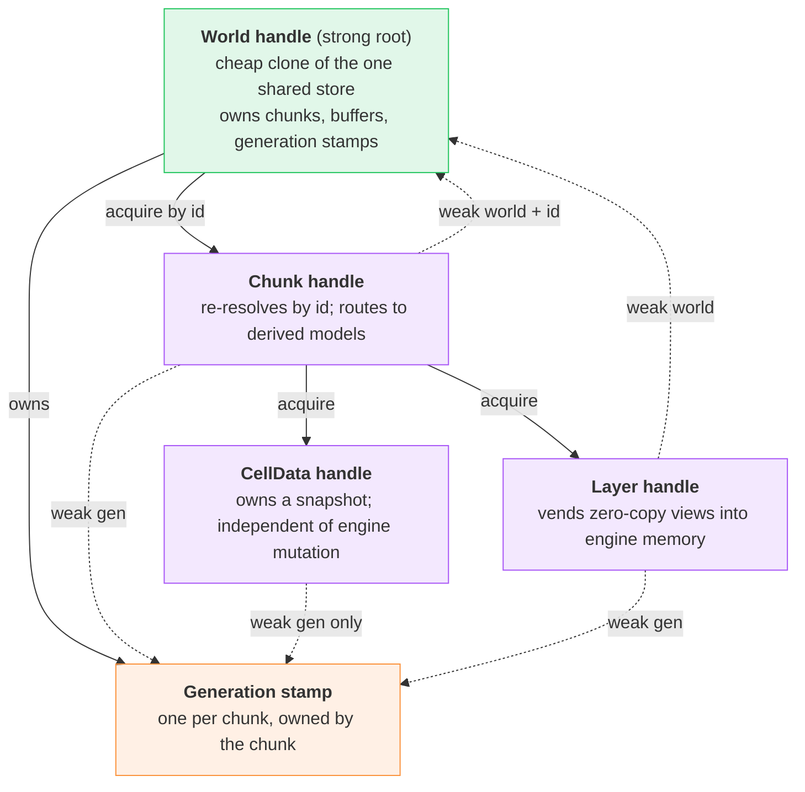
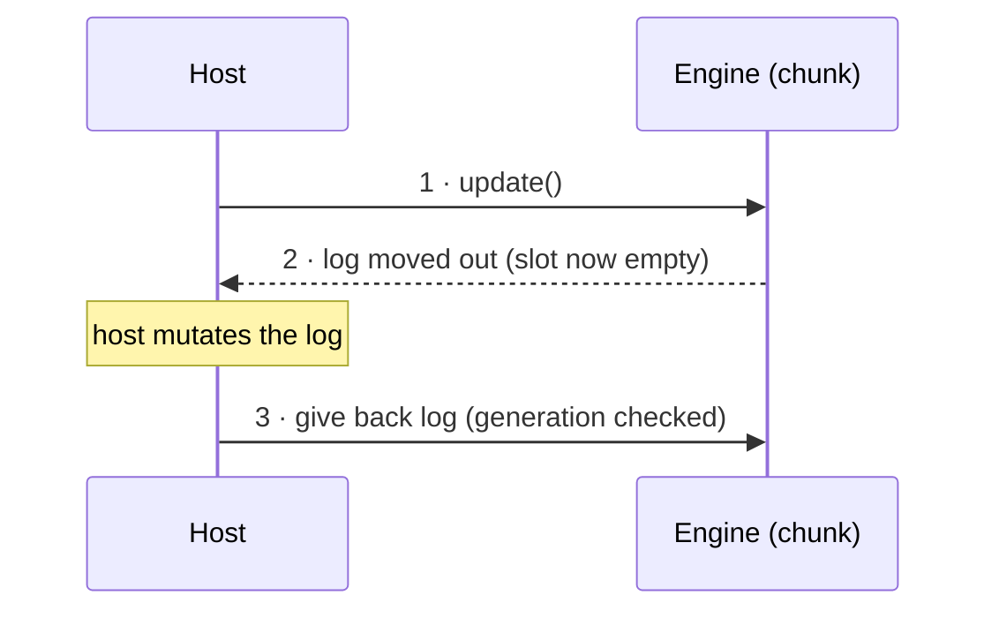

# Engine API

*The base pattern every wasm-exported engine model follows so a host can hold it, query it, and mutate it cheaply — without copies, dangling views, or keeping dead data alive.*

## Problem

The engine core runs as wasm and hands the host long-lived models — a world, a chunk, its cell data, a layer. A host keeps these around and operates on them across many calls, so each model needs a reference back into live engine memory that is *cheap* (no per-call copy, no full re-lookup), *safe* (never reads memory that moved or was freed, never keeps the whole world alive by accident), and *uniform* (the same rules apply to every future model, not a bespoke scheme each time). This document is that shared pattern: one strong owner, weak handles downstream, a generation stamp, and zero-copy views — plus the invariants that keep it sound and how each is enforced.

## Architecture

The single owning store lives in the engine core: an `Rc<RefCell<…>>` behind a cheaply-clonable **World** handle. Cloning a `World` shares that one store, so the strong side is the root and its clones and nothing else. Every handle the host derives points back **weakly** and carries just enough identity to re-resolve and to detect that its target has changed. A handle is acquired down a chain (`World → Chunk → {CellData, Layer}`), but each one tracks the engine independently through its own weak references, so a stray handle can never pin the store and a dropped world degrades every handle cleanly. The wasm layer only wraps these core handles; it holds no reference machinery of its own.

Solid arrows are acquisition and ownership; dotted arrows are the weak references each handle actually holds.

## Reference toolbox

Every model is assembled from the same small kit. Reach for the lightest tool that satisfies the model's invariants; do not invent a per-model scheme.

| Tool | What it is | Reach for it when |
|---|---|---|
| Single owning store | One backing store (`Rc<RefCell<WorldInner>>`) behind a cheaply-clonable `World` handle. Its clones share the store and are the only strong side; nothing else keeps engine data alive. | Always — it is the anchor every other tool references. Downstream handles hold a weak link, never a strong clone. |
| Weak back-reference | A non-owning link (`Weak`) a handle keeps to the root or its target. Upgrading yields the target only while it still lives. | Any handle that must reach engine state on later calls. Upgrade per call; a failed upgrade is a clean "gone", not a crash. |
| Generation stamp | A shared `Rc<Cell<u64>>` owned by a unit (e.g. a chunk), carrying its *structural* version. Handles hold a `Weak` to it and remember the value seen at creation. | Any handle whose validity depends on the target's memory layout not changing. Bump on realloc/rebuild/unload, **never** on in-place value edits. |
| Zero-copy view | A typed view straight into engine-owned memory (e.g. a typed-array view over a fixed buffer). No copy crosses the boundary. Relies on the heap never moving — see [Heap Allocation](heap-allocation.md). | Reading bulk buffers on the hot path. Vend it from a getter that rebuilds it each call; the host must not cache it across a structural change. |
| Owned snapshot | Derived data copied once into a buffer the handle owns. Lives on the host's timeline, unaffected by later engine mutation. | Data the host keeps and re-reads while the engine keeps changing, where a stale-but-stable copy is preferable to a live view. |
| Ownership hand-off | A buffer moved *out* of the engine to the host by value (leaving a hole), then handed back to be reused. Exclusivity is provable: while the host holds it, the engine cannot touch it. | Mutation logs / scratch buffers reused frame to frame — pooling capacity instead of reallocating, with no aliasing. |

### Best practices

- **Strong at the root only.** The strong side is the `World` handle and its cheap clones (one shared store); everything downstream is weak. A stray handle then can never leak the world, and dropping every `World` invalidates all handles at once.
- **No borrow escapes a function.** A borrow of the shared root is taken, used, and dropped within a single call — never held across a return to the host or a host callback. (Otherwise a re-entrant borrow is a runtime panic, not a clean error.)
- **Views are getters, fresh each call.** Never return a cached view; rebuild it on access so the generation check runs every time and a moved buffer is caught on the next read.
- **Generation tracks layout, not contents.** Bump it only when memory is reallocated or rebuilt. In-place value edits leave it untouched, so live views keep seeing the buffer and simply observe the new values.
- **Single-owner, single-thread.** The graph is intentionally non-shareable across threads; it assumes a single-threaded host.

## Exported models

Each model is one row of the toolbox applied. Columns: what it holds, how it tracks the engine world, what data it exposes, and where the host gets it.

| Model | Holds | Tracks world via | Data exposed | Acquired from |
|---|---|---|---|---|
| **World** | Cheaply-clonable handle over `Rc<RefCell<WorldInner>>` | It *is* the owning store | Chunk lifecycle + by-id chunk / cell reads | Exported constructor |
| **Chunk** | Weak world + `ChunkId` + weak generation | Weak world (resolve by id) + generation (identity) | None itself — a router to derived models | World, by id |
| **CellData** | Owned snapshot buffers + generation guard (weak generation + captured value) | Generation only (staleness of the snapshot) | Owned, host-lifetime snapshot | A Chunk function |
| **Layer** | Weak world + weak generation (+ layer key) | Weak world (reach its buffer) + generation (buffer still valid) | Zero-copy views into the fixed layer buffer | A Chunk function |
| **Update log** | Engine buffer moved out to the host + captured generation | Move-exclusivity (engine hole) + generation checked on return | Host-held engine buffer, given back to reuse | A Chunk/Layer `update()` |

### Invariants and how they are ensured

The reference kit is chosen so that each hazard is either impossible by construction or surfaces as an immediate, legible runtime error the host can act on — never a silent bad read.

| Invariant | Ensured by | Violation surfaces as |
|---|---|---|
| A handle never keeps the world alive | Strong reference exists only at the root; handles are weak | World drops on shutdown regardless of stray handles |
| The world is still there | Handle upgrades its weak world before use | Upgrade fails → "world gone" (wrong shutdown order) |
| The target still exists / was not reloaded | Weak generation cell (dies with the unit; a reload makes a new one) | Upgrade fails → "chunk gone / reloaded" (wrong load–unload order) |
| No view or snapshot reads reallocated memory | Generation captured at creation, compared on every access; bumped on any structural change | Generation mismatch → "stale, must re-fetch" (immediate, not lazy) |
| A live view never dangles across a rebuild | Views are per-call getters; the host does not cache them | Next getter call fails the generation check |
| No borrow of the root escapes a call | Borrows held only within a function body | Re-entrant borrow → runtime panic (a bug to fix, not a state) |
| At most one update in flight | The log is moved out, leaving a hole in the engine | Take finds the hole → "double update" |
| A returned buffer matches the current structure | The log carries the generation it was taken at; checked on return | Generation mismatch on give-back → rejected / discarded |

### The update hand-off

Mutation runs through a buffer the engine lends to the host and gets back, so the buffer's capacity is reused across frames and no copy crosses the boundary. While the host holds it the engine's slot is empty, which both prevents a second concurrent update and proves there is no aliasing.

### Optional client-side helpers

The give-back step and freeing a handle are easy to forget, and a lost buffer or leaked handle degrades performance (never correctness — a lost log just forces a fresh allocation next time). A host can wrap acquire-and-release into whatever scoped-cleanup construct it has — RAII in Rust/C++, `using`/dispose in TypeScript or C#, `defer` in Go — so the release is structural rather than remembered. This is a per-client convenience over the same engine contract; the pattern itself prescribes no host language.

## File map

| File | Role |
|---|---|
| `crates/shine-game/src/wasm/world/world.rs` | Thin wasm wrapper over the core `World` handle; vends chunk handles across the boundary. |
| `crates/shine-game/src/wasm/world/chunk.rs` | Thin wasm wrapper over the core `ChunkHandle`; marshals derived-model requests to it. |
| `crates/shine-game/src/wasm/world/cell_data.rs` | Thin wasm views over core cell snapshots (`InnerCells` / `EdgeCells` / `CornerCells`); marshals their already-guarded accessors to zero-copy typed arrays. |
| `crates/shine-game/src/world/world.rs` | Core `World`: cheaply-clonable handle over the private `WorldInner` store; owns chunks, serves by-id reads, and vends `ChunkHandle` / `WeakWorld`. |
| `crates/shine-game/src/world/chunk.rs` | Core `Chunk` (owns its buffers and generation stamp) and `ChunkHandle`, the weak downstream handle that revalidates on every access. |
| `crates/shine-game/src/world/generation.rs` | `Generation` / `WeakGeneration` version stamp and the `GenerationGuard` that captures a generation and rechecks its validity on demand. |
| `crates/shine-game/src/world/{inner,edge,corner}_cells.rs` | Per-kind snapshot structs `InnerCells` / `EdgeCells` / `CornerCells`, each wrapping private buffers behind 1 / 2 / 3 `GenerationGuard`s (one per contributing chunk), whose accessors return buffer slices only while every guard is valid; `edge_cells` and `corner_cells` also own their `EdgeSide` / `CornerSide` enums. |
| `crates/shine-game/src/world/layer.rs` | Fixed-size layer buffer viewed zero-copy; in-place edits leave the generation untouched. |

What counts as a structural change (generation bump) vs an in-place edit

The generation is a *structural* version, not a content version, and the distinction is load-bearing — get it wrong in either direction and the pattern breaks. **Bump** on anything that reallocates or rebuilds a unit's buffers: unload-and-reload at the same id, a remesh / re-quadrangulation that reallocates the mesh or index maps, a change to tile/cell counts that reallocates a layer buffer, or rebuilding cell data. **Do not bump** on an in-place value write (e.g. painting a cell value in a fixed-size layer): the buffer does not move, so a live view stays valid and should simply observe the new value — bumping here would invalidate every view on every edit and defeat the zero-copy path. Keeping layer buffers fixed-size (never growable) is what collapses "buffer reallocated on write" out of existence, so in-place edits are always safe. A host that needs "contents changed, re-upload" without a structural change needs a separate, finer-grained content version — never overload the structural generation with it.

Why weak-to-target beats a strong shared reference for the generation cell

A handle holds a `Weak` to the generation cell, not a strong `Rc`. With a weak link, unload is detected for free: the unit drops, the cell dies, and the next upgrade returns nothing — no explicit "bump on unload" step to remember and forget. The captured value then only has to catch the in-life structural change (a rebuild while the unit stays loaded). A strong clone would instead keep the cell alive past unload, so the handle would have to rely on `remove` remembering to bump first — an easy omission that turns into a silent stale read. The weak link makes the unload case impossible to get wrong at the cost of a marginally heavier upgrade, which is the right trade.

