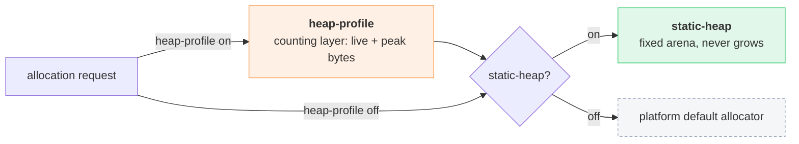

# Heap Allocation

*How the game heap is allocated across client hosts, and the cargo features each client enables and why.*

## Problem

The game core is embedded into different client hosts, each with its own memory constraints. How its heap is allocated — and in particular whether the heap is allowed to grow — is therefore a per-client build decision rather than a single global choice. Some hosts require a heap that never grows so that allocations stay at stable addresses for the lifetime of the process; others are happy with a conventional growable heap. This decision is expressed through cargo features so each client selects the behaviour it needs, and a diagnostic feature helps size a fixed heap correctly.

## Features

| Feature | Purpose |
|---|---|
| `static-heap` | Backs the heap with a fixed, pre-committed `static` arena and installs an allocator that serves every allocation from it, so the heap **never grows** and lives at a stable region for the process lifetime. Chosen by hosts that cannot tolerate the heap moving or growing (e.g. a host holding direct references into it). The whole ceiling is committed up front; overflowing it is a hard OOM abort, not degradation. |
| `heap-profile` | Wraps the active allocator in a counting layer that tracks live and peak bytes and exposes memory metrics (via `memory_info()`). Diagnostic tooling — used to size a `static-heap` ceiling above the real high-water mark. Left off in production for zero overhead. |

The features are independent and compose: with neither, the platform's default allocator is used; `heap-profile` wraps whatever allocator is underneath, so it can profile either the default heap or the static arena.

## Memory metrics

`memory_info()` is a plain function available on every target: the active allocator fills a fixed-capacity report, so gathering metrics allocates nothing and cannot perturb the allocator being measured. Each enabled feature contributes its own entries; with no allocator feature the report is empty. Every entry carries a `unit` (`bytes` | `count` | `ratio`), so a consumer formats by unit (`bytes` → MiB, `ratio` → %) without knowing which allocator produced the value, and adding a metric never changes the consumer contract.

Each entry is tagged with the `source` that produced it (e.g. `talc`, `count`), so metrics stay unambiguous when several allocators contribute; entries are sorted by `source` then `label` for a stable display order. Each client adds a thin binding over the common function for its host. The web binding exposes it to JavaScript as an array of `{source, label, value, unit}`.

| Feature | Entries contributed |
|---|---|
| `static-heap` | `reserved` (committed bytes) and `limit` (arena size). |
| `heap-profile` | `used` (live requested bytes) and `peak`; plus, when composed with `static-heap`, the arena counters — allocated, available, claimed, and a fragmentation figure. |

## Clients

### Web

| Feature | Enabled | Why |
|---|---|---|
| `static-heap` | ✅ all builds | The web host runs the core as wasm and hands JavaScript zero-copy views that point directly into linear memory (see [Engine API](engine-api.md)). A growing wasm heap swaps the backing `ArrayBuffer` and detaches those views mid-use; a non-growing heap removes the hazard structurally. |
| `heap-profile` | ⚠️ dev only | Enabled in the dev build (`VITE_HEAP_PROFILING`) to feed the heap HUD and tune the ceiling; excluded from production so shipped builds carry no counting overhead. |

## File map

| File | Role |
|---|---|
| `crates/shine-game/Cargo.toml` | Declares the `static-heap` and `heap-profile` features. |
| `crates/shine-game/src/heap/` | The global allocator selection, the static arena, the counting layer, and the portable `memory_info()` report. |
| `crates/shine-game/src/wasm/heap/` | Web binding exposing the report to JavaScript as a keyed object. |
| `client/web/vite-plugin-wasm-pack.ts` | Web build wiring: always `static-heap`, plus `heap-profile` when profiling. |
