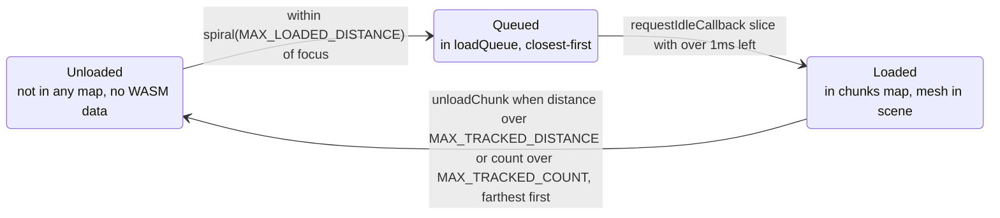
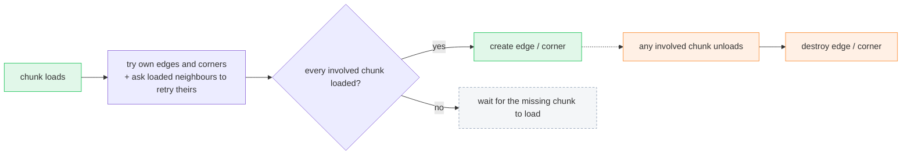
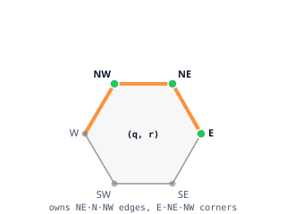

# Chunk Lifecycle

*Streams hex chunks — and their shared edges and corners — in and out around the focused chunk, so only a bounded neighbourhood of the infinite world is ever resident.*

## Problem

The world is unbounded but memory and the GPU are not. `World` keeps only a disc of chunks around the avatar's focused chunk: it loads chunks as the focus moves toward them and unloads them once they fall far behind. Each chunk's shared boundaries — the edges between two chunks and the corners between three — are derived entities with their own dependent lifetime: they exist only while every chunk they touch is resident.

## Architecture

A chunk moves through a fixed cycle. `WORLD_FOCUS_CHANGED` (see [World Reference Change](world-reference-change.md)) is the clock: each focus move rebuilds the load queue from the spiral of chunks within `MAX_LOADED_DISTANCE` of the new focus, then evicts whatever has drifted too far. Loading is sliced across idle time so a burst of new chunks never blocks a frame.

Edges and corners are not queued or distance-tracked on their own; they ride on the chunks they connect. When a chunk loads, `World` tries to build the boundary entities it *owns*, and asks its neighbours to retry theirs — each is created only once **all** the chunks it touches are resident, and destroyed the moment **any** of them unloads.

To build each shared boundary exactly once, a chunk owns only half of its ring: its three upper edges (`NE`, `N`, `NW`) and three corners (`E`, `NE`, `NW`). The lower neighbour owns the shared one.

Orange edges and green corners are the ones this chunk builds; grey ones belong to a neighbour. Because exactly one of the two (edge) or three (corner) sharers claims each boundary, no shared geometry is ever built twice.

## Key rules

| Concern | Rule |
|---|---|
| Load radius | On every focus change, `loadQueue` = `focus.spiral(MAX_LOADED_DISTANCE)` (= 4) minus already-loaded chunks. Spiral order is closest-first, so the queue drains nearest chunks first. |
| Load scheduling | Drained in `requestIdleCallback`, loading chunks only while `deadline.timeRemaining() > 1`ms, then re-scheduling. Loading never blocks a frame. |
| Unload — distance | Any chunk whose hex distance from the focus exceeds `MAX_TRACKED_DISTANCE` (= 10) is unloaded. |
| Unload — count cap | If more than `MAX_TRACKED_COUNT` (= 50) chunks remain, the farthest are unloaded down to the cap. |
| Hysteresis | Load distance (4) ≪ keep distance (10). A chunk loaded once lingers well past the load radius, so walking back and forth across a boundary doesn't thrash load/unload. |
| Edge ownership | A chunk owns edges `NE`, `N`, `NW` only. `ChunkEdgeId.involvedChunkIds()` = [owner, neighbor(edgeIdx)]. |
| Corner ownership | A chunk owns corners `E`, `NE`, `NW` only. `involvedChunkIds()` returns the three chunks meeting at that corner. |
| Boundary build gate | An edge/corner is instantiated only when every involved chunk is loaded, and removed when any involved chunk unloads. On load, a chunk also retries the boundaries owned by its already-present neighbours. |
| Coordinates | Axial `(q, r)`; `distanceTo` via cube coords. Mesh data is stored relative to `referenceChunkId`; positions shift on a reference change, not on load/unload. |

## File map

| File | Role |
|---|---|
| `client/web/src/world/world.ts` | Owns the resident maps; load queue, idle scheduling, distance/count eviction, and edge/corner build-and-tear-down. |
| `client/web/src/world/chunk.ts` | A loaded chunk: WASM cell data, mesh group, debug labels. |
| `client/web/src/world/chunk-edge.ts` | `ChunkEdgeId` (ownership + involved chunks) and the edge entity. |
| `client/web/src/world/chunk-corner.ts` | `ChunkCornerId` (ownership + involved chunks) and the corner entity. |
| `client/web/src/world/chunk-id.ts` | Axial `(q,r)` coordinate: `spiral`/`ring`, `distanceTo`, neighbours, world-position conversion. |
| `client/web/src/constants.ts` | `ChunkConst`: the load/track distances and counts. |
| `client/web/src/systems/world-reference-system.ts` | Emits `WORLD_FOCUS_CHANGED`, the signal that drives every load/unload pass. |

Why two thresholds, and why loading is deferred to idle time

The split between `MAX_LOADED_DISTANCE` (4) and `MAX_TRACKED_DISTANCE` (10) is deliberate hysteresis. If a chunk were unloaded the instant it left the load radius, an avatar loitering on a chunk boundary would load and unload the same ring every few steps — re-running WASM `init_chunk`, rebuilding meshes, and re-deriving edges/corners each time. The wide keep-band absorbs that jitter; the `MAX_TRACKED_COUNT` cap is the backstop that still bounds memory if the avatar travels in a straight line and the band never naturally evicts.

Loading is drained through `requestIdleCallback` rather than done eagerly because a single focus change can enqueue the whole spiral at once (up to the ring count for radius 4). Building them synchronously would spike frame time; slicing by `deadline.timeRemaining()` spreads the cost across whatever idle budget each frame has, at the price of chunks popping in over a few frames — an acceptable trade for a steady frame rate.

