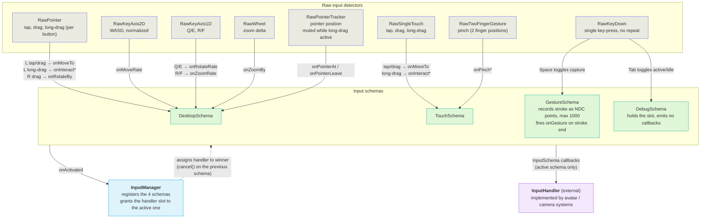
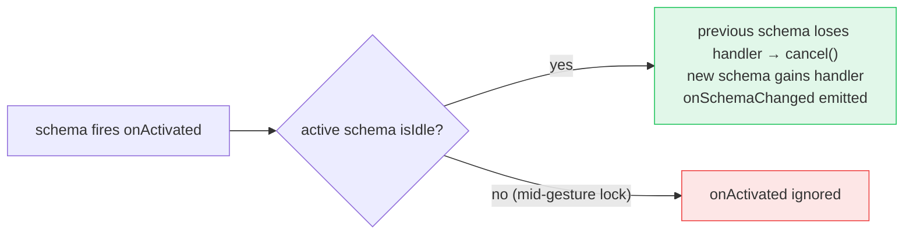
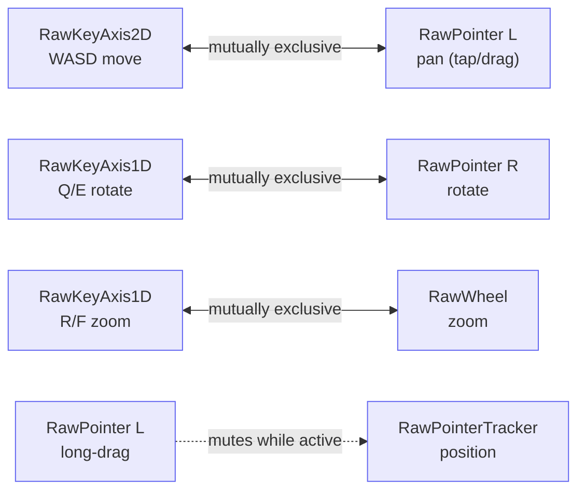
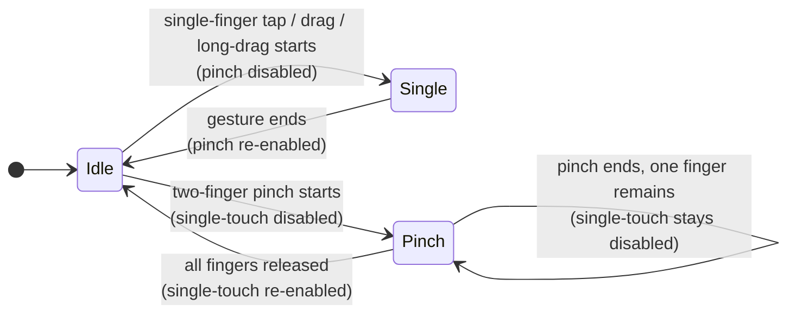
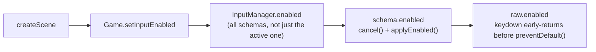

# Input System

*Maps raw device input to locomotion state and gesture events for the avatar/camera systems.*

## Problem

The input system maps raw device events (pointer, keyboard, touch, wheel) to callbacks consumed by avatar/camera systems. A layered architecture separates concerns: raw inputs detect gestures, schemas compose raw inputs and apply conflict resolution, InputManager grants the callback slot to the active schema, and external systems implement InputHandler to receive input events. This structure makes gesture detection, conflict rules, and schema switching independently testable.

## Architecture

Raw detectors feed schemas, the manager picks the one schema that talks to the handler, and only that schema's callbacks reach it.

InputManager does not proxy callbacks: it assigns `schema.handler` directly (dotted), and the active schema then calls the handler itself (solid).

### InputHandler callbacks

| Group | Callbacks |
|---|---|
| Pointer tracking | `onPointerAt(pos)`, `onPointerLeave()` |
| Delta | `onMoveTo`, `onRotateBy`, `onZoomBy` |
| Rate | `onMoveRate`, `onRotateRate`, `onZoomRate` |
| Gesture | `onPinchStart` / `onPinch` / `onPinchEnd`, `onInteractStart` / `onInteract` / `onInteractEnd`, `onGesture` |
| Schema change | `onSchemaChanged` |

### Schema switching

`DesktopSchema` is pre-activated at construction (handler assigned directly, no `onSchemaChanged`). When any schema fires `onActivated`, the manager decides whether to hand over the slot:

## DesktopSchema — conflict rules

Only the input that does the *same thing* as the currently active one is blocked; everything else stays live. First to start wins: the loser's raw input is disabled until the winner ends.

Everything not connected above never blocks anything else (in particular a long-press is not blocked by WASD). The full matrix:

| Active →   Blocked ↓ | Q/E rotate `RawKeyAxis1D` | R/F zoom `RawKeyAxis1D` | WASD move `RawKeyAxis2D` | L pan `RawPointer` | L long-drag `RawPointer` | R rotate `RawPointer` | Wheel zoom `RawWheel` |
|---|---|---|---|---|---|---|---|
| **RawKeyAxis1D** Q/E rotate | — | ✅ allowed | ✅ allowed | ✅ allowed | ✅ allowed | ⛔ blocked | ✅ allowed |
| **RawKeyAxis1D** R/F zoom | ✅ allowed | — | ✅ allowed | ✅ allowed | ✅ allowed | ✅ allowed | ⛔ blocked |
| **RawKeyAxis2D** WASD move | ✅ allowed | ✅ allowed | — | ⛔ blocked | ✅ allowed | ✅ allowed | ✅ allowed |
| **RawPointer L** pan | ✅ allowed | ✅ allowed | ⛔ blocked | — | — | ✅ allowed | ✅ allowed |
| **RawPointer L** long-drag | ✅ allowed | ✅ allowed | ✅ allowed | — | — | ✅ allowed | ✅ allowed |
| **RawPointer R** rotate | ⛔ blocked | ✅ allowed | ✅ allowed | ✅ allowed | ✅ allowed | — | ✅ allowed |
| **RawWheel** zoom | ✅ allowed | ⛔ blocked | ✅ allowed | ✅ allowed | ✅ allowed | ✅ allowed | — |
| **RawPointerTracker** position | ✅ allowed | ✅ allowed | ✅ allowed | ✅ allowed | 🔇 muted | ✅ allowed | ✅ allowed |

## TouchSchema — conflict rules

`TouchSchema` makes single-finger and two-finger gestures mutually exclusive. First gesture to start wins; the loser stays disabled until all fingers are released (`onAllFingersReleased` re-enables single-touch even when one finger lingers after a pinch).

| Active →   Blocked ↓ | `RawSingleTouch` tap / drag / long-drag | `RawTwoFingerGesture` pinch |
|---|---|---|
| **RawSingleTouch** tap / drag / long-drag | — | ⛔ blocked |
| **RawTwoFingerGesture** pinch | ⛔ blocked | — |

## Suspend gate

An overlay (e.g. a chat dialog) rendered over the running canvas must reclaim keyboard input — otherwise game keys (`w a s d q e r f`, Shift) bubble to `window`, the raw key handlers `preventDefault()`, and typed characters never reach the overlay's `<input>`. The host suspends the game while an overlay is open.

The gate is threaded down the stack. `createScene` returns an optional `setInputEnabled?(enabled)`; hosts call it defensively, so an older bundle without the method still runs (just ungated).

Every `InputSchema` exposes an `enabled` setter. Setting it `false`:

1. calls `cancel()` to gracefully terminate in-progress actions (held WASD axis, in-progress drag) — no stuck camera movement or `pointerId`;
2. fans `enabled=false` out to every raw input it owns via `applyEnabled()`. Each raw input's `keydown` early-returns **before** `preventDefault()`, so keystrokes reach the overlay again.

`InputManager.enabled` fans out to *all* schemas (not just the active one) so touch/gesture stop too. The setter is idempotent; default is enabled.

**keyup is never gated.** A key held before suspend must still clear its state on release — suspend-time cleanup is `cancel()`'s job; the raw `enabled=false` only short-circuits `keydown`. `RawKeyDown` (schema mode toggles: Tab, Space) also carries an `enabled` flag so mode toggles are gated.

## File map

| File | Role |
|---|---|
| `client/web/src/engine/input/raw/raw-pointer.ts` | Pointer gesture detector (tap, drag, long-drag) for single button. |
| `client/web/src/engine/input/raw/raw-pointer-tracker.ts` | Continuous pointer position tracker (pointermove / mouseleave); disabled while long-drag is active. |
| `client/web/src/engine/input/raw/raw-key-axis-2d.ts` | 2D keyboard axis (WASD) with normalized output. |
| `client/web/src/engine/input/raw/raw-key-axis-1d.ts` | 1D keyboard axis (Q/E, R/F). |
| `client/web/src/engine/input/raw/raw-key-down.ts` | Single key-press detector (no repeat); used for schema mode toggles. |
| `client/web/src/engine/input/raw/raw-wheel.ts` | Wheel zoom detector. |
| `client/web/src/engine/input/raw/raw-single-touch.ts` | Single-finger touch gesture detector (tap, drag, long-drag). |
| `client/web/src/engine/input/raw/raw-two-finger-gesture.ts` | Two-finger touch gesture detector (pinch with positions). |
| `client/web/src/engine/input/schemas/input-schema.ts` | InputSchema base class: handler injection, isActive/isIdle contract, activate helper. |
| `client/web/src/engine/input/schemas/debug-schema.ts` | Debug schema toggled by Tab; holds the input slot without emitting callbacks. |
| `client/web/src/engine/input/schemas/desktop-schema.ts` | Desktop input schema; composes raw inputs, applies WASD/Q/E/R/F conflict rules. |
| `client/web/src/engine/input/schemas/touch-schema.ts` | Touch input schema; composes single/two-finger raw inputs, applies conflict rules. |
| `client/web/src/engine/input/schemas/gesture-schema.ts` | Stroke-capture schema toggled by Space; records pointer/touch path as NDC points and fires onGesture. |
| `client/web/src/engine/input/input-handler.ts` | InputHandler interface: callback definitions for external implementations. |
| `client/web/src/engine/input/input-state.ts` | InputHandler implementation; accumulates per-frame pending events and exposes `pointerPos` for polling consumers. |
| `client/web/src/engine/input/input-manager.ts` | Manages schemas, tracks active schema, transfers handler reference on schema switch. |

## Testing

Raw inputs are tested for gesture detection only. Schemas are tested for conflict resolution (enable/disable logic). InputManager is tested for schema tracking and callback routing.

Kinds: **block** = input disabled/ignored, **allow** = input stays live, **state** = state change, **callback** = handler callback emitted.

Schema Conflict Rule Tests (DesktopSchema)

**WASD blocks left pointer drag (but not long-press)**

| # | Case | Kind |
|--:|---|---|
| 1 | WASD held → left-drag blocked (callbacks ignored if wasdActive) | block |
| 2 | Left-drag active → WASD pressed → WASD.enabled = false | block |
| 3 | Left-drag ends → WASD.enabled = true | state |
| 4 | WASD held → long-press still works (not blocked) | allow |
| 5 | WASD held → rightPointer still active (not blocked) | allow |
| 6 | WASD held → wheel still active (not blocked) | allow |

**Q/E blocks right pointer**

| # | Case | Kind |
|--:|---|---|
| 7 | Q/E held → rightPointer.enabled = false | block |
| 8 | Q/E released → rightPointer.enabled = true | state |
| 9 | Right-drag active → Q/E pressed → Q/E.enabled = false | block |
| 10 | Q/E held → leftPointer still active (not blocked) | allow |

**R/F blocks wheel**

| # | Case | Kind |
|--:|---|---|
| 11 | R/F held → wheel.enabled = false | block |
| 12 | R/F released → wheel.enabled = true | state |
| 13 | Wheel active → R/F pressed → wheel.enabled = false | block |

**Callback emission**

| # | Case | Kind |
|--:|---|---|
| 14 | WASD held → onMoveRate called with normalized (x, y, sprint) | callback |
| 15 | Q/E held → onRotateRate called with value | callback |
| 16 | R/F held → onZoomRate called with value | callback |
| 17 | Left-click tap → onMoveTo called with screen position | callback |
| 18 | Right-drag → onRotateBy called with angleDelta | callback |
| 19 | Wheel → onZoomBy called with delta | callback |
| 20 | Long-press → onInteractStart/onInteract/onInteractEnd sequence | callback |

**Rate value correctness**

| # | Case | Kind |
|--:|---|---|
| 21 | Diagonal WASD (W+D) → onMoveRate receives normalized unit vector | state |
| 22 | Q+E both held → onRotateRate receives 0 (cancel out) | state |
| 23 | R+F both held → onZoomRate receives 0 (cancel out) | state |

Schema Conflict Rule Tests (TouchSchema)

**Single-finger blocks two-finger**

| # | Case | Kind |
|--:|---|---|
| 24 | Single-finger drag starts → twoFingerGesture.enabled = false | block |
| 25 | Single-finger drag ends → twoFingerGesture.enabled = true | state |
| 26 | Single-finger long-drag starts → twoFingerGesture.enabled = false | block |
| 27 | Single-finger long-drag ends → twoFingerGesture.enabled = true | state |

**Two-finger blocks single-finger**

| # | Case | Kind |
|--:|---|---|
| 28 | Two-finger starts → singleTouch.enabled = false | block |
| 29 | Two-finger ends, 1 finger remains → singleTouch still disabled | block |
| 30 | All fingers released → singleTouch.enabled = true | state |

**Callback emission**

| # | Case | Kind |
|--:|---|---|
| 31 | Single-finger tap → onMoveTo called | callback |
| 32 | Single-finger drag → onMoveTo called per frame | callback |
| 33 | Two-finger pinch start → onPinchStart(pos1, pos2) called | callback |
| 34 | Two-finger pinch move → onPinch(pos1, pos2) called per frame | callback |
| 35 | Two-finger pinch end → onPinchEnd() called | callback |
| 36 | Long-press → onInteractStart/onInteract/onInteractEnd sequence | callback |

InputManager Routing Tests

**Schema tracking**

| # | Case | Kind |
|--:|---|---|
| 37 | First schema activation → onSchemaChanged not called | state |
| 38 | Switch from desktop → touch → onSchemaChanged('touch') called | callback |
| 39 | Switch from touch → desktop → onSchemaChanged('desktop') called | callback |
| 40 | No input → onSchemaChanged not called | state |

**Callback routing**

| # | Case | Kind |
|--:|---|---|
| 41 | First event from any schema → immediately routed to handler | callback |
| 42 | Touch input while desktop is mid-gesture → blocked (not routed) | block |
| 43 | Touch input after desktop goes idle → routed, onSchemaChanged('touch') emitted | allow |
| 44 | Active schema still routed after blocked input from other schema | allow |

Suspend Gate Tests

**InputManager**

| # | Case | Kind |
|--:|---|---|
| 45 | enabled = false cancels the active schema (held WASD → onMoveRate(0,0)) | state |
| 46 | keydown while disabled → no callback and defaultPrevented stays false | block |
| 47 | enabled = true restores raw callbacks | allow |

**DesktopSchema**

| # | Case | Kind |
|--:|---|---|
| 48 | disabled → w keydown neither emits onMoveRate nor calls preventDefault | block |
| 49 | keyup for a key held before disabling still clears movement | state |
| 50 | re-enabling restores normal handling | allow |

InputSchema active/idle contract and handler injection

**isActive** — `schema.handler !== undefined`. The schema owns the callback slot and may call `this.handler?.onXxx()`. Set by InputManager when this schema wins activation.

**isIdle** — abstract per schema. True when no raw input is in progress (no key held, no pointer down, no touch active). InputManager only allows a schema switch when the current active schema's `isIdle` is true.

**Handler injection** — InputManager does not proxy callbacks. It assigns `schema.handler` directly. The previous active schema loses its handler reference; the setter calls `cancel()` automatically on the outgoing schema. Schemas call `this.handler?.onXxx()` internally.

**GestureSchema idle semantics** — `isIdle` reflects the Space toggle state, not per-stroke raw-input activity. Once Space is pressed to enter capture mode, GestureSchema is non-idle and holds the slot until Space is pressed again. Individual strokes within a session do not affect `isIdle`; other schemas cannot take over while capture mode is on.

