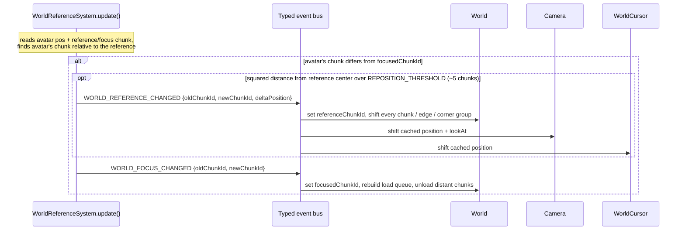

# World Reference Change

*Rebases the world coordinate origin to the avatar's chunk so geometry stays near zero, and lets every world-space entity shift itself to compensate.*

## Problem

The avatar can roam arbitrarily far, but floating-point precision degrades as world coordinates grow. The world reference is the chunk treated as the origin for all loaded geometry; periodically it is rebased to the avatar's current chunk and every world-space position is shifted by the same delta so nothing appears to move. Any entity that caches a world-space position must react to the rebase or it will jump.

## Architecture

Each frame, the trigger checks the avatar's chunk. Crossing into a new chunk always emits `WORLD_FOCUS_CHANGED`; if the avatar is also past the rebase threshold it *additionally* emits `WORLD_REFERENCE_CHANGED` first. Each event then fans out to consumers that react independently.

Consumers of `WORLD_REFERENCE_CHANGED` add `deltaPosition` to their own world-space state (x, y; z kept). The system never mutates state directly — it only reads and dispatches; each consumer owns its reaction. Not every component needs to: `SelectionSystem` never subscribes, because it reads chunk/edge/corner positions that `World` has already shifted, so it sees correct coordinates for free.

## Key rules

| Concern | Rule |
|---|---|
| Reference change condition | Focus chunk changed **and** squared distance from reference center exceeds `REPOSITION_THRESHOLD` (~5 chunks). Both must hold. |
| Focus change condition | Avatar's containing chunk differs from `focusedChunkId`. Fires on every crossing, independent of the threshold. |
| Nesting | Reference change is dispatched *inside* the focus-change branch, before the focus event. A reference change can never fire without a focus change in the same frame. |
| Delta direction | `deltaPosition = currentCenter.negate()`. Add it to a world-space position to keep that point visually fixed across the rebase. |
| Axes shifted | X and Y only. Z (height) is never rebased. |
| Subscription model | `EventSubscriptions.on()` keeps one listener per event name (re-subscribing replaces). Always `dispose()`. |

## How a new entity hooks in

Any entity that stores a world-space position must compensate for the rebase. The contract is identical for every consumer (see `engine/camera/camera.ts · handleWorldReferenceChanged` for the canonical form):

1. Subscribe in the constructor via `EventSubscriptions.on<WorldReferenceChangedEvent>(WORLD_REFERENCE_CHANGED, handler)` (import both from `systems/world-reference-system.ts`).
2. In the handler, add `event.deltaPosition.x/y` to every world-space position the entity caches — including derived targets (the camera also shifts its `lookAt`), but never Z.
3. Re-sync any Three.js object from the adjusted position.
4. Release the subscription in `dispose()`.

Subscribe to `WORLD_FOCUS_CHANGED` instead (or as well) only if the entity cares about which chunk is focused rather than the coordinate shift — only `World` does, to drive chunk streaming.

## File map

| File | Role |
|---|---|
| `client/web/src/systems/world-reference-system.ts` | Per-frame trigger; defines and dispatches both events. Source of the event constants and types. |
| `client/web/src/world/world.ts` | Owns `referenceChunkId`/`focusedChunkId`; shifts all chunk geometry on reference change; drives streaming on focus change. |
| `client/web/src/world/chunk-id.ts` | Axial chunk coordinate; `toWorldPosition`/`fromWorldPosition` convert relative to a reference chunk. |
| `client/web/src/engine/camera/camera.ts` | Consumer: shifts camera position and lookAt. |
| `client/web/src/avatar/world-cursor.ts` | Consumer: shifts cursor position (x,y). |
| `client/web/src/systems/selection-system.ts` | Indirect consumer: reads already-shifted chunk geometry; no subscription. |

Why two events instead of one, and why reference change is nested

Focus and reference are deliberately separate concerns. Focus changes constantly as the avatar walks between chunks and drives chunk load/unload — cheap, frequent. Reference rebasing shifts *all* loaded geometry and every cached world position — expensive, rare. Gating the reference change behind both "focus changed" and "distance > threshold" means a player wandering near the origin pays only the focus cost; rebasing waits until precision is actually at risk (~5 chunks out). The nesting guarantees a reference change is always accompanied by a focus change, so consumers of focus never miss a rebase frame.

