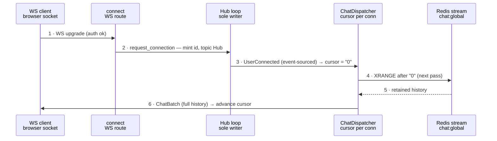
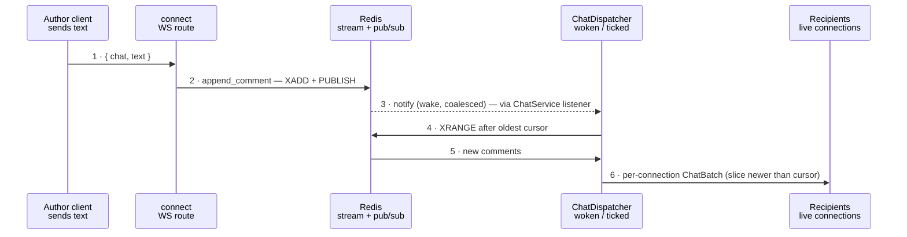
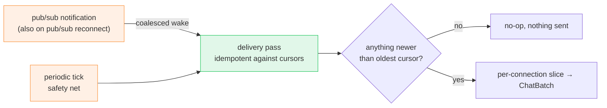

# Chat Data Flow

*How a WebSocket client connects, how chat is stored once and fanned out per connection, and how a Redis pub/sub notification drives low-latency delivery on top of a periodic safety net.*

## Problem

Chat is a single global room persisted as a Redis stream. Many clients connect over WebSockets and each must receive every message once, in order, starting from whatever history is retained when they join and continuing incrementally thereafter. Delivery must be prompt when a message arrives, cheap when nothing happens, and correct across a Redis reconnect. The hub already stores each message and publishes a notification on append; the chat dispatcher turns that into per-connection delivery — woken by the notification for latency, and backed by a periodic tick so a missed notification never strands a message.

## Roles

Chat rides on the hub's connection machinery (see [Hub Connection Lifecycle](hub-connection-lifecycle.md)) but owns the storage and fan-out described here.

| Component | Responsibility |
|---|---|
| `connect` (WS route) | Upgrades the socket, registers the connection with the hub, relays inbound text to `ChatService` and hub egress to the socket. |
| `ChatService` | Appends a comment to the room stream; exposes a pub/sub subscription for append notifications. |
| `ChatDispatcher` | Per-connection cursor tracking and delivery. Woken by a notification or the periodic tick; reads the stream once per pass and sends each connection only its unseen slice. |
| `RedisChatCommentsDb` | Stream storage: `XADD`/`XRANGE`, trimming, TTL, and the append `PUBLISH` and its listener. |

## Connecting & initial sync

A new connection is registered on the `Hub` topic so it receives hub lifecycle events. The dispatcher event-sources `UserConnected` into its own tracker and seeds the connection's cursor at `"0"` — the exclusive sentinel that yields all currently retained history on the next delivery pass.

## Distributing a message

An inbound message is appended once and delivered by the dispatcher. Append is `XADD` + a `PUBLISH` on the room's stream key; the dispatcher subscribes to that key through `ChatService` and treats any notification as a wake. The wake is coalesced — a burst of appends collapses into a single delivery pass, since one `XRANGE` from the oldest cursor already serves every connection. Message 3 (dashed) is the push that makes delivery prompt; the periodic tick fires the same pass as a fallback.

## Per-connection cursor & sync model

One stream read per pass serves everyone: the dispatcher queries from the *oldest* cursor across all connections, then slices each connection to the entries strictly newer than its own cursor. A connection's cursor advances only when a batch is actually sent to it, so at-least-once delivery holds and the client deduplicates on the stream id it carries in each comment.

| Connection state | Cursor | Delivered on a pass |
|---|---|---|
| New (just connected) | `"0"` | All retained history (bounded by `BATCH_LIMIT`; the rest catches up over later passes). |
| Existing | Last delivered stream id | Only entries strictly newer than the cursor. |
| Caught up | Latest stream id | Nothing — no batch is built or sent. |

## Empty delivery is suppressed

A pass that finds nothing new sends nothing — no empty `ChatBatch` ever reaches a client. Two guards enforce this, so a bare timer tick or a spurious wake is silent:

| Level | Guard |
|---|---|
| Whole pass | If the stream read from the oldest cursor is empty, the pass returns before touching any connection. |
| Per connection | If a connection's fresh slice is empty, it is skipped — no send, cursor unchanged. |

## Delivery triggers

| Trigger | Source | Role |
|---|---|---|
| Notification wake | Redis pub/sub on the room stream key, via the `ChatService` listener. | Primary — makes delivery prompt after an append. Coalesced so a burst is one pass. |
| Periodic tick | The dispatcher's interval timer. | Safety net — delivers anything missed while pub/sub was disconnected, and reconnects cursors after a Redis outage. |

The two converge on the same delivery pass, which is idempotent against the cursors: firing it with nothing new is a cheap no-op (see *Empty delivery is suppressed*). A pub/sub reconnect (a `None` notification) also wakes a pass, so any appends missed during the outage are picked up immediately rather than waiting for the next tick.

## File map

| File | Role |
|---|---|
| `routes/ws/connect.rs` | WS upgrade, connection registration, inbound text → `append_comment`, hub egress → socket. |
| `routes/ws/message.rs` | Wire request/response shapes (`WSMessageRequest`, `WSMessageResponse`, `ChatWireComment`). |
| `services/chat_service.rs` | Append a comment; subscribe to append notifications for the room. |
| `services/hub/tasks/chat_dispatcher.rs` | Per-connection cursors, oldest-cursor read, per-connection slicing, notification-driven wake. |
| `services/hub/tasks/connection_tracker.rs` | Periodic loop driver; selects timer tick, lifecycle events, and (for chat) the wake signal. |
| `models/messages/chat.rs` | `ChatComment` / `ChatBatch` egress payloads. |
| `repositories/chat_comments/chat_comment_store.rs` | `ChatCommentStore` trait — `append_comment`, `list_after`. |
| `repositories/chat_comments/redis/redis_chat_comments_store.rs` | `XADD` + trim/TTL/`PUBLISH`; `XRANGE` read. |
| `repositories/chat_comments/redis/redis_chat_comments_db.rs` | Pooled context factory; the append-notification listener (mirrors the hub registry listener). |

The notification payload is ignored — a wake only says "something changed"

`append_comment` issues `PUBLISH chat:<room> <stream_id>` alongside the `XADD`, and the dispatcher's handler merely signals the loop's wake channel. The payload (the stream id) is ignored because the dispatcher reads from its own cursors; that is what makes burst coalescing and reconnect (`None`) wakes safe. The subscriber side (`RedisChatCommentsDb::listen`, exposed by `ChatService`) mirrors `RedisHubConnectionDb::listen_to_registry_changes`: pooled connection, reconnect-aware.

Why the timer stays alongside push

Pub/sub is best-effort: notifications published during a listener disconnect are lost, exactly as in the hub registry. The periodic tick is the reconciler — it runs the same idempotent delivery pass, so any gap is closed within one interval regardless of pub/sub health. The push path only shortens latency in the common case; it is never the sole guarantee of delivery.

