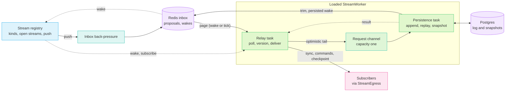
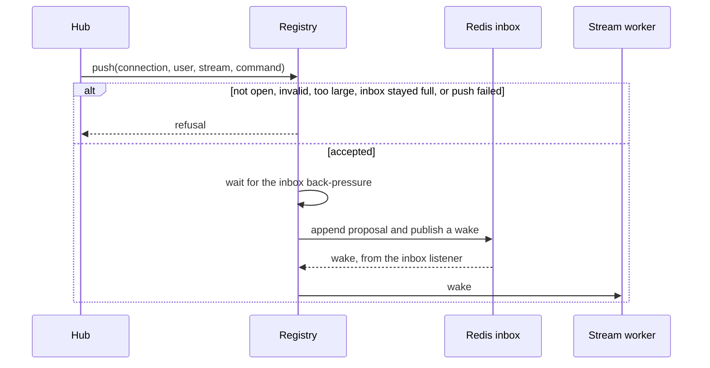
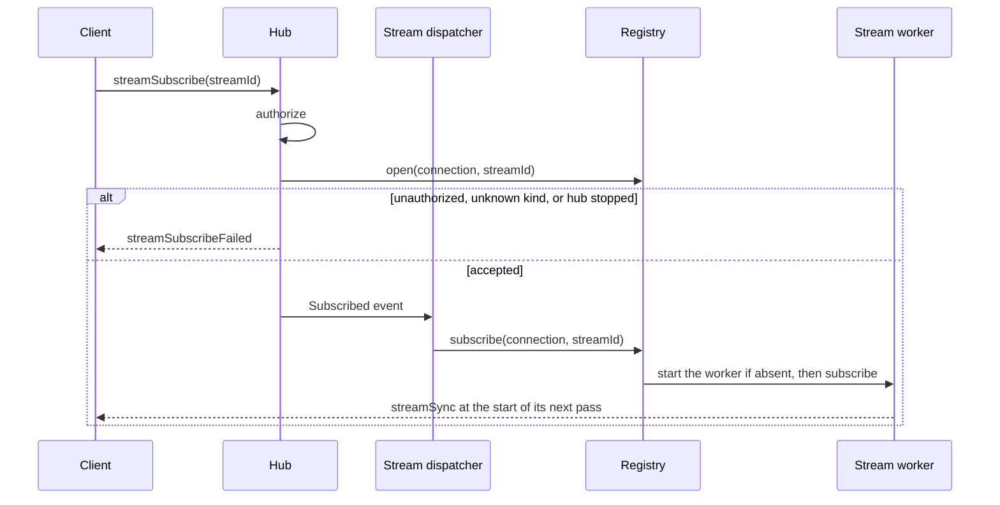
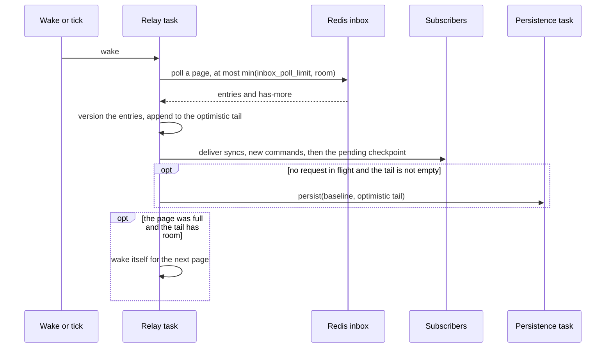
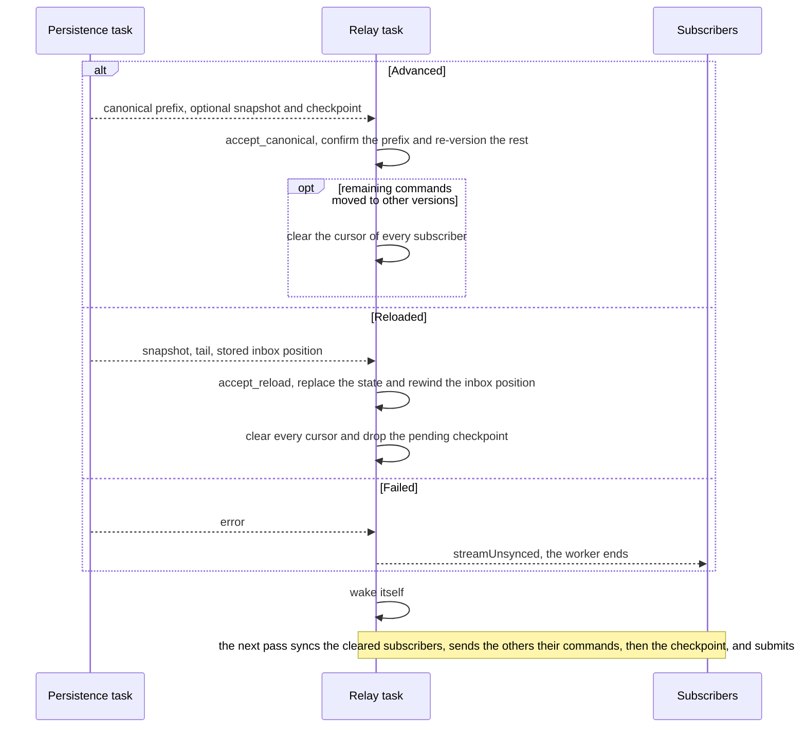
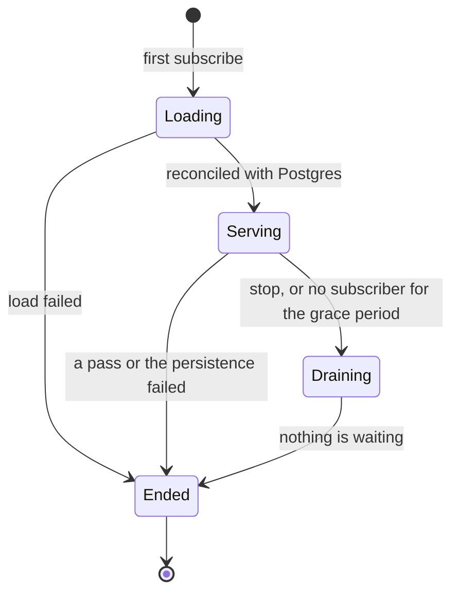
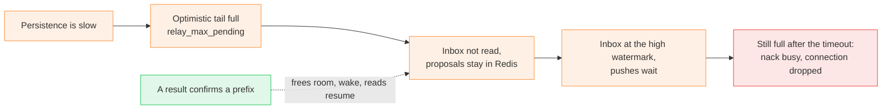

# Command Streams

*How a stream orders replayable commands: a registry that admits them, and one worker per loaded stream that delivers them optimistically and corrects them against a Postgres-backed canonical history.*

## Problem

Collaborative state such as chat or a shared pixel map needs one ordered command history, cheap writes, fast subscriber feedback and bounded catch-up for late joiners. Several builder instances may serve the same stream, so none is the authority. Redis takes short-lived command proposals and wakes workers, Postgres owns the canonical order and the snapshots, and every loaded worker serves an optimistic in-memory tail that it corrects when durable history disagrees. Clients reach a stream over their [hub](hub.md) connection, see [Client access](#client-access).

A **snapshot** is replayed state at a version. A **chain hash** covers the ordered command envelopes and lets workers and clients detect incompatible history.

## Architecture

The **registry** is an instance's front door: it admits commands into a stream's Redis inbox and finds or starts the stream's worker. Each loaded stream has one `StreamWorker` with two Tokio tasks. The relay never does Postgres work and the persistence task never owns subscribers. Their request channel holds one entry, so at most one durable operation is in flight while the relay keeps serving subscribers and accepting commands.

## Stream registry

The `StreamRegistry` is built with the supported replay kinds (`stream_kinds.rs`) and knows nothing of their state types. Per open stream it holds an inbox back-pressure handle and the stream's worker.

| Call | Made by | Effect |
|---|---|---|
| `open` | Hub, on an accepted subscribe | Checks the kind is registered and marks the stream open for the connection, which may push from then on. |
| `subscribe` | Stream dispatcher, on the `Subscribed` event | Joins the stream's worker, starting one if there is none or it has ended. Ignored if the stream is no longer open for the connection. |
| `push` | Hub, on a command | The write path, below. |
| `close`, `disconnect` | Hub | Removes the open stream (all of them on disconnect) and unsubscribes from the worker. |
| `wake` | Inbox listener | Wakes the worker named by an inbox wake; a listener that reconnected may have missed wakes and wakes every worker. |
| `purge` | Stream dispatcher, every 60 s | Forgets streams that nobody has open and whose worker has ended. |
| `shutdown` | Stream dispatcher, on the hub's shutdown | Has every worker persist what is waiting and end, for up to the shutdown timeout. |

The write path ends at one Redis inbox push. A command is its postcard bytes and the registry never encodes it again.

The checks run in this order, each with its refusal reason:

1. The stream is open for the connection: `notSubscribed`.
2. The command is at most `MAX_COMMAND_BYTES` (16 KiB) and is the canonical encoding of a well-formed command of the stream's kind, meaning decoding and encoding again gives the same bytes: `invalid`. So the bytes a client sends are the bytes that are stored and hashed.
3. The inbox back-pressure admits it: `busy`, see [Back-pressure](#back-pressure).
4. The inbox push succeeds: `failed`. The command may or may not have been queued.

## Client access

A stream is named by a `StreamId` whose prefix selects the registered replay kind (`chat`, `pixel-map`). Clients use it over a WebSocket that is also a [hub](hub.md) connection: the hub supplies the authenticated user id and the connection id, neither of which ever comes from a frame, and carries the worker's messages back to the socket. Everything else on this page is independent of the transport.

### Subscribe

`streamSubscribe` carries only `streamId`. The hub authorizes the user (`StreamAuthorizeService`, which currently allows every stream), then **opens** the stream for the connection: the registry checks that the kind is registered, and from then on the connection may push. The subscription itself travels as an event through the hub loop, which keeps it ordered with the connection's lifecycle: a subscribe for a connection that is gone, or a stream closed since, is ignored. Unsubscribe and disconnect reach the registry directly.

### Submit

The hub passes a command to the registry's write path ([Stream registry](#stream-registry)). There is no success acknowledgement: the sender sees its own `commandId` in a `streamCommands` batch once the worker has versioned it. A refusal answers with `streamNack`; `busy` also drops the connection (close code 4000, reason `busy`).

### Client protocol

Frames are JSON text with a camel-case `type`; the `StreamId` carries the kind prefix.

| Direction | Message | Fields and behavior |
|---|---|---|
| to server | `streamSubscribe` | `streamId`; authorizes and synchronizes the stream. |
| to server | `streamUnsubscribe` | `streamId`; removes this connection's subscription. |
| to server | `streamCommand` | `streamId`, `commandId`, `command` (base64, see [Command encoding](#command-encoding)); needs an open stream. |
| to client | `streamSync` | `streamId`, optional snapshot, the commands after it; replaces the client's state. |
| to client | `streamCommands` | `streamId`, contiguous optimistic or canonical commands. |
| to client | `streamCheckpoint` | `streamId`, `version`, `stateHash`; sent after the commands it covers, to compare with the client's own state hash at that version. |
| to client | `streamUnsynced` | `streamId`; the worker cannot serve the stream now, subscribe again. |
| to client | `streamNack` | `streamId`, `commandId`, reason `notSubscribed`, `invalid`, `failed` or `busy` (then the connection is dropped). |
| to client | `streamSubscribeFailed` | `streamId`, reason `unauthorized` or `failed`. |
| to client | `streamReset` | Defined but never sent: a sync alone replaces the state. |

A frame that carries an invalid stream id is ignored without an answer. A valid request that breaks a rule, such as a command that does not decode, gets the matching refusal frame. A socket message over twice `MAX_COMMAND_BYTES` ends the socket.

### Command encoding

A command is its **postcard** encoding: the same bytes on the client, in the Redis inbox and in Postgres. JSON frames carry them as base64. The server accepts only the canonical encoding of a well-formed command of the stream's kind and refuses anything else as `invalid`, so the bytes a client sends are the bytes that are stored and hashed.

Clients build and read commands and snapshots with the generated TypeScript bindings in `client/game-bindings` (`pnpm gen:game-bindings` writes them).

## Relay loop

The relay task is one loop over four inputs. Everything it owns (optimistic tail, confirmed tail, inbox position, subscriber cursors) is touched only here, so there are no locks. Inputs are served in this order (`biased`), so a result is settled before the next pass looks at the state.

| Input | Handling |
|---|---|
| Subscribe, unsubscribe, stop | Subscribe marks the subscriber as needing a sync and wakes the loop. Unsubscribe removes it. Stop drains and ends the worker. |
| Persistence result | Bookkeeping only, see [Persistence](#persistence), then a wake. |
| Wake, or poll tick | A **pass**: the only place that talks to subscribers and the only place that starts a persistence. The tick (`inbox_recovery_poll_interval`) recovers a lost wake. |
| Grace timer | Ends the worker after `worker_unload_grace` without a subscriber. |

The relay keeps one cursor per subscriber: the version it has been sent through, or none when it needs a sync (new, resubscribed, or told versions that no longer hold). Delivery sends a sync to the ones without a cursor and the commands after the cursor to the others; a subscriber that cannot be sent to is dropped. A sync is the latest snapshot plus every command the relay holds after it, optimistic ones included. The sender sees its own `commandId` in the optimistic batch, there is no separate acknowledgement. Wakes are coalesced, so a burst becomes bounded batches.

## Persistence

Postgres decides which proposed continuation is canonical. The persistence task keeps a private replica and compares every request with its canonical version and chain hash. Settling a result sends nothing: the relay wakes itself, and the next pass delivers and submits. A `Current` result (the head still matches) changes nothing.

## Worker lifecycle

- **Loading:** the relay starts empty and touches neither inbox nor subscribers until the persistence has reconciled it with the log (a `Reloaded` result).
- **Draining:** a final inbox pass, then the tail is persisted until nothing is waiting, then the request channel closes. Proposals that arrive later stay in Redis for the next worker. A returning subscriber cancels the grace countdown before it ends.
- **Ended by failure:** queued and registered subscribers get `streamUnsynced` and subscribe again. Commands that were not made durable stay in the Redis inbox for whoever serves the stream next.

A worker reconciles with Postgres at startup. After that a peer's advance is found by the next persistence, whose baseline no longer matches; a quiet worker is not checked periodically.

## Back-pressure

The two limits stack on either side of the Redis inbox, so a slow persistence ends up refusing client pushes.

**Write side.** Each open stream polls its inbox length every `inbox_backpressure_poll_period`. Pushes wait once it reaches `inbox_backpressure_high` and resume when it drains to `inbox_backpressure_low`. After `inbox_backpressure_timeout` the push fails `busy`: the sender gets `streamNack` and the hub drops the connection. An unreadable length does not block pushes, they fail on their own if Redis is down.

**Read side.** `relay_max_pending` caps the optimistic tail. At the cap a pass does not read the inbox, and each read asks for at most the room that is left.

## Snapshots and checkpoints

The persistence replica applies canonical commands in order. For a batch that crosses a multiple of `log_snapshot_every` it snapshots at the last such version in the batch (earlier ones would be obsolete at once) and stores it. The newest `log_keep_snapshots` stay, older ones are pruned together with the commands before the oldest kept. A stored snapshot yields a **checkpoint** (version and state hash): the relay sends it after the commands, once, so subscribers can compare their own state hash at that version. Only the latest unsent checkpoint is kept.

A snapshot that disagrees with the one in the log reloads the stream. Any other store failure skips the snapshot and its checkpoint without touching the durable commands.

After advancing, the persistence trims the Redis inbox through the latest stored position and publishes a persisted notification. Inbox positions, not client command ids, keep durable proposals from being ingested twice.

## Metrics

`stream_metrics()` exposes the OpenTelemetry instruments of the streams (meter `shine-builder-stream`, prefix `stream_`); without a configured meter provider they are no-ops. Every instrument carries the stream `kind` (`chat`, `pixel-map`) and, where listed, one more label with a small fixed set of values. Stream, user and command ids appear only in traces. The hub, websocket and control-command metrics are in [hub.md](hub.md#metrics).

| Metric | Labels | Measures |
|---|---|---|
| `stream_commands_pushed` | outcome: `queued`, `invalid`, `not_subscribed`, `busy`, `failed` | Commands offered to the write path. Tells apart what the websocket metric reports as `refused`. |
| `stream_push_throttle_wait` | outcome: `ok`, `timeout` | Time a push waited for the inbox to drain. Only pushes that had to wait are recorded, so the count is the number of throttled pushes. |
| `stream_inbox_depth` | | Inbox length, sampled by the back-pressure check. |
| `stream_commands_ingested` | | Commands taken from the inbox and versioned. |
| `stream_commands_dropped` | reason: `malformed`, `already_stored` | Inbox entries a pass did not take. |
| `stream_ingest_duration` | | One pass over the inbox that found entries, polling included. |
| `stream_ingest_batch_size` | | Entries a pass took. |
| `stream_inbox_age` | | Age of the oldest entry of a pass when it was taken: the delay between push and ingest. |
| `stream_persist_duration` | result: `advanced`, `reloaded`, `failed` | A persistence pass that had work. |
| `stream_commands_persisted` | | Commands made durable. |
| `stream_persist_delay` | | Age of the oldest command of a persisted batch when it became durable: the push-to-log latency. |
| `stream_reloads` | | Reloads of the history from the log; each is a divergence from it. |
| `stream_snapshots` | outcome: `stored`, `diverged`, `skipped` | Snapshots the persistence tried to store. |
| `stream_workers` | | Running workers. |
| `stream_worker_stops` | reason: `stopped`, `idle`, `gave_up` | Workers that ended. |
| `stream_subscribers` | | Connections subscribed to a worker. |

- **Idle work is not measured.** Polls that find nothing, and persistence passes that find the head current or have no batch, are left out so they do not dilute the histograms.
- **Ages are approximate.** `stream_inbox_age` and `stream_persist_delay` compare the timestamp in the Redis inbox id with this instance's clock (`InboxId::metric_age`), so a clock difference between the two shifts them. Use them for trends, not for exact latency.
- **Reading them together.** Rising `stream_inbox_depth` and `stream_push_throttle_wait`, with `stream_persist_duration` growing, show the slow-persistence chain of [Back-pressure](#back-pressure); `busy` in `stream_commands_pushed` is where it reaches clients.
- **Traces.** A persistence pass that stores commands is traced as a `persist stream` span, idle passes are not.

## Key rules

| Concern | Rule |
|---|---|
| Canonical order | Postgres decides durable versions; Redis order only proposes a continuation. |
| Client latency | Subscribers see optimistically versioned commands before Postgres confirms them. |
| Correction | A version that canonical history invalidates clears the subscriber cursors; the next pass sends a canonical `streamSync`. |
| Open streams | Only a connection that opened the stream can push; unsubscribing, closing or disconnecting removes it. |
| Concurrency | One relay task and one persistence task per loaded stream; one persistence request in flight. |
| Batching | A pass reads at most `inbox_poll_limit` entries; a full page wakes the relay for the next one. |
| Back-pressure | Write side: pushes wait above `inbox_backpressure_high`, then fail `busy`. Read side: `relay_max_pending` stops inbox reads. |
| Duplicates | Stored inbox positions suppress durable proposals; client command ids are correlation values, not uniqueness constraints. |
| Drift | Persistence reloads on a baseline, replay or canonical disagreement. |
| Failure | A failed pass or persistence sends `streamUnsynced` and ends the worker. |
| Redis loss | Unsequenced proposals may be lost; canonical Postgres history stays valid. |
| Isolation | A slow or failing stream does not block another stream's tasks. |
| Slow subscriber | `StreamEgress::send` never waits; when it cannot queue, the relay forgets the subscriber. |
| Identity | The user id and connection id come from the authenticated connection, never from a frame. |
| Authorization | `StreamAuthorizeService` decides a subscribe; it currently allows every stream. |
| Busy connection | A push into an inbox that stays full is nacked `busy` and the connection is dropped (close code 4000, reason `busy`). |
| Socket limit | A socket message over twice `MAX_COMMAND_BYTES` ends the socket; the command limits are the registry's. |
| Shutdown | On the hub's shutdown the dispatcher has the registry persist what is waiting, for up to `stream_shutdown_timeout`. |

## File map

| File | Role |
|---|---|
| `crates/shine-game/src/replica/` | Shared replay state, envelopes, chain hashes, snapshots and checkpoints, client replica logic. |
| `services/builder/src/repositories/command_inbox/` | Redis proposal queue, monotonic inbox cursor, trimming, wake notifications. |
| `services/builder/src/repositories/command_log/` | Postgres canonical commands, snapshots, append arbitration, pruning. |
| `services/builder/src/services/command_stream/stream_registry.rs` | Kind validation, open streams per connection, the write path with back-pressure, wake routing, workers by stream, purge and shutdown. |
| `services/builder/src/services/command_stream/stream_kinds.rs` | Registration of the supported replay kinds. |
| `services/builder/src/services/command_stream/stream_worker.rs` | Two-task lifecycle, channels, scheduling, persistence results, failure handling, drain and unload. |
| `services/builder/src/services/command_stream/stream_relay.rs` | Fast side: ingest, optimistic versions, subscriber cursors, delivery, sync, checkpoint. |
| `services/builder/src/services/command_stream/stream_persistence.rs` | Durable side: canonical replica, append, reconcile, reload, snapshot, cleanup. |
| `services/builder/src/services/command_stream/stream_log_service.rs` | Durable repository operations used by the persistence. |
| `services/builder/src/services/command_stream/stream_metrics.rs` | OpenTelemetry instruments of the streams. |
| `services/builder/src/services/command_stream/stream_config.rs` | Poll, back-pressure, pending, snapshot, recovery and unload-grace limits. |
| `services/builder/src/services/command_stream/stream_egress.rs` | Transport-independent worker-to-connection delivery interface. |
| `services/builder/src/services/hub/hub_service.rs` | Stream side of the hub: authorized subscribe, unsubscribe, command submission, busy-connection drop; `StreamEgress` implementation. |
| `services/builder/src/services/hub/tasks/stream_dispatcher.rs` | Applies ordered subscribe events to the registry, purges ended workers, shuts the registry down. |
| `services/builder/src/services/stream_authorize/stream_authorize_service.rs` | Decides whether a user may use a stream. |
| `services/builder/src/models/messages/stream.rs` | Internal stream messages, events and failures. |
| `services/builder/src/routes/ws/connect.rs`, `services/builder/src/routes/ws/message.rs` | Stream requests of the socket, wire shapes, conversion from `StreamMessage`. |
| `client/web/src/engine/net/stream-hub.ts` | Scene-facing transport contract: subscriptions and listener callbacks. |
| `client/web/src/engine/net/websocket-stream-hub.ts` | Development implementation: one reconnecting socket that waits for `connected`, resubscribes its streams and routes frames by `streamId`. |
| `client/game-bindings/` | Generated postcard serializers and helpers to build and parse commands and snapshots. |
| `crates/shine-core/src/tokio/backpressure.rs` | Watermark soft limit polled from an async count. |
| `crates/shine-core/src/tokio/grace_timer.rs` | Countdown that survives a cancelled wait, used for the unload grace. |

Why optimistic delivery stays safe across competing workers

The relay's version is provisional until the persistence returns the canonical continuation. The persistence checks both the submitted baseline and the overlapping command prefix. Agreement promotes the prefix, disagreement reloads Postgres. The relay never hides a changed version: it marks the subscribers for a canonical sync before any further incremental delivery.

Why the persistence has its own task and a capacity-one channel

Append, catch-up, snapshot and pruning must not stall subscriptions or optimistic fan-out, so they run in their own task. Capacity one keeps the invariant that one batch per stream is durable-in-flight. Further optimistic commands accumulate in the relay and go out in the first pass after the result settles.

Why open and subscribe are two steps

`open` runs on the connection's own task, so the connection can push at once and an unknown kind fails the subscribe immediately. `subscribe` comes later as an event through the hub loop, ordered with the connection's lifecycle. If the connection was released in between, the hub closes the stream again; if the stream was closed, the registry ignores the late subscribe and starts no worker.

Command types are a permanent wire and log format

Postcard is not self-describing and the log is replayed forever.

- Enum variants are identified by their index. Add new variants at the end; never remove, reorder or insert one.
- Do not change the fields of a variant. A different shape is a new variant (`AddV2`); the old one stays decodable and applicable.
- To retire a variant, make `is_well_formed` refuse it so no new one is accepted, and keep its `apply` for commands already in the log.
- `StableHash` tags follow the variant index and never change.
- Serde attributes that need a self-describing format (`tag`, `untagged`, `flatten`, `skip_serializing_if`) are not usable on commands.
- The TypeScript bindings come from twin types in `crates/shine-game/tools`; change a command type there too and regenerate. CI fails on a stale `client/game-bindings`.

Where the stream side is covered

`services/builder/src/services/hub/tests/streams.rs` covers subscribe events (ordered with the connection's lifecycle, ignored for a connection that is gone) and delivery to a connection by id. `tests/api-tests/builder/streams.ts` covers the wire protocol against the real service, and `stream_failures.ts` the Postgres and Redis outages (`infraOutage`).

Where the registry, worker and persistence are covered

`stream_registry_test.rs` covers kind validation, open-stream bookkeeping, write refusal, write-side back-pressure (a push into an inbox that stays full fails `busy` and is not queued), wake routing, worker reuse, purge and shutdown. `stream_worker_test.rs` covers sync and ordered exactly-once delivery, backlog draining, late subscribers, the recovery poll, forgotten subscribers, the grace period, shutdown drain, a log contradicting the worker, load failure and inbox read failure. `stream_relay_test.rs` covers re-versioning, cursors, the canonical prefix, reloads and checkpoint delivery. `stream_persistence_test.rs` and `stream_log_service_test.rs` cover loading, append and replay, concurrent instances converging, reconcile and the stored inbox marker.

