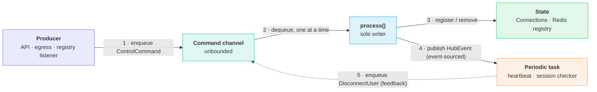
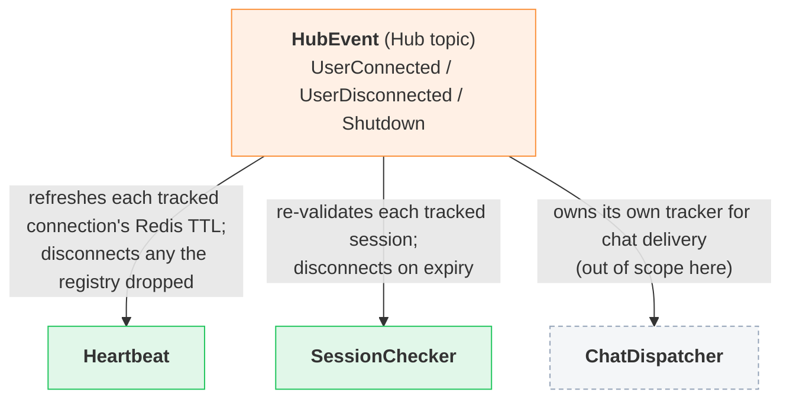
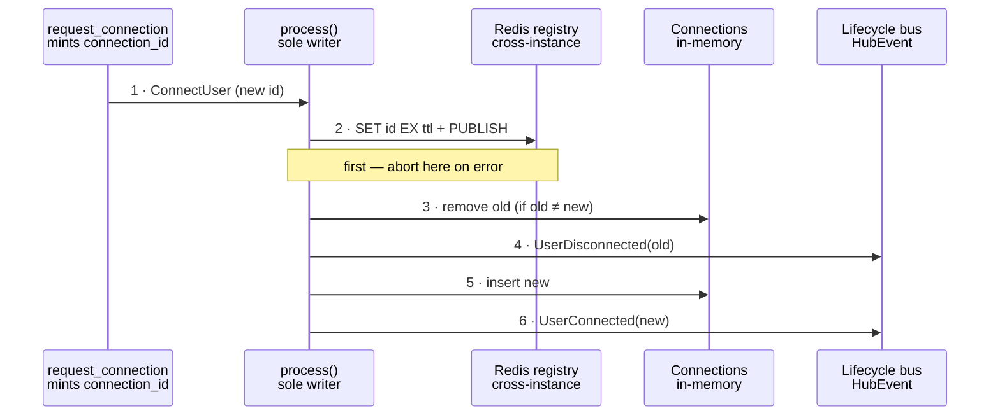

# Hub Connection Lifecycle

*How the builder hub keeps at most one live connection per user, in sync with the session and a cross-instance registry, through a single serial command loop.*

## Problem

The builder hub tracks who is connected and fans lifecycle signals out to the periodic tasks that keep that view honest. A user must end up with at most one live connection — a fresh connect supersedes the previous one — and a connection must never outlive its session or its registry entry. The hub holds these properties through one *serial command loop* that is the sole writer of connection state, a connection identity (`connection_id`) that lets a stale request be told apart from a fresh reconnect, and a Redis registry that extends the last-wins rule across service instances.

## Architecture

The hub is a closed loop with a single writer. Producers never touch state — they enqueue a `ControlCommand` on an unbounded channel that the loop drains one command at a time. For each command the loop mutates the in-memory `Connections` and the Redis registry, then publishes a lifecycle `HubEvent`. The periodic tasks event-source their own view from those events and, when they find a connection that should die, enqueue a `DisconnectUser` straight back onto the channel — so every mutation, including the ones the tasks trigger, is applied by the same serial writer.

The commands that enter the loop and the state it writes are detailed below; the events it publishes and how the tasks consume them follow in [Lifecycle events](#lifecycle-events) and [Event fan-out to tasks](#event-fan-out-to-tasks).

| Command | Enqueued by | Loop action |
|---|---|---|
| `ConnectUser` | Connection API (`request_connection`) | Register the new connection, superseding any prior one for the user. |
| `DisconnectUser` | Connection API, heartbeat, session checker | Remove the connection if its id still matches (CAS). |
| `DropConnection` | Egress senders that hit a dead channel | Force-remove the connection by id. |
| `HubRegistryChanged` | Redis registry-change listener | Recheck the user's active connection against the registry. |
| `Shutdown` | Connection API (`request_shutdown`) | Publish `Shutdown` and stop the loop. |

## Lifecycle events

The loop is the sole emitter of `HubEvent` (defined in `models/messages/hub.rs`). These events carry the connection identity that lets a consumer distinguish a supersede from a same-connection renewal.

| Event | Payload | Emitted when |
|---|---|---|
| `UserConnected` | `user_id`, `connection_id`, `session_key` | A new connection is registered (after any prior one is superseded). |
| `UserDisconnected` | `user_id`, `connection_id` | A connection is removed — superseded, disconnected, dropped-dead, or found inactive in the registry. |
| `Shutdown` | — | The hub is shutting down; ends every consumer loop. |

Every `HubEvent` is carried on the `Hub` topic. The bus has two classes of recipient, and the split is the reason lifecycle signals are never lost to the tasks:

| Recipient class | Channel | On lag | Why |
|---|---|---|---|
| `Connections` (addressable clients) | bounded `mpsc`, handed in at connect time | reported dead → pruned | A slow client must not stall the hub; dropping it is correct. |
| `Subscribers` (internal tasks) | unbounded `mpsc`, lossless | never dropped | A dropped `UserConnected`/`UserDisconnected` would corrupt a task's connection tracker forever. |

## Event fan-out to tasks

Each periodic task subscribes to the `Hub` topic and event-sources its *own* `ConnectionTracker` from the stream — there is no shared connection map between tasks and no lock. The tracker applies each event to a private `user_id → (connection_id, session_key)` map.

All subscriptions are registered synchronously before the command loop starts dispatching, so no task can miss an event emitted during startup — see `hub_service.rs · HubService::new`. The tracker's tick is prioritized over the event stream (`biased` select in `run_connection_loop`) so a heavy event burst cannot starve TTL refreshes and let a live connection expire.

## Last connection wins

Minting a connection id and superseding the prior connection is the core of the one-per-user rule. `request_connection` mints a fresh `connection_id` and enqueues `ConnectUser`; the loop then runs this ordered sequence. The registry write comes *first* so a transient Redis failure leaves the existing connection intact rather than orphaning a new socket.

A same-`connection_id` re-registration is a renewal, not a supersede: the old-vs-new check skips the teardown. Because each connect mints a new id, the same session reconnecting simply flows through the last-wins path against its own prior connection.

## Keeping connection info current

Three independent mechanisms detect a connection that should no longer be live and converge on the same CAS'd `DisconnectUser` path. Because the target carries a `connection_id`, a removal aimed at a connection that has since been replaced is a no-op — a stale check can never tear down a fresh reconnect.

| Mechanism | Trigger | Action |
|---|---|---|
| `Heartbeat` | Every `heartbeat` interval. | Batched `heartbeat_connections`: MGET all tracked entries, pipeline an `EXPIRE` for those still holding this id, and return the rest as stale → `request_disconnection` each. |
| `SessionChecker` | Every `session_check` interval. | Re-validates each tracked `(user_id, session_key)`. On `SessionExpired`/`SessionCompromised` → `request_disconnection`; transient errors skip the tick. |
| `HubRegistryChanged` | Redis pub/sub from another instance. | Loop rechecks the user's active connection with a CAS'd `heartbeat_connection`; if the registry no longer holds this id, removes it locally and emits `UserDisconnected`. |

## Cross-instance registry

The Redis registry (`repositories/hub_registry`) extends last-wins beyond a single process. The key `hub-connection:{user_id}` holds the user's current `connection_id` with a TTL; the local heartbeat is what keeps that TTL alive, so a crashed instance's entries expire on their own. Mutations publish to `hub-registry-changed` as `{instance_id}:{user_id}`, and the listener drops self-originated notifications (its local view is already current).

| Operation | Redis | Semantics |
|---|---|---|
| `create_connection` | `SET key id EX ttl` + `PUBLISH` | Overwrites the active id for the user (last write wins) and notifies other instances. |
| `heartbeat_connection` | WATCH/GET/`EXPIRE` txn | CAS: extends TTL only when the stored id matches. Returns `false` if not active. |
| `heartbeat_connections` | `MGET` + pipelined `EXPIRE` | Batched, no per-key CAS; compares in memory and returns the entries no longer holding this id. |
| `remove_connection_if_active` | WATCH/GET/`DEL` txn + `PUBLISH` | CAS: deletes only when both user and id match, then notifies. |

## Key rules

| Rule | Upheld by |
|---|---|
| At most one live connection per user; a new one supersedes the old. | `process(ConnectUser)` removes any different active connection and emits `UserDisconnected` before registering the new one. |
| A stale removal cannot tear down a fresh reconnect. | Every removal path is CAS'd on `connection_id` — locally (`remove_connection`) and in Redis (`remove_connection_if_active`). |
| A connection never outlives its session. | `SessionChecker` disconnects on definitive session loss. |
| A crashed instance's connections self-clean. | Registry entries carry a TTL kept alive only by the live instance's heartbeat. |
| Internal tasks never miss a lifecycle event. | Lossless unbounded subscriber channels + all subscriptions registered before the loop starts. |

## File map

| File | Role |
|---|---|
| `services/hub/hub_service.rs` | Command loop, sole writer; connect/disconnect/drop/registry-change handling; event publish. |
| `services/hub/hub_command.rs` | `ControlCommand` enum — the loop's input vocabulary. |
| `services/hub/hub_connections.rs` | Addressable connection registry; bounded egress; dead-channel detection. |
| `services/hub/hub_subscribers.rs` | Internal lossless fan-out subscribers. |
| `services/hub/hub_status.rs` | Health provider reporting live connection/subscriber counts. |
| `services/hub/tasks/connection_tracker.rs` | Event-sourced per-consumer tracker and the periodic loop driver. |
| `services/hub/tasks/heartbeat.rs` | Batched registry TTL refresh; disconnects registry-dropped connections. |
| `services/hub/tasks/session_checker.rs` | Per-tick session validation; disconnect on expiry. |
| `models/messages/hub.rs` | `HubEvent`, `HubMessage`, `TopicKey`, `ToTopic`. |
| `repositories/hub_registry/hub_registry.rs` | `HubRegistry` trait — cross-instance connection contract. |
| `repositories/hub_registry/redis/redis_hub_registry.rs` | Redis implementation: SET/EXPIRE/DEL, CAS transactions, pub/sub. |
| `repositories/hub_registry/redis/redis_hub_connection_db.rs` | Pooled context factory; registry-change listener with self-origin filtering. |

Why the registry write precedes local teardown in ConnectUser

In `process(ConnectUser)` the order is: (1) `create_registry_connection`, (2) supersede the old local connection, (3) register the new one. If the registry write fails the loop returns early *before* touching local state, so the previously active connection stays intact and tracked. Reversing the order would let a transient Redis error leave the user with no connection and an orphaned, untracked new socket. The registry removal on the disconnect paths is best-effort by contrast — a failure there is logged and left to TTL cleanup, because the local removal and `UserDisconnected` must still happen so sockets and trackers never wedge.

Pub/sub is lossy by design; the heartbeat is the reconciler

The `hub-registry-changed` listener treats a `None` payload (Redis reconnect) as "messages during the outage were lost" and does nothing — it does not attempt a resync. Correctness does not depend on any single notification arriving: the periodic `heartbeat_connections` reconciliation independently detects a connection the registry no longer holds and disconnects it. The pub/sub path is only a latency optimization that shortens the window between a cross-instance supersede and the local teardown; the heartbeat is the backstop.

