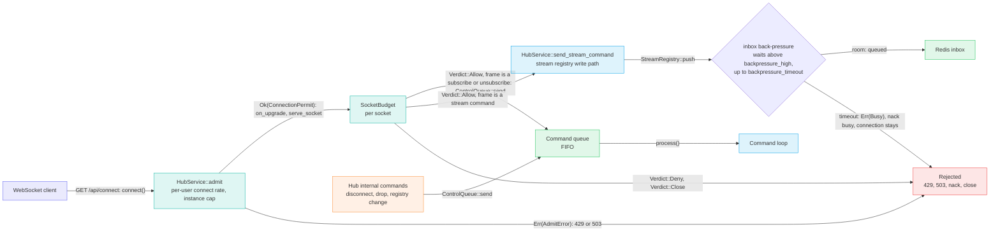
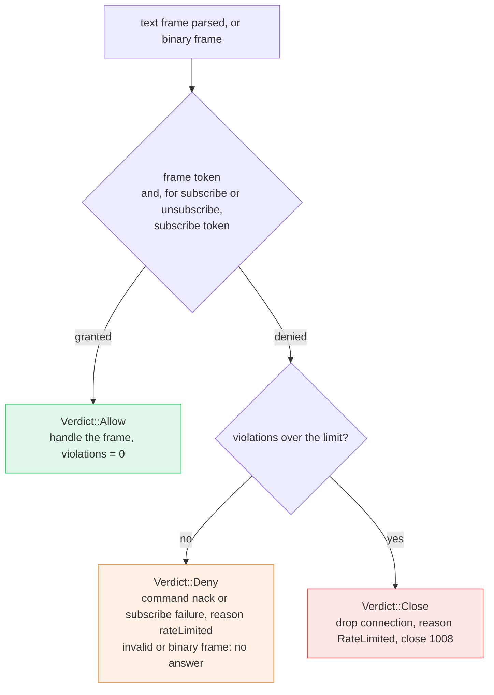

# Hub Load Protection

*Per-instance limits that keep one misbehaving client from exhausting the hub: admission at connect and a budget per socket.*

## Problem

A logged-in client can reconnect in a tight loop, flood a socket with frames, or spam subscribes that each cost the server a full `Sync`. Without limits, producers outrun the hub command loop, its queue grows until the process runs out of memory, and a slow Redis stalls every connect and disconnect behind it. Limits must stop the offender, not whoever happens to push next, and must stay simple: in memory, per instance, no shared state.

## Architecture

A connection passes two gates before it can load the hub: admission when it connects, then a budget on every frame it sends. Everything reaches the command loop through one FIFO queue, so a socket's connect, subscribes and disconnect keep their order. The queue has no limit of its own: what feeds it is bounded by the connection cap and the per-socket budgets.

`Verdict::Allow` is one verdict for every granted frame; what happens next depends on the frame. A stream command does not use the queue: it goes straight to the stream registry's write path ([Command Streams](command-stream.md)). A ping, when enabled, goes to the hub's topic delivery and is not drawn.

### Verdict

`SocketBudget::check` returns a `Verdict` for every frame. The overview above draws its three outcomes as the arrows leaving `SocketBudget`; this diagram is the inside of that box, showing how `check` reaches them.

A text frame is parsed first (bounded by the 32 KB message limit), then draws tokens. A binary frame is not parsed and draws one frame token. The violation counter turns a sustained flood into a close.

## Key rules

| Concern | Rule |
|---|---|
| Scope | Every limit is per instance and in memory. Nothing is shared through Redis. A user has one live connection per instance (last wins), so a per-socket budget is the user's budget across all streams. |
| Frame budget | One `TokenBucket` per socket, owned by its receive task (no lock). Every text or binary frame costs a frame token, parseable or not (WebSocket ping, pong and close frames are not charged). A granted binary frame is ignored. Subscribe and unsubscribe also cost a subscribe token. |
| Denied frame | Command: `streamNack` reason `rateLimited`. Subscribe: `streamSubscribeFailed` reason `rateLimited`. Invalid, binary or non-stream frame: no answer. The connection stays open. |
| Violations | Consecutive denied frames are counted; any granted frame resets the count. At `violation_limit` the socket is dropped as `RateLimited` (close 1008). |
| Subscribe coalescing | The subscribe bucket is the coalescing rule: repeated subscribes to a stream (each a full `Sync`) are bounded by its refill rate. |
| Busy inbox | The inbox back-pressure is kept as it is (`inbox.backpressure_high`, `backpressure_low`, `backpressure_poll_period`, `backpressure_timeout`): pushes wait above the high mark and fail `busy` after the timeout. A `busy` push is nacked; the connection stays open and there is no `Busy` disconnect reason. The sender's frame budget limits how fast it can retry. |
| Connect rate | `KeyedRateLimiter<Uuid>` keyed by `user_id`, before the upgrade. Every authenticated attempt that passes the host and origin checks draws a token, including ones the cap then refuses. It outlives the socket, so a reconnect loop does not reset its budget. Over budget: 429 with `Retry-After`. |
| Connection cap | A semaphore of `max_connections` permits, owned by `HubService`. `admit(user_id)` checks the rate, then the cap, and returns a `ConnectionPermit` that the socket holds until it ends. Exhausted: 503. |
| Client backoff | Clients are expected to back off on a refused connect and on close 1008; that work is the audit items C2 and C8 and is not part of this design. |
| Command queue | One FIFO without a limit of its own, so a connection's commands run in the order they were sent and none is ever refused. Its size is bounded by what feeds it: one `ConnectUser` per socket and the sockets are capped by `max_connections`; subscribes and unsubscribes by the subscribe bucket of each socket; one disconnect per connection; drops deduplicated per connection; one registry notice per remote connect; one tick of the tasks. A reconnect storm is at most `max_connections` small entries. |
| Stalled loop | While the loop waits for a registry call the queue grows at the rate above, for as long as the call takes, which the Redis `timeout` and `pool_timeout` bound. The depth metric (`hub_control_commands` queue delay) is the signal to watch. |
| Registry calls | The hub adds no timeout of its own to its calls to the hub connection registry. Each call is bounded by the Redis connection string: `timeout` (connect and per-command response, 500 ms by default) and `pool_timeout` (checkout wait, 30 s by default). Set `pool_timeout` for the builder to seconds, as `mock.json` does (5000), so a starved pool cannot hold the loop for long. A failed call is an error like any other, counted in the registry error counter; `ConnectUser` already re-reads the registry after a failed write, so a write that landed is accepted. |
| Ping | A ping frame is an ordinary frame: it draws a frame token. |
| Close codes | `RateLimited` 1008, the rest as in [Hub](hub.md#wire-protocol). |
| Metrics | Refused connects count in `hub_connect_rejected` (`rate_limited`, `capacity`); drops in `hub_connections_dropped` by reason; denied frames in `ws_messages_received` with outcome `rate_limited`. |

### Limits

All values are configuration; the defaults below are the starting point. The frame and subscribe limits are per socket (`WsConfig.limits`); the connect rate and the connection cap are hub settings (`HubConfig`).

| Setting | Default | Meaning |
|---|---|---|
| `frames` | burst 60, 30 / s | Frame bucket of a socket. |
| `subscribes` | burst 10, 2 / s | Subscribe and unsubscribe bucket of a socket. |
| `violation_limit` | 20 | Consecutive denied frames before the drop. |
| `connect_rate` | burst 5, 1 per 10 s | Connects per user. |
| `max_connections` | 10 000 | Sockets per instance, from upgrade to close. |

## Reusable pieces

Two types in `shine-infra::sync`, next to `ExponentialBackoff`; neither knows about the hub.

| Type | Contract |
|---|---|
| `TokenBucket` | `new(capacity, refill_per_second)`; `try_acquire(&mut self) -> bool`, one token per call, lazily refilled from a monotonic clock; `try_acquire_at(now)` and `is_full_at(now)` take the time as a parameter so tests need no sleeps. |
| `KeyedRateLimiter<K>` | Cloneable handle over a mutex-guarded map of buckets with one shared configuration. `check(key) -> bool` draws a token from the key's bucket, creating it full. Buckets that have refilled to full are idle and are swept lazily, so memory follows the keys active within one refill period. |

Another key shape is another `K` (`(Uuid, Group)`); another rule is another limiter instance with its own configuration. `SocketBudget` is builder-local (`ws_limits.rs`): two `TokenBucket`s and the violation counter behind a `check(frame_kind) -> Verdict` of `Allow`, `Deny` or `Close`, one instance per socket. Admission is not a type: it is the method `HubService::admit`, which combines the `KeyedRateLimiter`, and the connection semaphore.

## File map

| File | Role |
|---|---|
| `crates/shine-infra/src/sync/token_bucket.rs` | `TokenBucket`. |
| `crates/shine-infra/src/sync/keyed_rate_limiter.rs` | `KeyedRateLimiter<K>`. |
| `crates/shine-infra/src/sync/mod.rs` | Exports the two types. |
| `services/builder/src/routes/ws/ws_limits.rs` | `SocketBudget` and `Verdict`. |
| `services/builder/src/routes/ws/ws_config.rs` | `SocketLimits` and `WsConfig.limits`, next to `SocketTimeouts`. |
| `services/builder/src/routes/ws/connect.rs` | `admit` call before the upgrade; `SocketBudget` in the receive loop; answers for denied frames; close code 1008. |
| `services/builder/src/routes/ws/message.rs` | Wire reason `rateLimited` for nacks and subscribe failures. |
| `services/builder/src/models/messages/stream.rs` | `CommandFailure::RateLimited`, `SubscribeFailure::RateLimited`. |
| `services/builder/src/models/messages/hub.rs` | `DisconnectReason::RateLimited`; no `Busy`. |
| `services/builder/src/services/hub/hub_service.rs` | `admit` and `ConnectionPermit` (connect limiter, semaphore); busy nack without a drop; `HubConfig` fields. |
| `services/builder/src/services/hub/hub_metrics.rs` | New refusal reasons. |
| `crates/shine-game/src/replica/client_stream.rs` | A `rateLimited` nack removes the pending command like any other nack; a `rateLimited` subscribe failure takes the existing subscribe-failure path. No retry of the command. |

Why parse before charging, and why the queue has no limit

A denied command must be answered with its `commandId`, and a denied subscribe with its stream id, so the frame has to be parsed before it is charged. The parse cost per frame is bounded by the 32 KB message limit, and `violation_limit` closes a sustained flood after a few dozen frames.

The queue is one unbounded FIFO because a socket's `ConnectUser` must be processed before its `DisconnectUser`, and because a limit would turn a spike into refusals for honest clients. The rate limits and the connection cap are what keep it small: a producer cannot enqueue faster than its budget, and the sockets that can enqueue are capped. The bound is `max_connections` times the per-socket rates, so raise the cap together with a look at the budgets.

What this does not cover

Limits are per user: an attacker with many accounts has one budget per account, and `max_connections` is the backstop. There is no per-IP limit (it needs trusted proxy headers, see the audit item R17), no budget shared between instances, and no per-user quota inside the stream inbox. The loop still awaits registry calls inline; the Redis timeouts and the bounded producers limit the damage of a slow Redis, they do not remove it.

Coverage map

| # | Case | Kind |
|---|---|---|
| 1 | `TokenBucket`: burst, refill over time, capacity clamp, `is_full_at` | unit, injected time |
| 2 | `KeyedRateLimiter`: keys independent, idle keys swept, clone shares state | unit |
| 3 | `SocketBudget`: grant, deny, violation count resets on a granted frame, `Close` at the limit | unit |
| 4 | Denied command nacks `rateLimited` with its `commandId`; denied subscribe fails `rateLimited` | socket test |
| 5 | Sustained flood closes the socket 1008; honest traffic beside it is untouched | socket test |
| 6 | Connect loop of one user gets 429; another user is unaffected | route test |
| 7 | Cap reached gives 503; closing a socket frees its permit | route test |
| 8 | A quick connect then close leaves nothing registered | hub test |
| 9 | `busy` nack leaves the connection registered (replaces the tests that expect the busy drop) | hub stream test |

