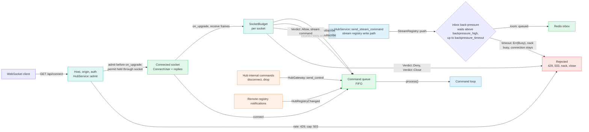
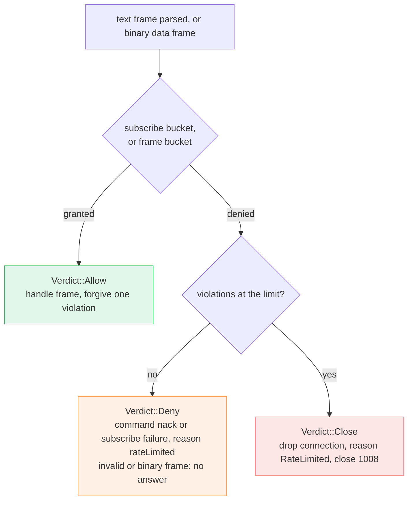

# Hub Load Protection

*Per-instance limits that constrain connection attempts and client frames before they can overwhelm hub and stream processing.*

## Problem

A logged-in client can reconnect in a tight loop, flood a socket with frames, or spam subscriptions that request a full sync. Without limits, socket producers can outrun hub and stream processing. Admission and per-socket budgets bound local client traffic; they are per instance and use no shared rate-limit state.

## Architecture

A connection attempt passes admission before the WebSocket upgrade; its permit remains held while the upgrade and socket are served. After connecting, each data frame draws from the socket's budget. Control-plane commands reach the hub loop through one FIFO queue, preserving lifecycle order; stream commands instead go directly to the stream registry. The queue has no limit of its own, and local socket traffic is constrained by connection and frame limits. Remote registry notifications are an additional producer, so queue growth during a stalled loop is not bounded by the local connection cap alone.

`Verdict::Allow` is one verdict for every granted frame; what happens next depends on the frame. A stream command does not use the queue: it goes straight to the stream registry's write path ([Command Streams](command-stream.md)). A ping, when enabled, goes to the hub's topic delivery and is not drawn.

### Verdict

`SocketBudget::check` returns a `Verdict` for every frame. The overview above draws its three outcomes as the arrows leaving `SocketBudget`; this diagram is the inside of that box, showing how `check` reaches them.

A text frame is parsed first (bounded by the 32 KB message limit), then draws one token from its selected bucket. Subscribes use the subscribe bucket; other data frames, including invalid text and binary frames, use the frame bucket. WebSocket Ping, Pong and Close control frames are not charged. The violation counter turns a sustained flood into a close.

## Key rules

| Concern | Rule |
|---|---|
| Scope | Admission and socket buckets are in-memory and per instance. There is no shared per-user rate budget: while cross-instance replacement converges, the same user may temporarily hold a socket on more than one instance, each with its own frame budget. |
| Frame budget | One `TokenBucket` per socket, owned by its receive task (no lock). Each received text or binary data frame draws from exactly one bucket: a parsed subscribe uses the subscribe bucket, everything else (including invalid text, unsubscribe, app ping and binary data) uses the frame bucket. WebSocket Ping/Pong/Close control frames are not charged. A granted binary frame is ignored; refusals are answered only when the parsed request expects a reply. |
| Denied frame | Command: `streamNack` reason `rateLimited`. Subscribe: `streamSubscribeFailed` reason `rateLimited`. Invalid, binary or non-stream frame: no answer. The connection stays open. |
| Violations | Each denied frame adds a violation and each granted frame forgives one. At `violation_limit` the socket is dropped as `RateLimited` (close 1008). A flood that now and then gets a frame through is closed all the same; a client that now and then runs into its limit is not. |
| Subscribe coalescing | The subscribe bucket is the coalescing rule: repeated subscribes to a stream (each a full `Sync`) are bounded by its refill rate. |
| Busy inbox | The inbox back-pressure is kept as it is (`inbox.backpressure_high`, `backpressure_low`, `backpressure_poll_period`, `backpressure_timeout`): pushes wait above the high mark and fail `busy` after the timeout. A `busy` push is nacked; the connection stays open and there is no `Busy` disconnect reason. The client removes that command from its pending set rather than retrying it; the socket budget still bounds further frames. |
| Connect rate | `KeyedRateLimiter<Uuid>` keyed by `user_id`, before the upgrade. Every authenticated attempt that passes host and origin checks draws a token, including attempts the cap then refuses. It outlives the socket, so reconnecting does not reset the budget. Over budget returns 429 with `retryAfter` seconds. |
| Connection cap | `HubService` owns an `Admission<Uuid>` with `max_connections` places. `admit(user_id)` checks rate, then acquires a place. The permit is acquired before upgrade and held through socket handling; a full cap returns 503. |
| Client backoff | The WebSocket client backs off on a refused connect and close 1008. A command `busy` nack removes that pending command and does not automatically retry it. Client rules are in [Hub](hub.md#client-contract). |
| Command queue | One unbounded FIFO preserves order for a connection's queued lifecycle commands; it does not carry stream commands. Local socket producers are constrained by the connection cap and per-socket budgets, with at most one disconnect queued per connection. Remote registry notifications are not covered by those local limits, so the queue has no fixed size bound; during an inline registry wait, it grows with the arrival rate and wait duration. |
| Stalled loop | While the loop waits for a registry call, queue delay grows. Redis command and pool timeouts bound their respective waits, but remote registry notifications can continue to enqueue work. Watch `hub_control_command_queue_delay` alongside Redis pool wait and registry call duration. |
| Registry calls | The hub adds no timeout of its own to registry calls. The Redis connection string's `timeout` and `pool_timeout` are milliseconds. Without `timeout`, redis-rs defaults are 1 s to connect and 500 ms per response; `pool_timeout` defaults to 30 s of checkout wait (including connection establishment). For builder, `pool_timeout=5000` in `mock.json` means 5 s. Registry failures are counted in `hub_registry_errors` by operation; if `ConnectUser` errors after writing, it checks whether Redis holds the new id and proceeds if the write landed. |
| Ping | The application `ping` message draws a frame token. WebSocket Ping/Pong/Close control frames are not charged. |
| Close codes | `RateLimited` 1008, the rest in [Hub](hub.md#ending-a-connection). |
| Metrics | Connect rejections include host/origin, rate/capacity and hub-stopped outcomes in `hub_connects_rejected`; drops use `hub_connections_dropped` by reason; denied frames use `ws_messages_received` with outcome `rate_limited`. |

### Limits

All values are configuration; the defaults below are the starting point. `burst` is the size of the bucket (the most a client can send at once) and `perSecond` the refill rate, which is also the steady rate a client can keep up; in any `T` seconds at most `burst + perSecond × T` get through. A `burst` below `perSecond` is a plain per-second limit. The frame and subscribe limits are per socket (`WsConfig.limits`); the connect rate and the connection cap are hub settings (`HubConfig`).

| Setting | Default | Meaning |
|---|---|---|
| `frames` | burst 60, 30 / s | Frame bucket of a socket. |
| `subscribes` | burst 10, 2 / s | Subscribe bucket of a socket, for the expensive request. |
| `violation_limit` | 20 | Denied frames, net of the granted ones, before the drop. |
| `connect_rate` | burst 5, 1 per 10 s | Connects per user. |
| `max_connections` | 10 000 | Admission permits per instance, acquired before upgrade and held through socket close. |

## Reusable pieces

Three types in `shine-infra::sync`, next to `ExponentialBackoff`; none knows about the hub.

| Type | Contract |
|---|---|
| `TokenBucket` | `new(capacity, refill_per_second)`; `try_acquire(&mut self) -> bool`, one token per call, lazily refilled from a monotonic clock; `try_acquire_at(now)` and `is_full_at(now)` take the time as a parameter so tests need no sleeps. |
| `Admission<K>` | `new(rate, places)`; `admit(key) -> Result<AdmissionPermit, AdmissionError>`. A key has to be within its rate (a `KeyedRateLimiter`) and there has to be a place left (a semaphore); every attempt costs a token, a refused one too. The permit holds the place until it is dropped. `AdmissionError` is `RateLimited { retry_after }` or `Full`, with `as_str` for metric labels and, in `shine-infra::web::responses`, a `Problem` conversion: 429 with `retryAfter` seconds, or 503. |
| `KeyedRateLimiter<K>` | Cloneable handle over a mutex-guarded map of buckets with one shared configuration. `check(key) -> bool` draws a token from the key's bucket, creating it full. A check triggers a sweep at most once per 60 s; full buckets are then removed. Cleanup is lazy and traffic-triggered, so idle keys can remain until a later check. |

Another key shape is another `K` (`(Uuid, Group)`); another rule is another limiter instance with its own configuration. `SocketBudget` is builder-local (`socket_budget.rs`): two `TokenBucket`s and the violation counter behind a `check(budget_kind) -> Verdict` of `Allow`, `Deny` or `Close`, one instance per socket.

## File map

| File | Role |
|---|---|
| `crates/shine-infra/src/sync/token_bucket.rs` | `TokenBucket`. |
| `crates/shine-infra/src/sync/keyed_rate_limiter.rs` | `KeyedRateLimiter<K>`. |
| `crates/shine-infra/src/sync/admission.rs` | `Admission<K>`, `AdmissionPermit`, `AdmissionError`; rate check occurs before capacity acquisition. |
| `crates/shine-infra/src/web/responses/admission.rs` | The `Problem` of an `AdmissionError`. |
| `crates/shine-infra/src/sync/mod.rs` | Exports the types. |
| `services/builder/src/routes/ws/socket_budget.rs` | `SocketBudget` and `Verdict`. |
| `services/builder/src/routes/ws/ws_config.rs` | `SocketLimits`, defaults and `WsConfig.limits`, next to `SocketTimeouts`. |
| `services/builder/src/routes/ws/connect.rs` | Host/origin validation and `admit` before upgrade; permit lifetime; `SocketBudget` in the receive loop; answers for denied frames; close code 1008. |
| `services/builder/src/routes/ws/message.rs` | Request budget classification, command wire-size validation and `rateLimited` failure reasons. |
| `services/builder/src/models/messages/stream.rs` | `CommandFailure::RateLimited`, `SubscribeFailure::RateLimited`. |
| `services/builder/src/models/messages/hub.rs` | `DisconnectReason::RateLimited`; no `Busy`. |
| `services/builder/src/services/hub/hub_service.rs` | `HubService::admit` over an `Admission<Uuid>`; direct stream write path; remote registry listener; `HubConfig` fields. |
| `services/builder/src/services/command_stream/stream_registry.rs` | Direct stream push, back-pressure wait and `busy` refusal; does not use the hub control queue. |
| `services/builder/src/services/command_stream/stream_config.rs` | Inbox watermark, polling and timeout configuration. |
| `crates/shine-game/src/replica/client_stream.rs` | A `rateLimited` nack removes the pending command like any other nack; a `rateLimited` subscribe failure takes the existing subscribe-failure path. No retry of the command. |

Why parse before charging, and why the queue has no limit

A denied command must be answered with its `commandId`, and a denied subscribe with its stream id, so the frame has to be parsed before it is charged. The parse cost per frame is bounded by the 32 KB message limit, and `violation_limit` closes a sustained flood after a few dozen frames.

The queue is one unbounded FIFO because a socket's `ConnectUser` must be processed before its `DisconnectUser`, and a separate queue limit would turn a spike into refusals for honest clients. Local socket producers are constrained by rate limits and the connection cap, but remote registry notifications are not. The queue has no fixed size bound; during a loop stall, watch `hub_control_command_queue_delay` and registry-call duration.

What this does not cover

Limits are per user: an attacker with many accounts has one budget per account, and `max_connections` is the local backstop. There is no per-IP limit (it needs trusted proxy headers), no budget shared between instances, and no per-user quota inside the stream inbox. The loop still awaits registry calls inline; Redis command and pool timeouts bound individual waits, but remote registry notifications can continue to queue during a stall.

Coverage map

| # | Case | Kind |
|---|---|---|
| 1 | `TokenBucket`: burst, refill over time, capacity clamp, `is_full_at` | unit, injected time |
| 2 | `KeyedRateLimiter`: keys independent, idle keys swept, clone shares state | unit |
| 3 | `SocketBudget`: grant, deny, a granted frame forgives a denial, a paced flood is closed, `Close` at the limit | unit |
| 4 | Denied command nacks `rateLimited` with its `commandId`; denied subscribe fails `rateLimited` | socket test |
| 5 | Sustained flood closes the socket 1008; honest traffic beside it is untouched | socket test |
| 6 | `Admission`: the budget of a key outlives its permits, a refusal for the places still costs a token, the places are limited and a dropped permit frees its place; `AdmissionError` is a 429 with `retryAfter` or a 503 | unit |
| 7 | A quick connect then close leaves nothing registered | hub test |
| 8 | `busy` nack leaves the connection registered (replaces the tests that expect the busy drop) | hub stream test |

