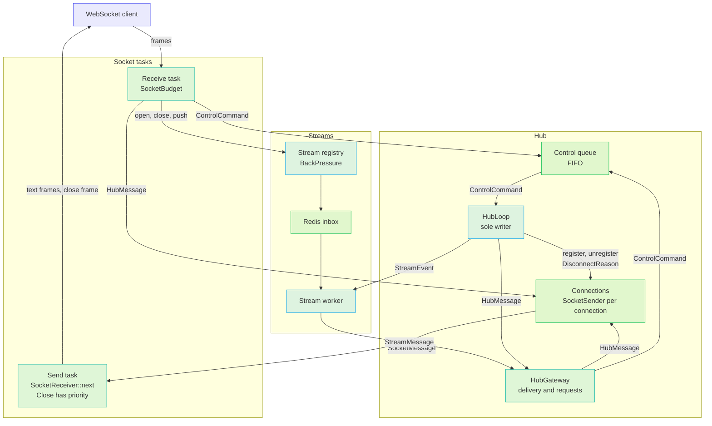
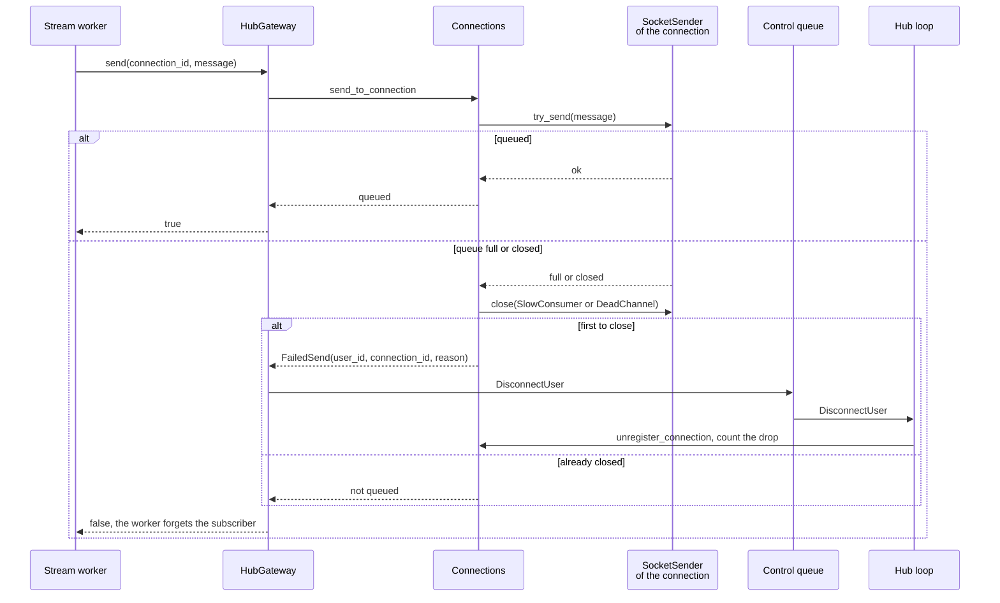
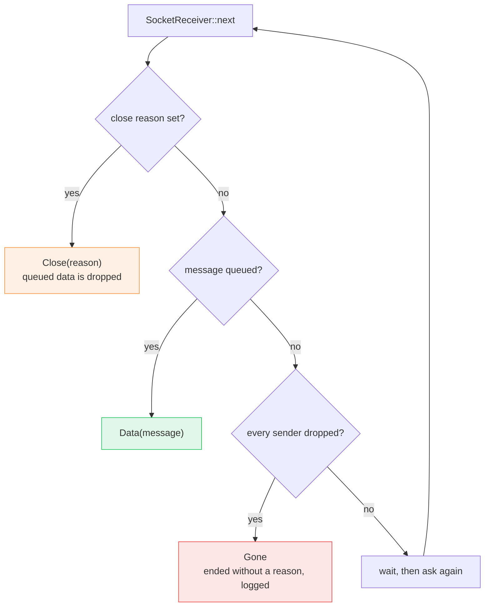
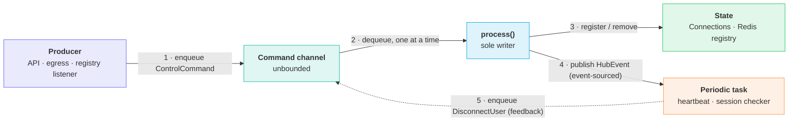
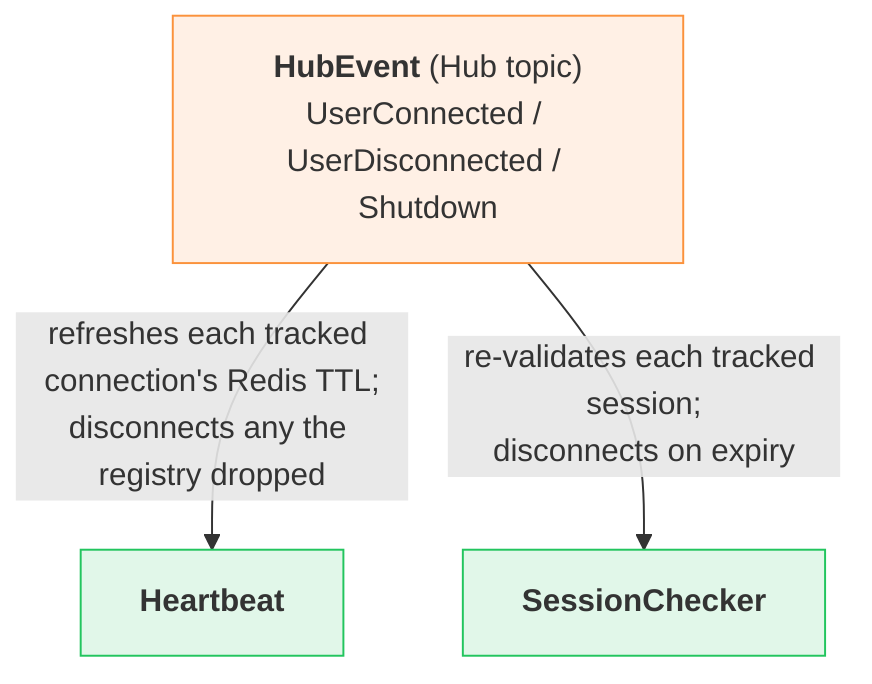
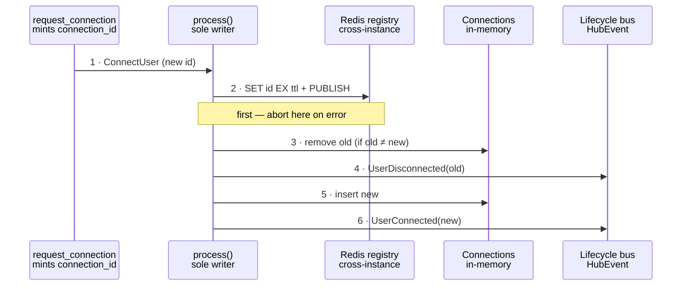
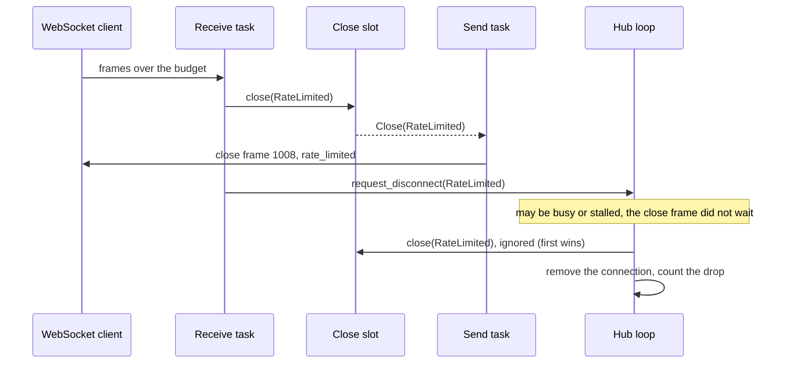

# Hub

*The builder's WebSocket hub: one live connection per user, kept in sync with the session and a cross-instance registry, and a topic-based message bus that delivers serialized messages to those connections.*

## Problem

The hub tracks who is connected and distributes messages to them. A user has at most one live connection — a fresh connect supersedes the previous one — and a connection never outlives its session or its registry entry. These properties come from one *serial command loop* that is the sole writer of connection state, a connection identity (`connection_id`) that tells a stale request from a fresh reconnect, and a Redis registry that extends the last-wins rule across service instances.

On top of that, the hub distributes messages by **topic**. Delivery is serialized through the loop and deliberately simple, not a high-throughput path. There are two topics: `Hub` carries the connection lifecycle events, `Ping` carries a ping message that exercises delivery. Stream requests and the stream data use the same socket; the streams themselves are [Command Streams](command-stream.md), a separate system.

A socket exchanges very different messages with the hub, each with its own guarantee, and the end of a connection always carries one reason, so the client knows whether to reconnect, back off or sign in again.

## Architecture

The user id and the connection id come from the authenticated connection, never from a frame. After the upgrade and the registration, the server's first frame is `{"type":"connected","userId":"<uuid>"}`, which the socket writes itself before its two tasks start.

Two tasks serve a socket. The receive task reads the client's frames and hands each to the part of the hub that owns it. The send task reads one endpoint, `SocketReceiver`, that the hub side feeds through a `SocketSender` registered with the connection. Every message to the client reaches the socket through that sender, whoever produced it.

`StreamEgress` is the trait a worker delivers through; the `HubGateway` implements it (`HubService` forwards to it), so a worker never sees a socket, and it cannot close one: a connection that is full or dead is ended by the send that finds it. The gateway is the handle producers use: it delivers messages to the connections and sends requests to the loop. The loop is the only writer of the connections. Periodic tasks (heartbeat, session checker) and the registry listener also put commands on the control queue; they are in [Connection lifecycle](#connection-lifecycle).

### Message paths

| Direction | Message | Path | When overloaded |
|---|---|---|---|
| to hub | `streamCommand` | Receive task → registry `push` → Redis inbox → worker. Does not touch the control queue or the loop. | Inbox back-pressure: nack `busy`, the connection stays. |
| to hub | `streamSubscribe` | Registry `open` (authorize) → control queue → loop publishes `Subscribed` → dispatcher → worker. | Subscribe bucket of the socket; refusal is `streamSubscribeFailed`. |
| to hub | `streamUnsubscribe` | Registry `close` → control queue → loop publishes `Unsubscribed`. | Frame bucket of the socket. |
| to hub | `ping` | Receive task → `send_to_user` or `broadcast` → queue of the target. Off unless `ping_enabled`. | Frame bucket of the socket. |
| to hub | connect, disconnect, drop | Control queue → loop → `Connections` and the Redis registry. | One entry per connection, bounded by the connection cap. |
| to client | `streamSync`, `streamCommands`, `streamCheckpoint`, `streamUnsynced` | Worker → `StreamEgress::send` → `Connections` → queue. Ordered per connection. | A full queue drops the connection as `slow_consumer`. |
| to client | `streamNack`, `streamSubscribeFailed` | The answer of a refused request goes from the receive task into the queue; a failed stream is answered by the hub. | Lost with a full queue; that client is dropped anyway. |
| to client | `ping` | Topic delivery → queue. | As stream data. |
| to client | close frame | The close slot, see [Ending a connection](#ending-a-connection). | Cannot be full. |

A subscribe has two steps. The registry `open` runs at once on the receive task: it authorizes the stream and refuses with `streamSubscribeFailed`. The `Subscribed` event follows through the control queue, so the loop orders it after the connection's own `ConnectUser`, and drops it when the connection is already gone; the dispatcher then starts or joins the worker. An unsubscribe is the same pair, `close` and `Unsubscribed`.

Hub lifecycle events are published to the internal consumers and to the sockets' topic, but are not forwarded to the client.

### Stream delivery

The `HubGateway` holds the connections and the sender of the control queue. A delivery is one call: it never waits, and a failure is answered by ending the connection, not by retrying.

A connection with a full or closed queue is found by every send to it. The sender closes the connection's slot, and `close` tells whether the caller was first: only the first sender queues the disconnect, the others find the connection closed and queue nothing. The close slot is the deduplication; the control queue keeps no state for it. The socket is told at once, and the loop counts and publishes the reason the slot holds, so the metric and the event are what the client was told.

`notify_failed` queues `StreamFailed` on the same control queue. The loop closes the stream for every connection that has it open and answers each with `streamSubscribeFailed` through this same `send`.

### Next event of the send task

`SocketReceiver::next` is the only way the send task reads its endpoint and it decides by priority: a close reason beats queued data, so a slow consumer hears why it is dropped instead of draining a full queue first.

### Topics

A message on the bus has exactly one topic. A connection declares its topics when it connects (the WS route uses `Hub` and `Ping`) and receives only messages of those topics. Internal tasks subscribe to topics in the same way.

| Topic | Message | Carries |
|---|---|---|
| `Hub` | `HubEvent` | Connection lifecycle: `UserConnected`, `UserDisconnected`, `Shutdown`. |
| `Ping` | `PingEvent` | A client-chosen `id`, delivered to one user or to every connection subscribed to the topic. |

| Delivery | Recipients |
|---|---|
| `send_to_connection` | One connection by id. |
| `send_to_user` | The user's active connection. |
| `broadcast` | Every connection whose topics include the message's topic. |
| `subscribe` | An internal task, on its own channel. |

### Ping

A client sends `{"type":"ping","id":"…","userId":"<uuid>?"}`. With a `userId` the ping goes to that user's active connection, without one it goes to every connection subscribed to `Ping`, the sender included. Recipients get `{"type":"ping","id":"…"}`. `id` is at most 255 characters; an invalid ping is ignored. With `ping_enabled` off the request is counted as `disabled` and nothing is delivered.

### Wire protocol

| Direction | Frame | Fields and behavior |
|---|---|---|
| to server | `ping` | `id`, optional `userId`. |
| to client | `connected` | `userId`; first frame of a connection. |
| to client | `ping` | `id`. |
| to client | close | Sent when a connection ends: the `DisconnectReason` name as reason, and a code that tells the client whether to reconnect, back off or sign in again. See [Ending a connection](#ending-a-connection). |

Frames that are not text, do not parse, or fail validation are ignored without an answer and do not end the connection. A socket that sends more than its budget allows has its frames refused and, if it keeps on, is dropped; a connect that is too frequent or finds the hub full is refused before the upgrade. See [Hub Load Protection](hub-load-protection.md).

## Connection lifecycle

The hub is a closed loop with a single writer. Producers never touch state — they enqueue a `ControlCommand` on an unbounded channel that the loop drains one command at a time. For each command the loop mutates the in-memory `Connections` and the Redis registry, then publishes a lifecycle `HubEvent`. The periodic tasks event-source their own view from those events and, when they find a connection that should die, enqueue a `DisconnectUser` straight back onto the channel — so every mutation, including the ones the tasks trigger, is applied by the same serial writer.

| Command | Enqueued by | Loop action |
|---|---|---|
| `ConnectUser` | Connection API (`request_connection`) | Register the new connection, superseding any prior one for the user. |
| `DisconnectUser` | Connection API, heartbeat, session checker, senders that find a dead channel | Remove the connection if its id still matches (CAS). |
| `HubRegistryChanged` | Redis registry-change listener | Recheck the user's active connection against the registry. |
| `Shutdown` | Connection API (`shutdown`), or the service when a hub task ends unexpectedly (Key rules, task supervision) | Publish `Shutdown`, close every socket at once, then remove the registry rows side by side (32 at a time) within 5 s; rows left behind expire with their TTL. Stops the loop. |

### Lifecycle events

The loop is the sole emitter of `HubEvent` (defined in `models/messages/hub.rs`). These events carry the connection identity that lets a consumer distinguish a supersede from a same-connection renewal.

| Event | Payload | Emitted when |
|---|---|---|
| `UserConnected` | `user_id`, `connection_id`, `session_key` | A new connection is registered (after any prior one is superseded). |
| `UserDisconnected` | `user_id`, `connection_id`, `reason` | A connection is removed — superseded, disconnected, dropped-dead, or found inactive in the registry. |
| `Shutdown` | — | The hub is shutting down; ends every consumer loop. |

`reason` is a `DisconnectReason`. `Client` is a disconnect the client asked for; every other reason is a *drop*, counted in `hub_connections_dropped`. The reason of every end is also told to the socket, see [Ending a connection](#ending-a-connection).

Every `HubEvent` is carried on the `Hub` topic. The bus has two classes of recipient, and the split is the reason lifecycle signals are never lost to the tasks:

| Recipient class | Channel | On lag | Why |
|---|---|---|---|
| `Connections` (addressable clients) | bounded queue of a `SocketReceiver`, handed in at connect time | reported dead → pruned | A slow client must not stall the hub; dropping it is correct. |
| `Subscribers` (internal tasks) | unbounded `mpsc`, lossless | never dropped | A dropped `UserConnected`/`UserDisconnected` would corrupt a task's connection tracker forever. |

### Event fan-out to tasks

Each periodic task subscribes to the `Hub` topic and event-sources its *own* `ConnectionTracker` from the events — there is no shared connection map between tasks and no lock. The tracker applies each event to a private `user_id → (connection_id, session_key)` map.

All subscriptions are registered synchronously before the command loop starts dispatching, so no task can miss an event emitted during startup — see `hub_service.rs · HubServiceBuilder::build`. The tracker's tick is prioritized over the event stream (`biased` select in `run_connection_loop`) so a heavy event burst cannot starve TTL refreshes and let a live connection expire.

### Last connection wins

`request_connection` mints a fresh `connection_id` and enqueues `ConnectUser`; the loop then runs this ordered sequence. The registry write comes *first* so a transient Redis failure leaves the existing connection intact rather than orphaning a new socket.

A same-`connection_id` re-registration is a renewal, not a supersede: the old-vs-new check skips the teardown. Because each connect mints a new id, the same session reconnecting simply flows through the last-wins path against its own prior connection.

### Keeping connection info current

Three independent mechanisms detect a connection that should no longer be live and converge on the same CAS'd `DisconnectUser` path. Because the target carries a `connection_id`, a removal aimed at a connection that has since been replaced is a no-op — a stale check can never tear down a fresh reconnect.

| Mechanism | Trigger | Action |
|---|---|---|
| `Heartbeat` | Every `heartbeat` interval. | Batched `heartbeat_connections`: one script call per 256 tracked entries refreshes the TTL of those holding this id and returns the rest (entry gone or held by another connection) as stale → `request_drop` each. |
| `SessionChecker` | Every `session_check` interval. | Re-validates each tracked `(user_id, session_key)`. On `SessionExpired`/`SessionCompromised` → `request_disconnect`; transient errors skip the tick. |
| `HubRegistryChanged` | Redis pub/sub from another instance. | Loop rechecks the user's active connection with a CAS'd `heartbeat_connection`; if the registry does not hold this id, removes it locally and emits `UserDisconnected`. |

### Cross-instance registry

The Redis registry (`repositories/hub_registry`) extends last-wins beyond a single process. The key `hub-connection:{user_id}` holds the user's current `connection_id` with a TTL; the local heartbeat is what keeps that TTL alive, so a crashed instance's entries expire on their own. Mutations publish to `hub-registry-changed` as `{instance_id}:{user_id}`, and the listener drops self-originated notifications (its local view is already current).

| Operation | Redis | Semantics |
|---|---|---|
| `create_connection` | `SET key id EX ttl` + `PUBLISH` | Overwrites the active id for the user (last write wins) and notifies other instances. |
| `heartbeat_connection` | Lua script (`GET`, `SET EX` / `EXPIRE`) | Atomic CAS: extends the TTL when the stored id matches, writes nothing and returns `false` otherwise (row gone or held by another id). |
| `heartbeat_connections` | The same Lua script over many rows | Batched in chunks of 256 rows, one round trip per chunk; returns the entries that do not hold this id. A row lost to a Redis restart drops the node's connections, which reconnect (accepted, R3). |
| `remove_connection_if_active` | Lua script (`GET`, `DEL`, `PUBLISH`) | Atomic CAS: deletes only when both user and id match, and notifies in the same step. |

## Ending a connection

Every end of a connection is one `DisconnectReason`, set through `SocketSender::close` by the hub loop, the receive task, or a sender that finds the queue full or closed. The data queue carries no end-of-connection event. `connect.rs · close_code` maps the reason to the code of the close frame; the frame's reason text is `DisconnectReason::as_str`.

| Reason | Set by | Code | Client reaction |
|---|---|---|---|
| `Client` | Receive task, the peer closed or went away | 1000 | None; the client is gone. Not a drop. |
| `Shutdown` | Hub loop, the hub stops | 1001 | Reconnect with backoff, possibly to another instance. |
| `RateLimited` | Receive task, the socket budget is exhausted | 1008 | Back off, then reconnect. |
| `Replaced` | Hub loop, a newer connection of the user | 4001 | Do not reconnect; show that another tab took over. |
| `RegistryInactive` | Hub loop, another instance took the user over | 4001 | As `Replaced`. |
| `SessionInvalid` | Session checker, through the hub | 4002 | Do not reconnect; the user signs in again. |
| `HeartbeatInactive` | Heartbeat, the registry row is gone | 4000 | Reconnect with backoff. |
| `SlowConsumer` | The first send that finds the queue full | 4000 | Reconnect with backoff. |
| `DeadChannel` | The first send that finds the queue closed | 4000 | Reconnect with backoff. |

A close that no reason explains (a dropped connection, a failed write) carries no code; the client sees 1006 and backs off like for 4000.

A socket over its frame budget sets its own reason before it asks the hub to remove the connection, so the close frame does not depend on the hub loop. The hub's own close for the same drop finds the slot taken.

## Client contract

The web client reads the close code in `WebSocketStreamHub` and passes the outcome to the stream listeners (`disconnected(stopped?)`).

| Concern | Rule |
|---|---|
| 4001, 4002 | The hub does not reconnect. Listeners get `disconnected('replaced')` or `disconnected('sessionInvalid')`. A manual `connect()` starts again. |
| Other closes | Reconnect after an exponential backoff: 1 s doubling to 15 s, jittered to 50–100 % of the step, so clients of a restarted server do not return at once. |
| Backoff reset | Only after a `streamSync` (or a `connected` while nothing is subscribed). A server that accepts the upgrade and closes again keeps growing the delay. |
| Socket creation | A `new WebSocket` that throws takes the same backoff path. |
| After a reconnect | A stream goes back to waiting for its sync (`ClientStream::resync`); paints are only taken while the connection is live. |
| Replaced, signed out | The pixel map shows the state and ignores resync requests; it never subscribes to a hub that will not reconnect. |
| Subscribe failure | `unauthorized` ends in `StreamStatus::Rejected` and is not retried; the other failures leave the stream `Unsynced`, resubscribed after 5 s doubling to 60 s, jittered to 50–100 %. A sync resets the delay. |

## Metrics

The hub works asynchronously — control commands queue for the loop, messages are pushed to clients, consumers tick on their own schedule — so request-style metrics do not apply. Metrics are split by scope, each a process-wide set of OpenTelemetry instruments with its own meter and prefix; without a configured meter provider they are no-ops. Labels take a small fixed set of values; user and connection ids appear only in traces.

| Scope | Meter | Prefix | Covers |
|---|---|---|---|
| Hub | `shine-builder-hub` (`hub_metrics()`) | `hub_` | Connections, control commands, pushes to clients, background ticks. |
| WebSocket | `shine-builder-ws` (`ws_metrics()`) | `ws_` | What the clients send. |

A *control command* is the hub's own input (connect, disconnect, registry change…).

| Metric | Measures |
|---|---|
| `hub_connections` | Live connections. |
| `hub_connections_dropped` | Connections the hub removed, by reason. |
| `hub_connects_rejected` | Connects refused before the upgrade, by reason (`host`, `origin`, `rate_limited`, `capacity`, `hub_stopped`). |
| `hub_control_commands` | Control commands processed, by command. |
| `hub_control_command_duration` | Processing time of a control command in the loop. |
| `hub_control_command_queue_delay` | Time a control command waited before the loop picked it up. |
| `hub_messages_sent` | Messages pushed to connections, by kind and outcome. |
| `hub_tick_duration` | Tick time of the background consumers, by consumer. |
| `ws_messages_received` | Messages received from clients, by kind and outcome (`rate_limited` for the ones over the budget of the socket). |

## Key rules

| Concern | Rule |
|---|---|
| One connection per user | `process(ConnectUser)` removes any different active connection and emits `UserDisconnected` before registering the new one. |
| Stale removal | Every removal path is CAS'd on `connection_id` — locally (`unregister_connection`) and in Redis (`remove_connection_if_active`) — so a stale removal cannot tear down a fresh reconnect. |
| Session bound | `SessionChecker` disconnects on definitive session loss, so a connection never outlives its session. |
| Crashed instance | Registry entries carry a TTL kept alive only by the live instance's heartbeat, so its connections self-clean. |
| Task supervision | The command loop, heartbeat, session checker, stream dispatcher and the registry listener (when its subscribe fails) live as long as the hub. One that ends before a shutdown is recorded by the service-wide `TaskSupervisor` (`shine-core`, in `CoreServices`; the hub starts its tasks with its `spawn`, named `hub ...`). The web app then runs the shutdown as for a SIGTERM (hooks, then the server drains), so the platform restarts the service instead of leaving it half alive. |
| Lifecycle delivery | Lossless unbounded subscriber channels, with all subscriptions registered before the loop starts, so internal tasks never miss an event. |
| Topics | A connection receives only the topics it declared at connect time; a message has exactly one topic. |
| Identity | The user id and connection id come from the authenticated connection, never from a frame. |
| Slow connection | Egress never waits: a connection whose queue is full is dropped as `slow_consumer`, and its socket closes at once. |
| One endpoint | Everything to a client goes through its `SocketSender`: stream data, pings, answers and the close reason. `socket_channel(capacity)` creates the sender and the `SocketReceiver` together; `HubService::request_connection` takes the sender. |
| Data and end | The queue is bounded and carries data only. The reason of the end is a separate set-once slot that is not part of the queue, so it cannot be full. |
| First wins | The slot is set once; later calls are ignored, and `close` returns whether the caller was first. The receive task, the hub loop and the senders may all end the same connection; the first reason is the one the client gets, and the one the loop counts and publishes (`UnregisteredConnection::close` returns it). |
| Dead connection | A send that finds the queue full or closed ends the connection as `SlowConsumer` or `DeadChannel`. Only the first sender to end it queues a `DisconnectUser`, so a mass eviction queues one command per connection. |
| Priority | `next` returns `Close` before queued data. Queued data is not flushed: the peer of a `Client` close has stopped reading, and after `Shutdown` or any drop the client resubscribes and gets a fresh sync; its unconfirmed commands stay pending and go out again with it. |
| Silent end | The queue closing with no reason is `Gone`: the socket still ends, a warning is logged, and the close frame has no code. It marks a bug, not a case. |
| Commands skip the loop | A stream command goes from the receive task to the registry; it never waits for the control queue. Only subscribe, unsubscribe and lifecycle commands do, in order, so a socket's connect comes before its disconnect. |
| Drop bookkeeping | Removing the connection from the registry, publishing `UserDisconnected` and counting `hub_connections_dropped` stay on the control queue. `Client` is not a drop and is not counted. |
| Workers do not close | A worker that finds a connection full or dead gets `false` from `StreamEgress::send`; the hub drops the connection with `SlowConsumer` or `DeadChannel`. `StreamEgress` has no close. |
| Other ends | The idle timeout and the message size limit end the receive task, and the socket ends the connection as `Client` (1000). A write or drain timeout ends the send task without a close frame. |
| Ping | Gated by `ping_enabled`; `id` is at most 255 characters. |
| Load | A connect is admitted by the per-user connect rate and the connection cap before the upgrade, and every frame of a socket draws on its budget; the command queue stays unbounded because these bound what feeds it. See [Hub Load Protection](hub-load-protection.md). |

## File map

| File | Role |
|---|---|
| `services/builder/src/routes/ws/connect.rs` | Upgrade (after `admit`), `connected` frame, receive and send tasks over the connection's endpoint, ping request, `close_code`, the close frame, the receive task's own close and answers. |
| `services/builder/src/routes/ws/socket_budget.rs` | `SocketBudget`: the frame budget of a socket. |
| `services/builder/src/routes/ws/message.rs` | Wire request and response shapes. |
| `services/builder/src/services/hub/hub_service.rs` | The public handle: builder, admission, the stream entry points, `request_*`, delivery through the gateway (`send_to_user`, `broadcast`, `subscribe`), the registry listener. |
| `services/builder/src/services/hub/control_command.rs` | `ControlCommand` enum — the loop's input vocabulary. |
| `services/builder/src/services/hub/hub_gateway.rs` | `HubGateway`: delivery to the connections, `send_control` to the loop (the one place that stamps and counts), `StreamEgress` for the workers. |
| `services/builder/src/services/hub/hub_loop.rs` | `HubLoop`: the command loop and everything only it does (`process`, registry changes, shutdown, `publish`). |
| `services/builder/src/services/hub/hub_registry.rs` | `HubRegistry`: the hub's calls to the Redis registry, counted by operation. |
| `services/builder/src/services/hub/hub_connections.rs` | Addressable connection registry (`register_connection`, `unregister_connection`); keeps each connection's `SocketSender`; dead-connection detection. |
| `services/builder/src/services/hub/hub_subscribers.rs` | Internal lossless fan-out subscribers. |
| `services/builder/src/services/hub/hub_status.rs` | Health provider reporting live connection/subscriber counts. |
| `services/builder/src/services/hub/hub_metrics.rs` | OpenTelemetry instruments of the hub. |
| `services/builder/src/routes/ws/ws_metrics.rs` | OpenTelemetry instruments of the websocket endpoint. |
| `services/builder/src/services/hub/tasks/connection_tracker.rs` | Event-sourced per-consumer tracker and the periodic loop driver. |
| `services/builder/src/services/hub/tasks/heartbeat.rs` | Batched registry TTL refresh; disconnects registry-dropped connections. |
| `services/builder/src/services/hub/tasks/session_checker.rs` | Per-tick session validation; disconnect on expiry. |
| `services/builder/src/models/messages/hub.rs` | `HubEvent`, `DisconnectReason`, `HubMessage`, `TopicKey`, `ToTopic`. |
| `services/builder/src/models/messages/ping.rs` | `PingEvent`. |
| `services/builder/src/services/hub/socket_channel.rs` | `socket_channel`, `SocketSender`, `SocketReceiver`, `SocketMessage`: the data queue and the close slot of a connection. |
| `services/builder/src/services/hub/tasks/stream_dispatcher.rs` | Turns `Subscribed` events into registry subscriptions. |
| `services/builder/src/services/command_stream/stream_egress.rs` | `StreamEgress`: worker-to-connection delivery. |
| `client/web/src/engine/net/stream-hub.ts` | `StreamListener.disconnected(stopped?)`, `HubStopReason`. |
| `client/web/src/engine/net/websocket-stream-hub.ts` | Close codes, backoff with jitter, reset after a sync, guarded socket creation. |
| `client/web/src/experiments/pixel-map/index.ts` | Resync on connect, paints only while live, replaced and signed-out states, resubscribe backoff. |
| `crates/shine-game/src/replica/client_stream.rs` | `StreamStatus::Rejected` for an `unauthorized` subscribe failure. |
| `services/builder/src/repositories/hub_registry/hub_connections.rs` | `HubConnections` trait — cross-instance connection contract. |
| `services/builder/src/repositories/hub_registry/redis/redis_hub_connections.rs` | Redis implementation: SET/EXPIRE/DEL, CAS transactions, pub/sub. |
| `services/builder/src/repositories/hub_registry/redis/redis_hub_connection_db.rs` | Pooled context factory; registry-change listener with self-origin filtering. |
| `services/builder/src/app_config.rs`, `services/builder/src/app_state.rs` | Hub configuration (`heartbeat`, `session_check`, `ping_enabled`) and application wiring. |

Why the registry write precedes local teardown in ConnectUser

In `process(ConnectUser)` the order is: (1) `create_registry_connection`, (2) supersede the old local connection, (3) register the new one. If the registry write fails the loop returns early *before* touching local state, so the previously active connection stays intact and tracked. Reversing the order would let a transient Redis error leave the user with no connection and an orphaned, untracked new socket. The registry removal on the disconnect paths is best-effort by contrast — a failure there is logged and left to TTL cleanup, because the local removal and `UserDisconnected` must still happen so sockets and trackers never wedge.

Pub/sub is lossy by design; the heartbeat is the reconciler

The `hub-registry-changed` listener treats a `None` payload (Redis reconnect) as "messages during the outage were lost" and does nothing — it does not attempt a resync. Correctness does not depend on any single notification arriving: the periodic `heartbeat_connections` reconciliation independently detects a connection the registry no longer holds and disconnects it. The pub/sub path is only a latency optimization that shortens the window between a cross-instance supersede and the local teardown; the heartbeat is the backstop.

Why a close slot and not an event on the queue

The reason has to arrive exactly when the queue is the problem: a slow consumer has a full queue by definition, and an event queued behind it either does not fit or arrives after the stale data. A slot kept inside the same bounded queue works but needs every sender to leave room for it, which is arithmetic every producer must know. A separate slot, owned by `SocketReceiver`, keeps the rule in one place: data is data, the reason is the reason, and `next` is the only reader.

`SocketReceiver` holds an `mpsc::Receiver` for the data and a `watch::Receiver<Option<DisconnectReason>>` for the reason. The sender sets it with `send_if_modified` so only the first writer changes it, and returns whether that was the caller. `next` has to stay cancel safe because the send task selects on it next to the ping timer: both `recv` and the watch wait are, and a change must keep that true.

A sender that finds a dead queue ends the connection itself, so its reason can win against a decision the loop was about to take. The one case that matters is a stuck client that is replaced at the same moment: it is told `slow_consumer` (4000), reconnects once, and takes the connection back from the newer tab, which is told `replaced` and stays down until it is reloaded. The fresh connection is not slow, so it settles after that one reconnect.

A watch whose senders are all dropped without a reason is the `Gone` case; the hub keeps its sender until the connection is removed, so `Gone` after a registered connection means a path closed a connection without telling it why.

Where the hub is covered

`services/builder/src/services/hub/tests/` covers the loop: `lifecycle.rs` (last-wins, disconnect, topic delivery, heartbeat, session checks), `contention.rs` (concurrent connects and broadcasts, across instances) and `fault.rs` (registry write failures; the faults of the streams are in `stream_fault.rs`). Unit tests sit beside `hub_connections.rs`, `hub_subscribers.rs` and `tasks/connection_tracker.rs`, and `routes/ws/connect_test.rs` covers the socket. `tests/api-tests/builder/ws_connect.ts` covers the real service: origin and auth rejection and the close code of a replaced socket (last-wins). The rest of the hub (ping delivery, session checks, drop reasons) is covered in Rust only.

Coverage map of the egress, close and client rules

| # | Case | Kind |
|---|---|---|
| 1 | `next`: close beats queued messages; a message when no reason; `Gone` when every sender dropped without a reason | unit |
| 2 | The first reason wins, also across clones of the sender | unit |
| 3 | A full queue still delivers the reason (`SlowConsumer`) | unit, socket test |
| 4 | `close_code` of every reason, compared with the literal codes | unit |
| 5 | A socket over its budget closes 1008 while the hub loop is not serving | socket test |
| 6 | A client that closes gets 1000 and no drop is counted | socket test, hub test |
| 7 | The replaced socket of the real service closes 4001 `replaced` | Playwright (`ws_connect.ts`) |
| 8 | Hub client: stops on 4001 and 4002, backs off with jitter, resets only after a sync, a throwing socket takes the backoff path | vitest |
| 9 | `ClientStream`: `unauthorized` is `Rejected`, other failures `Unsynced` | Rust unit |
| 10 | Many sends to one full or closed queue queue one `DisconnectUser`; a replaced connection is not removed by a late one | unit, hub test |

