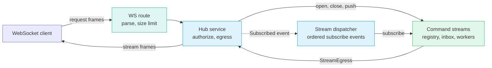
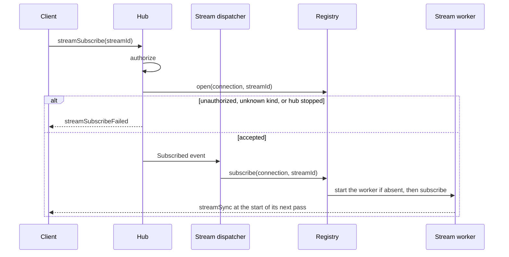
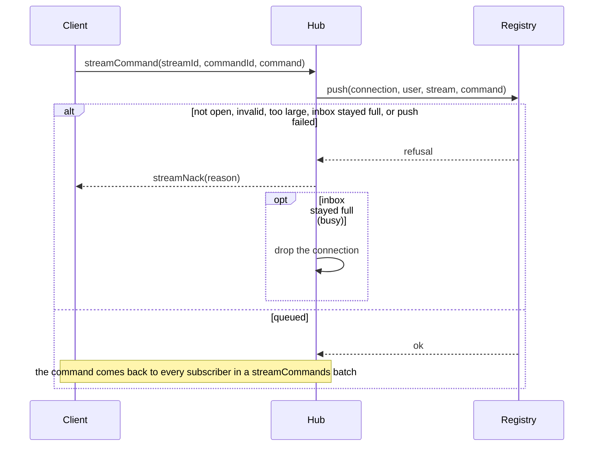

# Hub Streams

*The WebSocket API of command streams: how a client subscribes, submits commands and receives ordered updates through the hub.*

## Problem

Clients share ordered, replayable state such as chat or a pixel map through **streams**. A stream is named by a `StreamId` whose prefix selects the registered replay kind (`chat`, `pixel-map`). The hub is the transport side: it authenticates through the connection, authorizes subscriptions, hands subscriptions and commands to the stream registry, and delivers whatever the stream workers send back. The registry, the inbox, ordering, persistence and snapshots are described in [Command Streams](command-stream.md).

## Architecture

After the upgrade and the connection's registration with the hub ([Hub Connection Lifecycle](hub-connection-lifecycle.md)), the server's first frame is `{"type":"connected","userId":"<uuid>"}`. The client waits for it before subscribing. That user id is the identity of every command sent over the connection; neither it nor the connection id ever comes from a frame.

## Subscribe

`streamSubscribe` carries only `streamId`. The hub authorizes the user, then **opens** the stream for the connection: the registry checks that the kind is registered, and from then on the connection may push. The subscription itself travels as an event through the hub loop, which keeps it ordered with the connection's lifecycle: a subscribe for a connection that is gone, or a stream closed since, is ignored. Unsubscribe and disconnect reach the registry directly.

## Submit

The hub passes a command to the registry's write path ([Stream registry](command-stream.md#stream-registry)), which validates it and queues it in the stream's inbox. There is no success acknowledgement: the sender sees its own `commandId` in a `streamCommands` batch once the worker has versioned it.

## Client protocol

Frames are JSON text with a camel-case `type`; the `StreamId` carries the kind prefix.

| Direction | Message | Fields and behavior |
|---|---|---|
| to server | `streamSubscribe` | `streamId`; authorizes and synchronizes the stream. |
| to server | `streamUnsubscribe` | `streamId`; removes this connection's subscription. |
| to server | `streamCommand` | `streamId`, `commandId`, `command` (base64, see [Command encoding](#command-encoding)); needs an open stream. |
| to client | `connected` | `userId`; first frame of a connection. |
| to client | `streamSync` | `streamId`, optional snapshot, the commands after it; replaces the client's state. |
| to client | `streamCommands` | `streamId`, contiguous optimistic or canonical commands. |
| to client | `streamCheckpoint` | `streamId`, `version`, `stateHash`; sent after the commands it covers, to compare with the client's own state hash at that version. |
| to client | `streamUnsynced` | `streamId`; the worker cannot serve the stream now, subscribe again. |
| to client | `streamNack` | `streamId`, `commandId`, reason `notSubscribed`, `invalid`, `failed` or `busy` (then the connection is dropped). |
| to client | `streamSubscribeFailed` | `streamId`, reason `unauthorized` or `failed`. |
| to client | `streamReset` | Defined but never sent: a sync alone replaces the state. |

Frames that do not parse, are not text, or carry an invalid stream id are ignored without an answer. A valid request that breaks a rule gets the matching refusal frame.

### Command encoding

A command is its **postcard** encoding: the same bytes on the client, in the Redis inbox and in Postgres. JSON frames carry them as base64. The server accepts only the canonical encoding of a well-formed command of the stream's kind and refuses anything else as `invalid`, so the bytes a client sends are the bytes that are stored and hashed.

Clients build and read commands and snapshots with the generated TypeScript bindings in `client/game-bindings` (`pnpm gen:game-bindings` writes them).

## Key rules

| Concern | Rule |
|---|---|
| Identity | The user id and connection id come from the authenticated connection, never from a frame. |
| Authorization | `StreamAuthorizeService` decides a subscribe; it currently allows every stream. |
| Busy connection | A push into an inbox that stays full is nacked `busy` and the connection is dropped (close code 4000, reason `busy`). |
| Socket limit | A socket message over twice `MAX_COMMAND_BYTES` ends the socket; the command limits are the registry's. |
| Slow connection | Egress never waits: a connection whose queue is full is dropped, and the worker forgets it as a subscriber. |
| Shutdown | On the hub's shutdown the dispatcher has the registry persist what is waiting, for up to `stream_shutdown_timeout`. |

## File map

| File | Role |
|---|---|
| `services/builder/src/routes/ws/connect.rs` | Upgrade, `connected` frame, request dispatch to the hub, egress to the socket, close codes. |
| `services/builder/src/routes/ws/message.rs` | Wire request and response shapes, conversion from `StreamMessage`. |
| `services/builder/src/services/hub/hub_service.rs` | Authorized subscribe, unsubscribe, command submission, busy-connection drop, `StreamEgress` implementation. |
| `services/builder/src/services/hub/tasks/stream_dispatcher.rs` | Applies ordered subscribe events to the registry, purges ended workers, shuts the registry down. |
| `services/builder/src/services/stream_authorize/stream_authorize_service.rs` | Decides whether a user may use a stream. |
| `services/builder/src/models/messages/stream.rs` | Internal stream messages, events and failures. |
| `services/builder/src/app_config.rs`, `services/builder/src/app_state.rs` | Stream configuration and application wiring. |
| `client/web/src/engine/net/stream-hub.ts` | Scene-facing transport contract: subscriptions and listener callbacks. |
| `client/web/src/engine/net/websocket-stream-hub.ts` | Development implementation: one reconnecting socket that waits for `connected`, resubscribes its streams and routes frames by `streamId`. |
| `client/game-bindings/` | Generated postcard serializers and helpers to build and parse commands and snapshots. |

Command types are a permanent wire and log format

Postcard is not self-describing and the log is replayed forever.

- Enum variants are identified by their index. Add new variants at the end; never remove, reorder or insert one.
- Do not change the fields of a variant. A different shape is a new variant (`AddV2`); the old one stays decodable and applicable.
- To retire a variant, make `is_well_formed` refuse it so no new one is accepted, and keep its `apply` for commands already in the log.
- `StableHash` tags follow the variant index and never change.
- Serde attributes that need a self-describing format (`tag`, `untagged`, `flatten`, `skip_serializing_if`) are not usable on commands.
- The TypeScript bindings come from twin types in `crates/shine-game/tools`; change a command type there too and regenerate. CI fails on a stale `client/game-bindings`.

Where the hub side is covered

`services/builder/src/services/hub/tests/streams.rs` covers subscribe events (ordered with the connection's lifecycle, ignored for a connection that is gone) and delivery to a connection by id. `tests/api-tests/builder/streams.ts` covers the wire protocol against the real service, and `stream_failures.ts` the Postgres and Redis outages (`infraOutage`).

