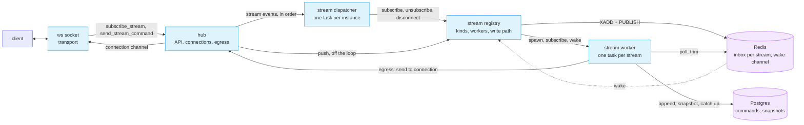
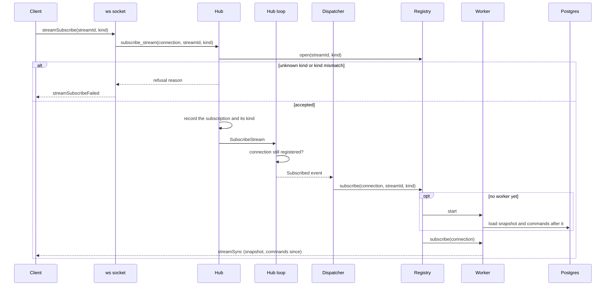
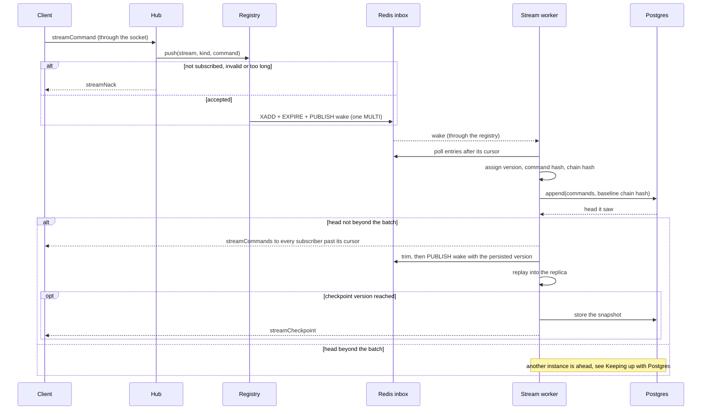
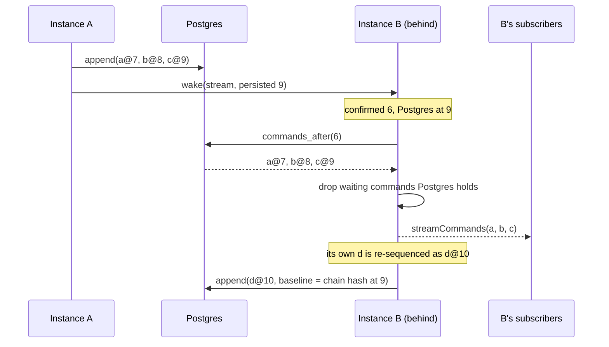
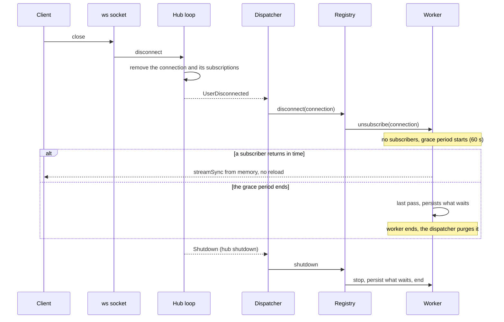
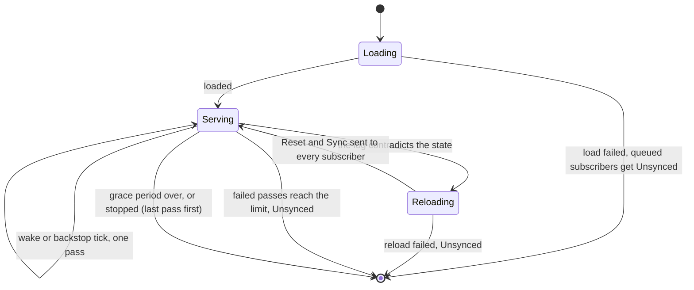
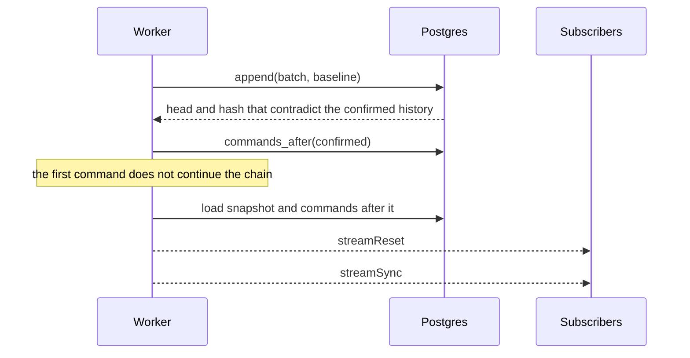

# Hub v2: Command Streams

*How clients write ordered commands through a Redis inbox, how builder instances sequence them into Postgres, and how subscribers receive a snapshot followed by the commands after it.*

## Problem

Collaborative, server-authoritative state (a shared canvas, chat as a replayable log) needs one total order of commands, durable history, and cheap catch-up for late joiners. Any number of builder instances run side by side and a client may be on any of them, so no instance owns a stream. The write path stays cheap (one Redis write), Redis may lose data without losing stored history, and clients can detect and heal drift on their own.

A **stream** is an ordered log of **commands** of one **kind** (`chat`, `pixel-map`). A **snapshot** is the replayed state at a checkpoint version. A **chain hash** runs over the log and proves two parties hold the same history.

## Architecture

Redis is only the **inbox**: unordered, short-lived, loss-tolerant. Postgres is the **truth**: ordered commands with their chain hash, and snapshots. Every stream with a local subscriber has a **worker** task on that instance, which owns the stream's state in memory. Workers share no loop, so a slow or failing stream never delays another. The **hub is the API** for every transport (the WebSocket is one): transports call the hub, and only the hub knows the registry.

Clients subscribe explicitly. A connection lives on one instance and its liveness is the socket's, already tracked by the hub; a stream tracks no clients and holds no connection open: the inbox wakes arrive on one shared pub/sub subscription per instance.

### Subscribe

The hub checks the stream, records the subscription, and publishes it as an event on the same ordered channel as the connection's lifecycle, so a subscribe is always seen before the disconnect that follows it. A subscribe answers from memory: the latest snapshot plus the commands after it, as one `streamSync`.

### Write, persist, deliver

The worker of every instance with the stream resident runs this independently; the repository makes the duplicate work harmless (the first append stores, the rest verify).

The writer gets no acknowledgement: it sees its own `commandId` come back in a `streamCommands` batch with the version it was given. Versions are assigned by the worker; the chain hash covers only the command envelope, so persisting never waits for replay.

### Keeping up with Postgres

A worker can be behind: another instance persisted and trimmed entries it has not seen. Its subscribers still receive those commands, and its own batch is re-sequenced after them.

The worker catches up when `append` returns a head beyond what it confirmed, when a wake carries a higher persisted version, or when the backstop tick reads the head. A mismatch past the confirmed prefix is lag (adopt, re-sequence). A mismatch inside it is drift (reload, `streamReset`).

### Leaving, unloading, shutdown

## Key rules

| Concern | Rule |
|---|---|
| Order | Defined by Postgres: a version exists once appended. The inbox order only proposes; the repository arbitrates between instances. |
| Truth | Postgres wins every conflict. Memory is a cache of it plus a tail that is not confirmed yet. |
| Notify | Clients hear of a version only after it is confirmed against Postgres. |
| Write path | One Redis `MULTI` per command, off the hub loop. A refusal is a `streamNack`; there is no success ack. |
| Duplicates | Each stored command records its inbox position; an entry at or before the latest stored position is never taken again. Command ids are the client's and never checked. |
| Rejected commands | A well-formed command the state ignores still takes a version; replay is deterministic, so every party ignores the same ones. |
| Drift | Client: its state hash differs from `streamCheckpoint`, it resubscribes. Server: a contradiction with the log reloads the stream and sends `streamReset`. |
| Isolation | One task per stream and no shared loop; the number of streams an instance serves does not depend on the number of clients. |
| Hub loop | Only subscription bookkeeping; it never waits on Redis or Postgres for streams. |
| Trust | The hub trusts its caller: a transport has authenticated the user and holds the connection id the hub gave it, and takes neither from the client. |
| Back-pressure | The inbox TTL and the 16 KiB command limit bound the inbox; there is no length check and no rate limit. |
| Redis loss | Unsequenced inbox entries are lost. Clients resubmit their pending commands after a resync. |

### Client protocol

JSON text frames, `type` tagged in camelCase, hashes as hex, snapshot data as base64. Frames with an invalid stream id or missing fields are ignored.

| Direction | Message | Fields |
|---|---|---|
| to server | `streamSubscribe` | `streamId`, `kind` (counts only when the stream is new) |
| to server | `streamUnsubscribe` | `streamId` |
| to server | `streamCommand` | `streamId`, `commandId`, `command` (the kind's JSON) |
| to client | `streamSync` | `streamId`, `snapshot` (version, chain hash, state hash, data) or null, `commands[]`; replaces the client's state |
| to client | `streamCommands` | `streamId`, `commands[]` of `version`, `commandId`, `userId`, `command`; contiguous versions |
| to client | `streamCheckpoint` | `streamId`, `version`, `stateHash` |
| to client | `streamReset` | `streamId`; a fresh `streamSync` follows |
| to client | `streamUnsynced` | `streamId`; the stream cannot be served, the subscriber is dropped and has to subscribe again |
| to client | `streamNack` | `streamId`, `commandId`, `reason` (`notSubscribed`, `invalid`, `failed`) |
| to client | `streamSubscribeFailed` | `streamId`, `reason` (`unknownKind`, `kindMismatch`, `failed`) |

A `streamSync` the client did not ask for is a resync. After any sync the client resubmits the pending commands whose `commandId` it does not find in it.

## File map

| File | Role |
|---|---|
| `crates/shine-game/src/replica/` | Replay core shared with the client: `ReplayState`, `Replica`, chain hash, snapshot codec; the kinds `chat` and `pixel-map`. |
| `services/builder/src/repositories/command_log/` | Postgres log: `append`, `commands_after`, snapshots, `prune`, `check_consistency`. |
| `services/builder/src/repositories/command_inbox/` | Redis inbox: push, poll, trim, wake publish and listen. |
| `services/builder/src/services/command_stream/command_stream_service.rs` | Stateless `load`, `sync` and `replay` over the log and the inbox. |
| `services/builder/src/services/command_stream/stream_state.rs` | The per-stream state the service works on. |
| `services/builder/src/services/command_stream/stream_worker.rs` | The per-stream task: loop, fan-out, grace period, reload, give up. |
| `services/builder/src/services/command_stream/stream_registry.rs` | Kinds table, workers by stream, wake routing, the write path (`push`). |
| `services/builder/src/services/command_stream/stream_kinds.rs` | The kinds this service serves, each with its own service. |
| `services/builder/src/services/command_stream/stream_egress.rs` | The interface a worker sends through; the hub implements it. |
| `services/builder/src/services/hub/hub_service.rs` | The hub API: `subscribe_stream`, `unsubscribe_stream`, `send_stream_command`. |
| `services/builder/src/services/hub/hub_command.rs` | The `SubscribeStream` and `UnsubscribeStream` control commands of the hub loop. |
| `services/builder/src/services/hub/hub_streams.rs` | What each connection is subscribed to, and as which kind. |
| `services/builder/src/services/hub/tasks/stream_dispatcher.rs` | Turns the hub's ordered events into registry calls. |
| `services/builder/src/models/messages/stream.rs` | Stream messages and events; independent of the hub and of any wire format. |
| `services/builder/src/routes/ws/connect.rs`, `message.rs` | The socket: reads the stream frames, calls the hub, makes the JSON frames. |
| `services/builder/src/app_state.rs` | Builds the inbox, the kinds and the hub with its streams. |
| `tests/api-tests/builder/streams.ts` | API tests of the protocol over a real socket. |

The worker: states, passes and failures

A pass is `sync` (poll the inbox, version, append, adopt what other instances stored, trim, announce), delivery of the confirmed commands, then `replay`. A backlog larger than one poll makes the worker wake itself for another pass. Wakes collapse into one pass and wake-driven passes are at least 50 ms apart. A pass that fails counts; after 5 in a row the stream is given up (`Unsynced`). A reload or an unload never happens while a pass runs: they are steps of the same loop.

Reload on drift

The same happens when a snapshot stored by another instance for a checkpoint version has another state hash, and when the commands the worker needs were pruned.

Why Ok from append is not enough, and what "confirmed" means

`append` verifies overlap only when the Postgres head falls inside the batch or right before it (`pg/append.rs`, `my_hash_at_head`). If the head is beyond the batch's last version there is nothing to compare and nothing to store. A lagging instance holding `d@7` while Postgres has `a@7..c@9` must not be told its batch is stored. `append` therefore returns the head, and the service treats a batch as stored only when that head is the batch's last command; a hash mismatch is `Diverged { head }`.

The baseline of each append is the **confirmed prefix**: it advances only after a verified append or a catch-up read, never after an `Ok` with a head beyond the batch. A baseline mismatch is then real drift, and a mismatch past the baseline is lag, with no extra classification in the repository. The chain hash includes the version, so the same command at two versions never agrees.

Inbox positions, trimming and an unloaded stream

The service trims the inbox up to the latest inbox position known to be in the log; no waiting command is at or before it. Trimming is monotonic, so concurrent trims by several instances are harmless. A trim that is late or fails leaves entries that are already stored; they are at or before the stored position and skipped, and a stream loaded later starts reading after it. Positions are Redis stream ids, which only grow within a live inbox; if an inbox is recreated while the clock has gone backwards, new entries can look stored and are lost, which is accepted. With no instance holding the stream, unsequenced entries wait in the inbox until its TTL, and the next load reads them.

Checkpoints, snapshots and pruning

A checkpoint is every version that is a multiple of `snapshot_every`, captured at exactly that version even when more commands follow. A replay stores only the latest checkpoint it passed; the stored snapshot is authoritative and carries `chain_hash` and `state_hash`. A failed store is logged and the next checkpoint stores one. An instance whose state differs from the stored snapshot of that version reloads from it. The log keeps the latest `keep_snapshots` snapshots and the commands from the oldest of them; an instance that needs older commands reloads.

Failure behavior

| Situation | Behavior |
|---|---|
| Redis down | Commands are refused with `streamNack` `failed`; workers' passes fail and count; after 5 in a row the stream is given up and its subscribers get `streamUnsynced` |
| Redis loses its data | Unsequenced inbox entries are lost; stored history is intact; clients resubmit |
| Postgres down | Nothing is delivered unconfirmed; passes fail and count as above. A stream that was given up needs a new subscribe once Postgres is back |
| A wake is lost | The backstop tick delivers within its interval; a pub/sub reconnect wakes every worker |
| An instance crashes | The others carry on from the log; entries it had not persisted stay in the inbox |
| A subscriber is too slow or gone | The hub drops the connection; the worker forgets the subscriber on its first failed send |
| A worker panics | The process aborts (`panic = "abort"` in the release profile): a panic is a bug |

Configuration

These are constants in code, not yet part of the application config.

| Setting | Value |
|---|---|
| Worker backstop tick, minimum wake spacing, unload grace, failed passes before giving up | 10 s, 50 ms, 60 s, 5 |
| Inbox entries read per pass, waiting commands, log page, append attempts per pass | 128, 512, 256, 4 |
| `snapshot_every`, `keep_snapshots` | 100, 3 |
| Inbox TTL, command size limit | 1 h, 16 KiB |
| Dispatcher purge of ended workers, workers' time to persist on shutdown | 60 s, 10 s |
| Per-connection egress queue (slow consumer limit) | 1000 messages |

Coverage map

| # | Case | Kind |
|---|---|---|
| 1 | Append: stored, covered, partly covered, ahead (head returned), diverged; concurrent writers; snapshots; prune; consistency | Rust, Postgres |
| 2 | Inbox: order, paging, unreadable entries, trim, expiry, wakes | Rust, Redis |
| 3 | Two services on one stream agree; lag with the head inside or beyond the batch; stored but untrimmed entries are not taken again; contradiction reloads | Rust, Postgres + Redis |
| 4 | Replay, checkpoints, snapshot stored once, a disagreeing snapshot reloads, pruning | Rust, Postgres + Redis |
| 5 | Worker: sync, ordered delivery, late join, backlog larger than a poll, dead subscriber, grace period, final persist, reload, giving up | Rust, Postgres + Redis |
| 6 | Registry: kinds, running worker decides the kind, wakes, release on disconnect, purge, shutdown, write path refusals | Rust, Postgres + Redis |
| 7 | Hub: subscribe is ordered with the lifecycle and never reaches the sockets; API refusals; two kinds end to end | Rust, Postgres + Redis |
| 8 | Protocol over a real socket: sync, ordered delivery to several users, two kinds, refusals, unsubscribe, checkpoint and snapshot | API |

