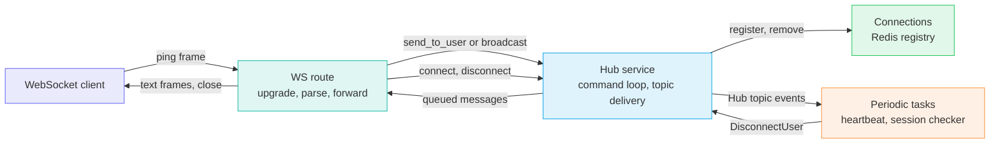
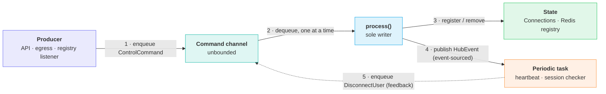
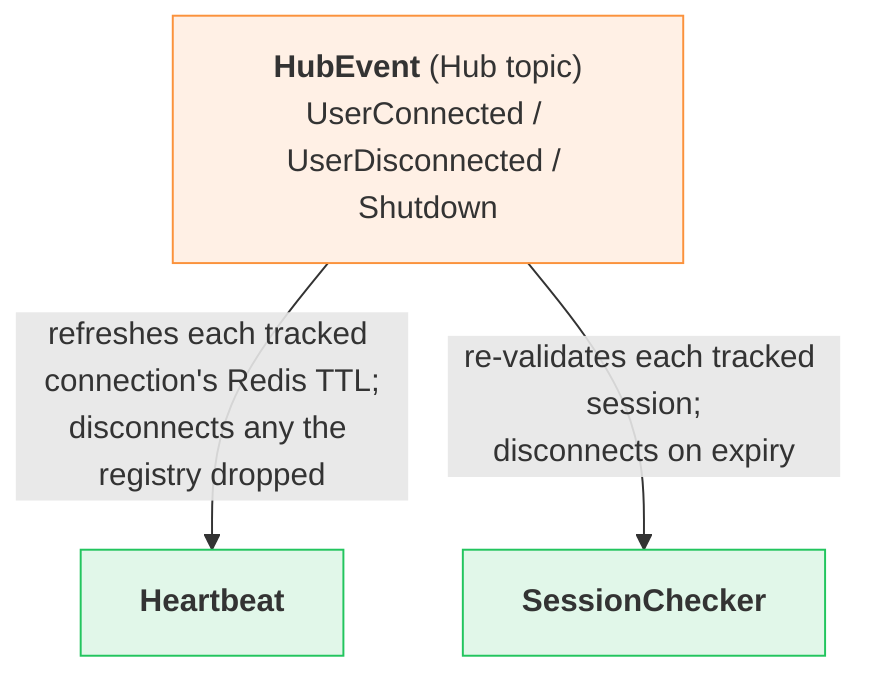
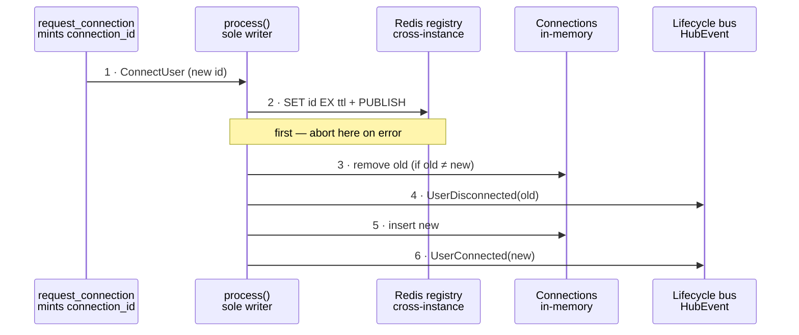

# Hub

*The builder's WebSocket hub: one live connection per user, kept in sync with the session and a cross-instance registry, and a topic-based message bus that delivers serialized messages to those connections.*

## Problem

The hub tracks who is connected and distributes messages to them. A user has at most one live connection — a fresh connect supersedes the previous one — and a connection never outlives its session or its registry entry. These properties come from one *serial command loop* that is the sole writer of connection state, a connection identity (`connection_id`) that tells a stale request from a fresh reconnect, and a Redis registry that extends the last-wins rule across service instances.

On top of that, the hub distributes messages by **topic**. Delivery is serialized through the loop and deliberately simple, not a high-throughput path. There are two topics: `Hub` carries the connection lifecycle events, `Ping` carries a ping message that exercises delivery. Anything else a client does over the socket is outside the hub; [Command Streams](command-stream.md) is a separate system.

## Architecture

A WebSocket client reaches the hub through the WS route, which registers the connection and forwards what the hub sends back. After the upgrade and the registration, the server's first frame is `{"type":"connected","userId":"<uuid>"}`. The user id and the connection id come from the authenticated connection, never from a frame.

### Topics

A message on the bus has exactly one topic. A connection declares its topics when it connects (the WS route uses `Hub` and `Ping`) and receives only messages of those topics. Internal tasks subscribe to topics in the same way.

| Topic | Message | Carries |
|---|---|---|
| `Hub` | `HubEvent` | Connection lifecycle: `UserConnected`, `UserDisconnected`, `Shutdown`. |
| `Ping` | `PingEvent` | A client-chosen `id`, delivered to one user or to every connection subscribed to the topic. |

| Delivery | Recipients |
|---|---|
| `send_to_connection` | One connection by id. |
| `send_to_user` | The user's active connection. |
| `broadcast` | Every connection whose topics include the message's topic. |
| `subscribe` | An internal task, on its own channel. |

### Ping

A client sends `{"type":"ping","id":"…","userId":"<uuid>?"}`. With a `userId` the ping goes to that user's active connection, without one it goes to every connection subscribed to `Ping`, the sender included. Recipients get `{"type":"ping","id":"…"}`. `id` is at most 255 characters; an invalid ping is ignored. With `ping_enabled` off the request is counted as `disabled` and nothing is delivered.

### Wire protocol

| Direction | Frame | Fields and behavior |
|---|---|---|
| to server | `ping` | `id`, optional `userId`. |
| to client | `connected` | `userId`; first frame of a connection. |
| to client | `ping` | `id`. |
| to client | close | Sent when the hub drops the connection: code 4000 with the `DisconnectReason` name as reason, or 1001 (going away) on shutdown. A client-initiated disconnect sends none. |

Frames that are not text, do not parse, or fail validation are ignored without an answer and do not end the connection.

## Connection lifecycle

The hub is a closed loop with a single writer. Producers never touch state — they enqueue a `ControlCommand` on an unbounded channel that the loop drains one command at a time. For each command the loop mutates the in-memory `Connections` and the Redis registry, then publishes a lifecycle `HubEvent`. The periodic tasks event-source their own view from those events and, when they find a connection that should die, enqueue a `DisconnectUser` straight back onto the channel — so every mutation, including the ones the tasks trigger, is applied by the same serial writer.

| Command | Enqueued by | Loop action |
|---|---|---|
| `ConnectUser` | Connection API (`request_connection`) | Register the new connection, superseding any prior one for the user. |
| `DisconnectUser` | Connection API, heartbeat, session checker | Remove the connection if its id still matches (CAS). |
| `DropConnection` | Egress senders that hit a dead channel | Force-remove the connection by id. |
| `HubRegistryChanged` | Redis registry-change listener | Recheck the user's active connection against the registry. |
| `Shutdown` | Connection API (`request_shutdown`) | Publish `Shutdown` and stop the loop. |

### Lifecycle events

The loop is the sole emitter of `HubEvent` (defined in `models/messages/hub.rs`). These events carry the connection identity that lets a consumer distinguish a supersede from a same-connection renewal.

| Event | Payload | Emitted when |
|---|---|---|
| `UserConnected` | `user_id`, `connection_id`, `session_key` | A new connection is registered (after any prior one is superseded). |
| `UserDisconnected` | `user_id`, `connection_id`, `reason` | A connection is removed — superseded, disconnected, dropped-dead, or found inactive in the registry. |
| `Shutdown` | — | The hub is shutting down; ends every consumer loop. |

`reason` is a `DisconnectReason`. `Client` is a disconnect the client asked for; every other reason is a *drop* — counted in `hub_connections_dropped` and told to the socket as its close reason.

Every `HubEvent` is carried on the `Hub` topic. The bus has two classes of recipient, and the split is the reason lifecycle signals are never lost to the tasks:

| Recipient class | Channel | On lag | Why |
|---|---|---|---|
| `Connections` (addressable clients) | bounded `mpsc`, handed in at connect time | reported dead → pruned | A slow client must not stall the hub; dropping it is correct. |
| `Subscribers` (internal tasks) | unbounded `mpsc`, lossless | never dropped | A dropped `UserConnected`/`UserDisconnected` would corrupt a task's connection tracker forever. |

### Event fan-out to tasks

Each periodic task subscribes to the `Hub` topic and event-sources its *own* `ConnectionTracker` from the events — there is no shared connection map between tasks and no lock. The tracker applies each event to a private `user_id → (connection_id, session_key)` map.

All subscriptions are registered synchronously before the command loop starts dispatching, so no task can miss an event emitted during startup — see `hub_service.rs · HubServiceBuilder::build`. The tracker's tick is prioritized over the event stream (`biased` select in `run_connection_loop`) so a heavy event burst cannot starve TTL refreshes and let a live connection expire.

### Last connection wins

`request_connection` mints a fresh `connection_id` and enqueues `ConnectUser`; the loop then runs this ordered sequence. The registry write comes *first* so a transient Redis failure leaves the existing connection intact rather than orphaning a new socket.

A same-`connection_id` re-registration is a renewal, not a supersede: the old-vs-new check skips the teardown. Because each connect mints a new id, the same session reconnecting simply flows through the last-wins path against its own prior connection.

### Keeping connection info current

Three independent mechanisms detect a connection that should no longer be live and converge on the same CAS'd `DisconnectUser` path. Because the target carries a `connection_id`, a removal aimed at a connection that has since been replaced is a no-op — a stale check can never tear down a fresh reconnect.

| Mechanism | Trigger | Action |
|---|---|---|
| `Heartbeat` | Every `heartbeat` interval. | Batched `heartbeat_connections`: MGET all tracked entries, pipeline an `EXPIRE` for those still holding this id, and return the rest as stale → `request_disconnection` each. |
| `SessionChecker` | Every `session_check` interval. | Re-validates each tracked `(user_id, session_key)`. On `SessionExpired`/`SessionCompromised` → `request_disconnection`; transient errors skip the tick. |
| `HubRegistryChanged` | Redis pub/sub from another instance. | Loop rechecks the user's active connection with a CAS'd `heartbeat_connection`; if the registry no longer holds this id, removes it locally and emits `UserDisconnected`. |

### Cross-instance registry

The Redis registry (`repositories/hub_registry`) extends last-wins beyond a single process. The key `hub-connection:{user_id}` holds the user's current `connection_id` with a TTL; the local heartbeat is what keeps that TTL alive, so a crashed instance's entries expire on their own. Mutations publish to `hub-registry-changed` as `{instance_id}:{user_id}`, and the listener drops self-originated notifications (its local view is already current).

| Operation | Redis | Semantics |
|---|---|---|
| `create_connection` | `SET key id EX ttl` + `PUBLISH` | Overwrites the active id for the user (last write wins) and notifies other instances. |
| `heartbeat_connection` | WATCH/GET/`EXPIRE` txn | CAS: extends TTL only when the stored id matches. Returns `false` if not active. |
| `heartbeat_connections` | `MGET` + pipelined `EXPIRE` | Batched, no per-key CAS; compares in memory and returns the entries no longer holding this id. |
| `remove_connection_if_active` | WATCH/GET/`DEL` txn + `PUBLISH` | CAS: deletes only when both user and id match, then notifies. |

## Metrics

The hub works asynchronously — control commands queue for the loop, messages are pushed to clients, consumers tick on their own schedule — so request-style metrics do not apply. Metrics are split by scope, each a process-wide set of OpenTelemetry instruments with its own meter and prefix; without a configured meter provider they are no-ops. Labels take a small fixed set of values; user and connection ids appear only in traces.

| Scope | Meter | Prefix | Covers |
|---|---|---|---|
| Hub | `shine-builder-hub` (`hub_metrics()`) | `hub_` | Connections, control commands, pushes to clients, background ticks. |
| WebSocket | `shine-builder-ws` (`ws_metrics()`) | `ws_` | What the clients send. |

A *control command* is the hub's own input (connect, disconnect, registry change…).

| Metric | Measures |
|---|---|
| `hub_connections` | Live connections. |
| `hub_connections_dropped` | Connections the hub removed, by reason. |
| `hub_control_commands` | Control commands processed, by command. |
| `hub_control_command_duration` | Processing time of a control command in the loop. |
| `hub_control_command_queue_delay` | Time a control command waited before the loop picked it up. |
| `hub_messages_sent` | Messages pushed to connections, by kind and outcome. |
| `hub_tick_duration` | Tick time of the background consumers, by consumer. |
| `ws_messages_received` | Messages received from clients, by kind and outcome. |

## Key rules

| Concern | Rule |
|---|---|
| One connection per user | `process(ConnectUser)` removes any different active connection and emits `UserDisconnected` before registering the new one. |
| Stale removal | Every removal path is CAS'd on `connection_id` — locally (`remove_connection`) and in Redis (`remove_connection_if_active`) — so a stale removal cannot tear down a fresh reconnect. |
| Session bound | `SessionChecker` disconnects on definitive session loss, so a connection never outlives its session. |
| Crashed instance | Registry entries carry a TTL kept alive only by the live instance's heartbeat, so its connections self-clean. |
| Lifecycle delivery | Lossless unbounded subscriber channels, with all subscriptions registered before the loop starts, so internal tasks never miss an event. |
| Topics | A connection receives only the topics it declared at connect time; a message has exactly one topic. |
| Identity | The user id and connection id come from the authenticated connection, never from a frame. |
| Slow connection | Egress never waits: a connection whose queue is full is dropped as `slow_consumer`. |
| Ping | Gated by `ping_enabled`; `id` is at most 255 characters. |

## File map

| File | Role |
|---|---|
| `services/builder/src/routes/ws/connect.rs` | Upgrade, `connected` frame, ping request, egress to the socket, close codes. |
| `services/builder/src/routes/ws/message.rs` | Wire request and response shapes. |
| `services/builder/src/services/hub/hub_service.rs` | Command loop (sole writer); connect/disconnect/drop/registry-change handling; event publish; topic delivery (`send_to_connection`, `send_to_user`, `broadcast`, `subscribe`). |
| `services/builder/src/services/hub/hub_command.rs` | `ControlCommand` enum — the loop's input vocabulary. |
| `services/builder/src/services/hub/hub_connections.rs` | Addressable connection registry; bounded egress; dead-channel detection. |
| `services/builder/src/services/hub/hub_subscribers.rs` | Internal lossless fan-out subscribers. |
| `services/builder/src/services/hub/hub_status.rs` | Health provider reporting live connection/subscriber counts. |
| `services/builder/src/services/hub/hub_metrics.rs` | OpenTelemetry instruments of the hub. |
| `services/builder/src/routes/ws/ws_metrics.rs` | OpenTelemetry instruments of the websocket endpoint. |
| `services/builder/src/services/hub/tasks/connection_tracker.rs` | Event-sourced per-consumer tracker and the periodic loop driver. |
| `services/builder/src/services/hub/tasks/heartbeat.rs` | Batched registry TTL refresh; disconnects registry-dropped connections. |
| `services/builder/src/services/hub/tasks/session_checker.rs` | Per-tick session validation; disconnect on expiry. |
| `services/builder/src/models/messages/hub.rs` | `HubEvent`, `DisconnectReason`, `HubMessage`, `TopicKey`, `ToTopic`. |
| `services/builder/src/models/messages/ping.rs` | `PingEvent`. |
| `services/builder/src/repositories/hub_registry/hub_registry.rs` | `HubRegistry` trait — cross-instance connection contract. |
| `services/builder/src/repositories/hub_registry/redis/redis_hub_registry.rs` | Redis implementation: SET/EXPIRE/DEL, CAS transactions, pub/sub. |
| `services/builder/src/repositories/hub_registry/redis/redis_hub_connection_db.rs` | Pooled context factory; registry-change listener with self-origin filtering. |
| `services/builder/src/app_config.rs`, `services/builder/src/app_state.rs` | Hub configuration (`heartbeat`, `session_check`, `ping_enabled`) and application wiring. |

Why the registry write precedes local teardown in ConnectUser

In `process(ConnectUser)` the order is: (1) `create_registry_connection`, (2) supersede the old local connection, (3) register the new one. If the registry write fails the loop returns early *before* touching local state, so the previously active connection stays intact and tracked. Reversing the order would let a transient Redis error leave the user with no connection and an orphaned, untracked new socket. The registry removal on the disconnect paths is best-effort by contrast — a failure there is logged and left to TTL cleanup, because the local removal and `UserDisconnected` must still happen so sockets and trackers never wedge.

Pub/sub is lossy by design; the heartbeat is the reconciler

The `hub-registry-changed` listener treats a `None` payload (Redis reconnect) as "messages during the outage were lost" and does nothing — it does not attempt a resync. Correctness does not depend on any single notification arriving: the periodic `heartbeat_connections` reconciliation independently detects a connection the registry no longer holds and disconnects it. The pub/sub path is only a latency optimization that shortens the window between a cross-instance supersede and the local teardown; the heartbeat is the backstop.

Where the hub is covered

`services/builder/src/services/hub/tests/` covers the loop: `lifecycle.rs` (last-wins, disconnect, topic delivery, heartbeat, session checks), `contention.rs` (concurrent connects and broadcasts, across instances) and `fault.rs` (registry write failures). Unit tests sit beside `hub_connections.rs`, `hub_subscribers.rs` and `tasks/connection_tracker.rs`, and `routes/ws/connect_test.rs` covers the socket. `tests/api-tests/builder/ws_connect.ts` covers the real service: origin and auth rejection, ping delivery, malformed frames, last-wins and the session-deleted drop.

