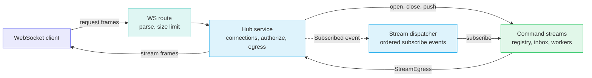
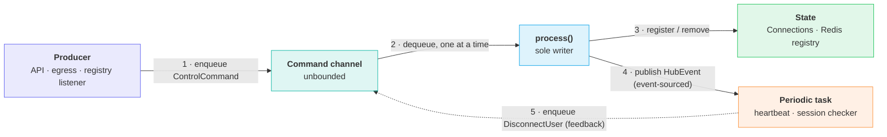
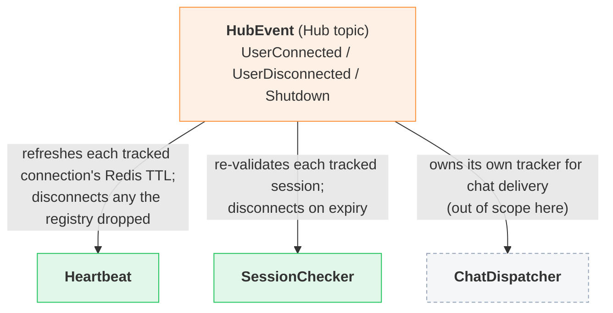
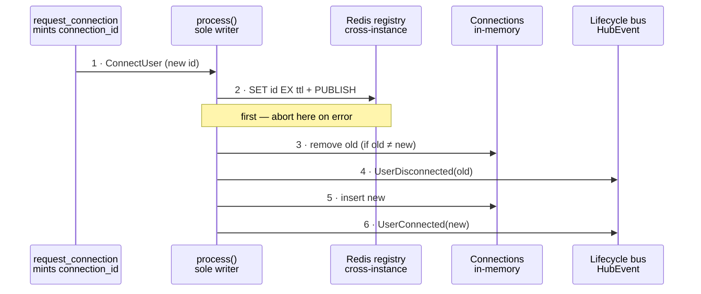
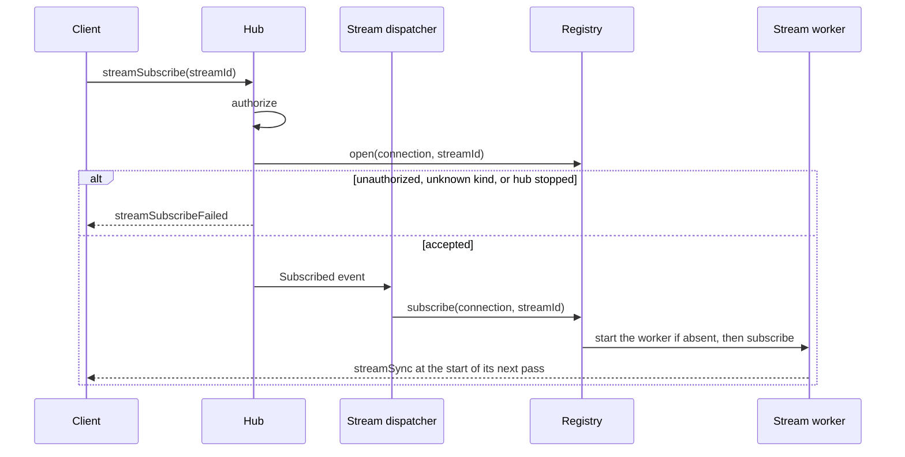
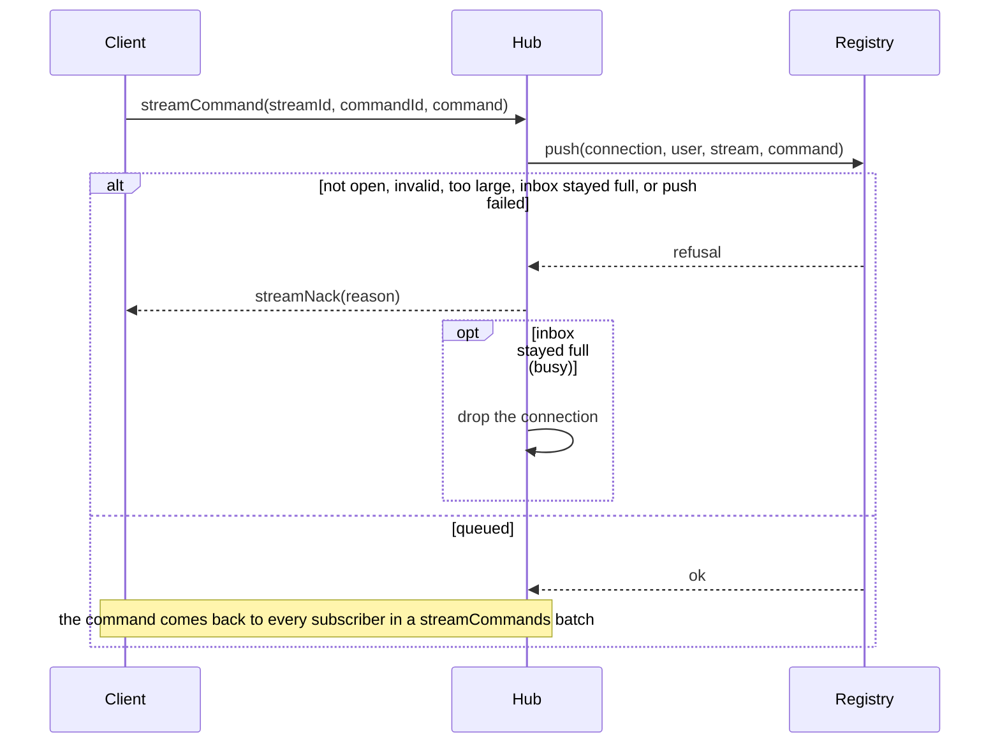

# Hub

*The builder's WebSocket hub: one live connection per user, kept in sync with the session and a cross-instance registry, carrying ordered command streams to and from clients.*

## Problem

The hub tracks who is connected and fans lifecycle signals out to the tasks that keep that view honest. A user ends up with at most one live connection — a fresh connect supersedes the previous one — and a connection never outlives its session or its registry entry. These properties come from one *serial command loop* that is the sole writer of connection state, a connection identity (`connection_id`) that tells a stale request from a fresh reconnect, and a Redis registry that extends the last-wins rule across service instances.

On top of that connection layer, clients share ordered, replayable state such as chat or a pixel map through **streams**. A stream is named by a `StreamId` whose prefix selects the registered replay kind (`chat`, `pixel-map`). The hub authenticates through the connection, authorizes subscriptions, hands subscriptions and commands to the stream registry, and delivers whatever the stream workers send back. The registry, the inbox, ordering, persistence and snapshots are described in [Command Streams](command-stream.md).

## Architecture

The hub has two halves: the connection lifecycle owns *who is connected*, the stream transport owns *what they exchange*. After the upgrade and the connection's registration, the server's first frame is `{"type":"connected","userId":"<uuid>"}`. The client waits for it before subscribing. That user id is the identity of every command sent over the connection; neither it nor the connection id ever comes from a frame.

## Connection lifecycle

The hub is a closed loop with a single writer. Producers never touch state — they enqueue a `ControlCommand` on an unbounded channel that the loop drains one command at a time. For each command the loop mutates the in-memory `Connections` and the Redis registry, then publishes a lifecycle `HubEvent`. The periodic tasks event-source their own view from those events and, when they find a connection that should die, enqueue a `DisconnectUser` straight back onto the channel — so every mutation, including the ones the tasks trigger, is applied by the same serial writer.

| Command | Enqueued by | Loop action |
|---|---|---|
| `ConnectUser` | Connection API (`request_connection`) | Register the new connection, superseding any prior one for the user. |
| `DisconnectUser` | Connection API, heartbeat, session checker | Remove the connection if its id still matches (CAS). |
| `DropConnection` | Egress senders that hit a dead channel | Force-remove the connection by id. |
| `HubRegistryChanged` | Redis registry-change listener | Recheck the user's active connection against the registry. |
| `Shutdown` | Connection API (`request_shutdown`) | Publish `Shutdown` and stop the loop. |

### Lifecycle events

The loop is the sole emitter of `HubEvent` (defined in `models/messages/hub.rs`). These events carry the connection identity that lets a consumer distinguish a supersede from a same-connection renewal.

| Event | Payload | Emitted when |
|---|---|---|
| `UserConnected` | `user_id`, `connection_id`, `session_key` | A new connection is registered (after any prior one is superseded). |
| `UserDisconnected` | `user_id`, `connection_id` | A connection is removed — superseded, disconnected, dropped-dead, or found inactive in the registry. |
| `Shutdown` | — | The hub is shutting down; ends every consumer loop. |

Every `HubEvent` is carried on the `Hub` topic. The bus has two classes of recipient, and the split is the reason lifecycle signals are never lost to the tasks:

| Recipient class | Channel | On lag | Why |
|---|---|---|---|
| `Connections` (addressable clients) | bounded `mpsc`, handed in at connect time | reported dead → pruned | A slow client must not stall the hub; dropping it is correct. |
| `Subscribers` (internal tasks) | unbounded `mpsc`, lossless | never dropped | A dropped `UserConnected`/`UserDisconnected` would corrupt a task's connection tracker forever. |

### Event fan-out to tasks

Each periodic task subscribes to the `Hub` topic and event-sources its *own* `ConnectionTracker` from the stream — there is no shared connection map between tasks and no lock. The tracker applies each event to a private `user_id → (connection_id, session_key)` map.

All subscriptions are registered synchronously before the command loop starts dispatching, so no task can miss an event emitted during startup — see `hub_service.rs · HubService::new`. The tracker's tick is prioritized over the event stream (`biased` select in `run_connection_loop`) so a heavy event burst cannot starve TTL refreshes and let a live connection expire.

### Last connection wins

`request_connection` mints a fresh `connection_id` and enqueues `ConnectUser`; the loop then runs this ordered sequence. The registry write comes *first* so a transient Redis failure leaves the existing connection intact rather than orphaning a new socket.

A same-`connection_id` re-registration is a renewal, not a supersede: the old-vs-new check skips the teardown. Because each connect mints a new id, the same session reconnecting simply flows through the last-wins path against its own prior connection.

### Keeping connection info current

Three independent mechanisms detect a connection that should no longer be live and converge on the same CAS'd `DisconnectUser` path. Because the target carries a `connection_id`, a removal aimed at a connection that has since been replaced is a no-op — a stale check can never tear down a fresh reconnect.

| Mechanism | Trigger | Action |
|---|---|---|
| `Heartbeat` | Every `heartbeat` interval. | Batched `heartbeat_connections`: MGET all tracked entries, pipeline an `EXPIRE` for those still holding this id, and return the rest as stale → `request_disconnection` each. |
| `SessionChecker` | Every `session_check` interval. | Re-validates each tracked `(user_id, session_key)`. On `SessionExpired`/`SessionCompromised` → `request_disconnection`; transient errors skip the tick. |
| `HubRegistryChanged` | Redis pub/sub from another instance. | Loop rechecks the user's active connection with a CAS'd `heartbeat_connection`; if the registry no longer holds this id, removes it locally and emits `UserDisconnected`. |

### Cross-instance registry

The Redis registry (`repositories/hub_registry`) extends last-wins beyond a single process. The key `hub-connection:{user_id}` holds the user's current `connection_id` with a TTL; the local heartbeat is what keeps that TTL alive, so a crashed instance's entries expire on their own. Mutations publish to `hub-registry-changed` as `{instance_id}:{user_id}`, and the listener drops self-originated notifications (its local view is already current).

| Operation | Redis | Semantics |
|---|---|---|
| `create_connection` | `SET key id EX ttl` + `PUBLISH` | Overwrites the active id for the user (last write wins) and notifies other instances. |
| `heartbeat_connection` | WATCH/GET/`EXPIRE` txn | CAS: extends TTL only when the stored id matches. Returns `false` if not active. |
| `heartbeat_connections` | `MGET` + pipelined `EXPIRE` | Batched, no per-key CAS; compares in memory and returns the entries no longer holding this id. |
| `remove_connection_if_active` | WATCH/GET/`DEL` txn + `PUBLISH` | CAS: deletes only when both user and id match, then notifies. |

## Streams

### Subscribe

`streamSubscribe` carries only `streamId`. The hub authorizes the user, then **opens** the stream for the connection: the registry checks that the kind is registered, and from then on the connection may push. The subscription itself travels as an event through the hub loop, which keeps it ordered with the connection's lifecycle: a subscribe for a connection that is gone, or a stream closed since, is ignored. Unsubscribe and disconnect reach the registry directly.

### Submit

The hub passes a command to the registry's write path ([Stream registry](command-stream.md#stream-registry)), which validates it and queues it in the stream's inbox. There is no success acknowledgement: the sender sees its own `commandId` in a `streamCommands` batch once the worker has versioned it.

### Client protocol

Frames are JSON text with a camel-case `type`; the `StreamId` carries the kind prefix.

| Direction | Message | Fields and behavior |
|---|---|---|
| to server | `streamSubscribe` | `streamId`; authorizes and synchronizes the stream. |
| to server | `streamUnsubscribe` | `streamId`; removes this connection's subscription. |
| to server | `streamCommand` | `streamId`, `commandId`, `command` (base64, see [Command encoding](#command-encoding)); needs an open stream. |
| to client | `connected` | `userId`; first frame of a connection. |
| to client | `streamSync` | `streamId`, optional snapshot, the commands after it; replaces the client's state. |
| to client | `streamCommands` | `streamId`, contiguous optimistic or canonical commands. |
| to client | `streamCheckpoint` | `streamId`, `version`, `stateHash`; sent after the commands it covers, to compare with the client's own state hash at that version. |
| to client | `streamUnsynced` | `streamId`; the worker cannot serve the stream now, subscribe again. |
| to client | `streamNack` | `streamId`, `commandId`, reason `notSubscribed`, `invalid`, `failed` or `busy` (then the connection is dropped). |
| to client | `streamSubscribeFailed` | `streamId`, reason `unauthorized` or `failed`. |
| to client | `streamReset` | Defined but never sent: a sync alone replaces the state. |

Frames that do not parse, are not text, or carry an invalid stream id are ignored without an answer. A valid request that breaks a rule gets the matching refusal frame.

### Command encoding

A command is its **postcard** encoding: the same bytes on the client, in the Redis inbox and in Postgres. JSON frames carry them as base64. The server accepts only the canonical encoding of a well-formed command of the stream's kind and refuses anything else as `invalid`, so the bytes a client sends are the bytes that are stored and hashed.

Clients build and read commands and snapshots with the generated TypeScript bindings in `client/game-bindings` (`pnpm gen:game-bindings` writes them).

## Metrics

The hub works asynchronously — control commands queue for the loop, messages are pushed to clients, consumers tick on their own schedule — so request-style metrics do not apply. Metrics are split by scope, each a process-wide set of OpenTelemetry instruments with its own meter and prefix; without a configured meter provider they are no-ops. Labels take a small fixed set of values; user and connection ids appear only in traces.

| Scope | Meter | Prefix | Covers |
|---|---|---|---|
| Hub | `shine-builder-hub` (`hub_metrics()`) | `hub_` | Connections, control commands, pushes to clients, background ticks. |
| WebSocket | `shine-builder-ws` (`ws_metrics()`) | `ws_` | What the clients send. |
| Command streams | `shine-builder-stream` (`stream_metrics()`) | `stream_` | Stream commands, throttling, ingest, persistence and workers — see [command-stream.md](command-stream.md#metrics). |

A *control command* is the hub's own input (connect, disconnect, subscribe…), not a command of a stream.

| Metric | Measures |
|---|---|
| `hub_connections` | Live connections. |
| `hub_connections_dropped` | Connections the hub removed, by reason. |
| `hub_control_commands` | Control commands processed, by command. |
| `hub_control_command_duration` | Processing time of a control command in the loop. |
| `hub_control_command_queue_delay` | Time a control command waited before the loop picked it up. |
| `hub_messages_sent` | Messages pushed to connections, by kind and outcome. |
| `hub_tick_duration` | Tick time of the background consumers, by consumer. |
| `ws_messages_received` | Messages received from clients, by kind and outcome. |

## Key rules

| Concern | Rule |
|---|---|
| One connection per user | `process(ConnectUser)` removes any different active connection and emits `UserDisconnected` before registering the new one. |
| Stale removal | Every removal path is CAS'd on `connection_id` — locally (`remove_connection`) and in Redis (`remove_connection_if_active`) — so a stale removal cannot tear down a fresh reconnect. |
| Session bound | `SessionChecker` disconnects on definitive session loss, so a connection never outlives its session. |
| Crashed instance | Registry entries carry a TTL kept alive only by the live instance's heartbeat, so its connections self-clean. |
| Lifecycle delivery | Lossless unbounded subscriber channels, with all subscriptions registered before the loop starts, so internal tasks never miss an event. |
| Identity | The user id and connection id come from the authenticated connection, never from a frame. |
| Authorization | `StreamAuthorizeService` decides a subscribe; it currently allows every stream. |
| Busy connection | A push into an inbox that stays full is nacked `busy` and the connection is dropped (close code 4000, reason `busy`). |
| Socket limit | A socket message over twice `MAX_COMMAND_BYTES` ends the socket; the command limits are the registry's. |
| Slow connection | Egress never waits: a connection whose queue is full is dropped, and the worker forgets it as a subscriber. |
| Shutdown | On the hub's shutdown the dispatcher has the registry persist what is waiting, for up to `stream_shutdown_timeout`. |

## File map

| File | Role |
|---|---|
| `services/builder/src/routes/ws/connect.rs` | Upgrade, `connected` frame, request dispatch to the hub, egress to the socket, close codes. |
| `services/builder/src/routes/ws/message.rs` | Wire request and response shapes, conversion from `StreamMessage`. |
| `services/builder/src/services/hub/hub_service.rs` | Command loop (sole writer); connect/disconnect/drop/registry-change handling; event publish; authorized subscribe, unsubscribe, command submission, busy-connection drop; `StreamEgress` implementation. |
| `services/builder/src/services/hub/hub_command.rs` | `ControlCommand` enum — the loop's input vocabulary. |
| `services/builder/src/services/hub/hub_connections.rs` | Addressable connection registry; bounded egress; dead-channel detection. |
| `services/builder/src/services/hub/hub_subscribers.rs` | Internal lossless fan-out subscribers. |
| `services/builder/src/services/hub/hub_status.rs` | Health provider reporting live connection/subscriber counts. |
| `services/builder/src/services/hub/hub_metrics.rs` | OpenTelemetry instruments of the hub. |
| `services/builder/src/routes/ws/ws_metrics.rs` | OpenTelemetry instruments of the websocket endpoint. |
| `services/builder/src/services/hub/tasks/connection_tracker.rs` | Event-sourced per-consumer tracker and the periodic loop driver. |
| `services/builder/src/services/hub/tasks/heartbeat.rs` | Batched registry TTL refresh; disconnects registry-dropped connections. |
| `services/builder/src/services/hub/tasks/session_checker.rs` | Per-tick session validation; disconnect on expiry. |
| `services/builder/src/services/hub/tasks/stream_dispatcher.rs` | Applies ordered subscribe events to the registry, purges ended workers, shuts the registry down. |
| `services/builder/src/services/stream_authorize/stream_authorize_service.rs` | Decides whether a user may use a stream. |
| `services/builder/src/models/messages/hub.rs` | `HubEvent`, `HubMessage`, `TopicKey`, `ToTopic`. |
| `services/builder/src/models/messages/stream.rs` | Internal stream messages, events and failures. |
| `services/builder/src/repositories/hub_registry/hub_registry.rs` | `HubRegistry` trait — cross-instance connection contract. |
| `services/builder/src/repositories/hub_registry/redis/redis_hub_registry.rs` | Redis implementation: SET/EXPIRE/DEL, CAS transactions, pub/sub. |
| `services/builder/src/repositories/hub_registry/redis/redis_hub_connection_db.rs` | Pooled context factory; registry-change listener with self-origin filtering. |
| `services/builder/src/app_config.rs`, `services/builder/src/app_state.rs` | Hub and stream configuration and application wiring. |
| `client/web/src/engine/net/stream-hub.ts` | Scene-facing transport contract: subscriptions and listener callbacks. |
| `client/web/src/engine/net/websocket-stream-hub.ts` | Development implementation: one reconnecting socket that waits for `connected`, resubscribes its streams and routes frames by `streamId`. |
| `client/game-bindings/` | Generated postcard serializers and helpers to build and parse commands and snapshots. |

Why the registry write precedes local teardown in ConnectUser

In `process(ConnectUser)` the order is: (1) `create_registry_connection`, (2) supersede the old local connection, (3) register the new one. If the registry write fails the loop returns early *before* touching local state, so the previously active connection stays intact and tracked. Reversing the order would let a transient Redis error leave the user with no connection and an orphaned, untracked new socket. The registry removal on the disconnect paths is best-effort by contrast — a failure there is logged and left to TTL cleanup, because the local removal and `UserDisconnected` must still happen so sockets and trackers never wedge.

Pub/sub is lossy by design; the heartbeat is the reconciler

The `hub-registry-changed` listener treats a `None` payload (Redis reconnect) as "messages during the outage were lost" and does nothing — it does not attempt a resync. Correctness does not depend on any single notification arriving: the periodic `heartbeat_connections` reconciliation independently detects a connection the registry no longer holds and disconnects it. The pub/sub path is only a latency optimization that shortens the window between a cross-instance supersede and the local teardown; the heartbeat is the backstop.

Command types are a permanent wire and log format

Postcard is not self-describing and the log is replayed forever.

- Enum variants are identified by their index. Add new variants at the end; never remove, reorder or insert one.
- Do not change the fields of a variant. A different shape is a new variant (`AddV2`); the old one stays decodable and applicable.
- To retire a variant, make `is_well_formed` refuse it so no new one is accepted, and keep its `apply` for commands already in the log.
- `StableHash` tags follow the variant index and never change.
- Serde attributes that need a self-describing format (`tag`, `untagged`, `flatten`, `skip_serializing_if`) are not usable on commands.
- The TypeScript bindings come from twin types in `crates/shine-game/tools`; change a command type there too and regenerate. CI fails on a stale `client/game-bindings`.

Where the hub side is covered

`services/builder/src/services/hub/tests/streams.rs` covers subscribe events (ordered with the connection's lifecycle, ignored for a connection that is gone) and delivery to a connection by id. `tests/api-tests/builder/streams.ts` covers the wire protocol against the real service, and `stream_failures.ts` the Postgres and Redis outages (`infraOutage`).

