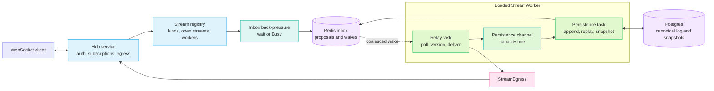
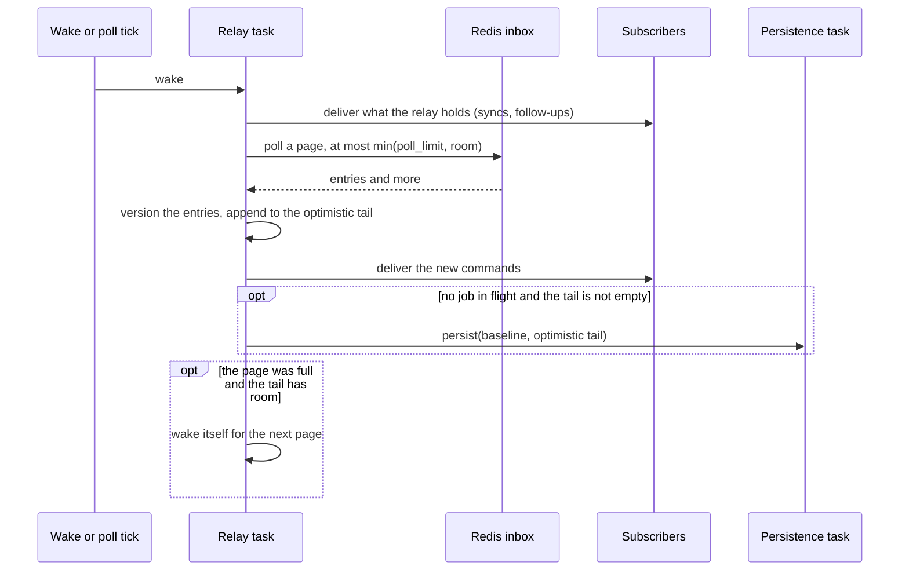
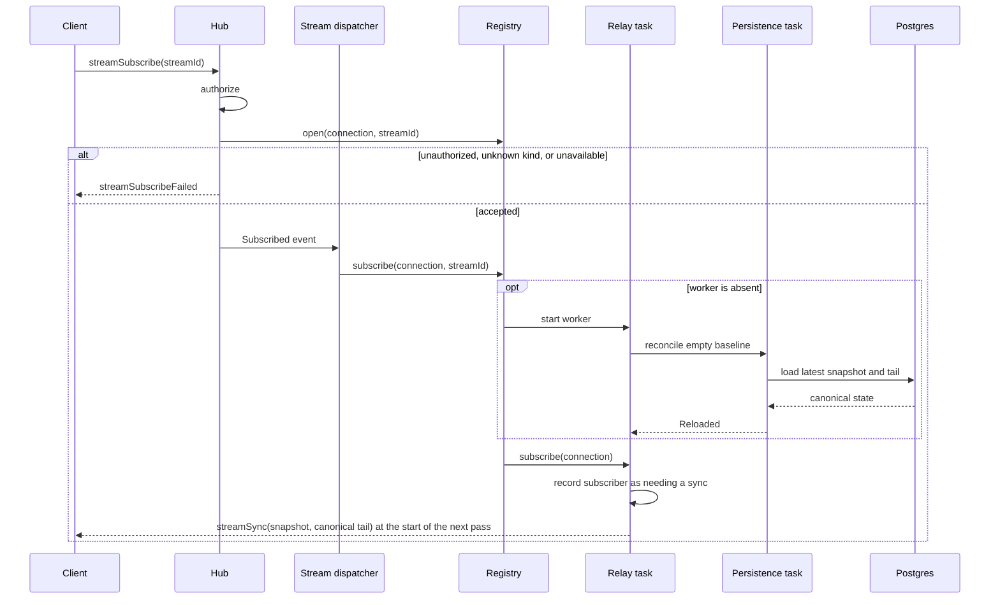
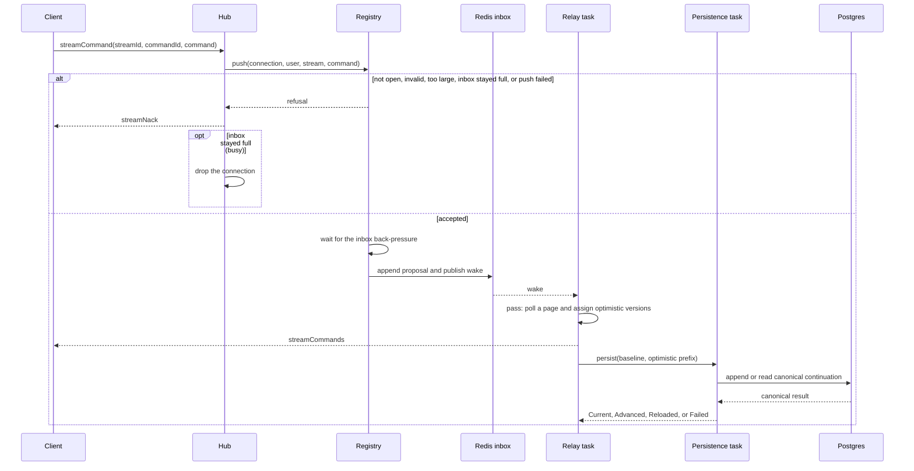
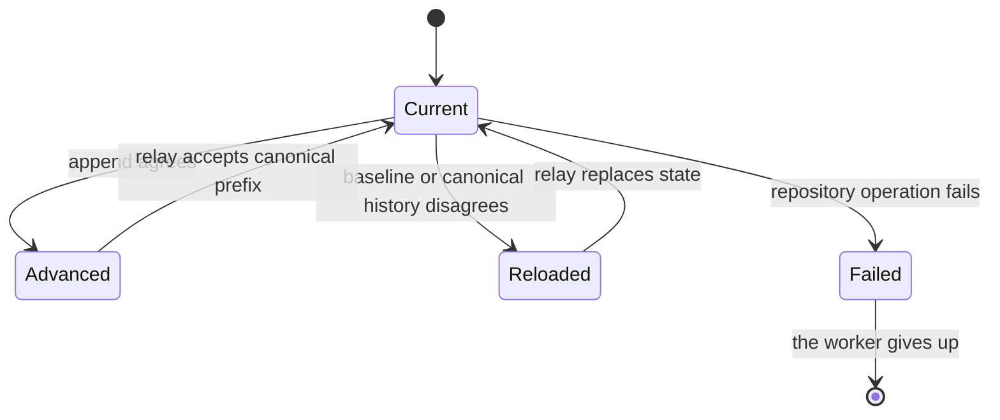
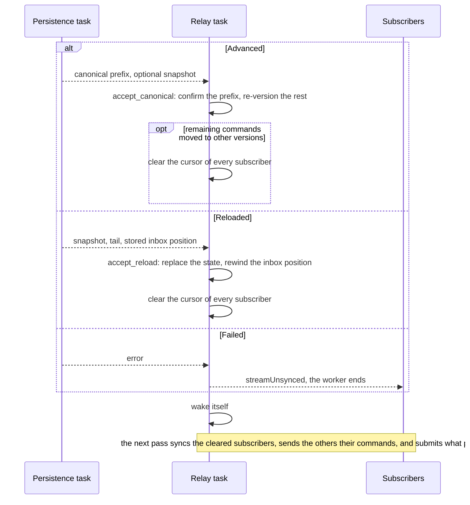
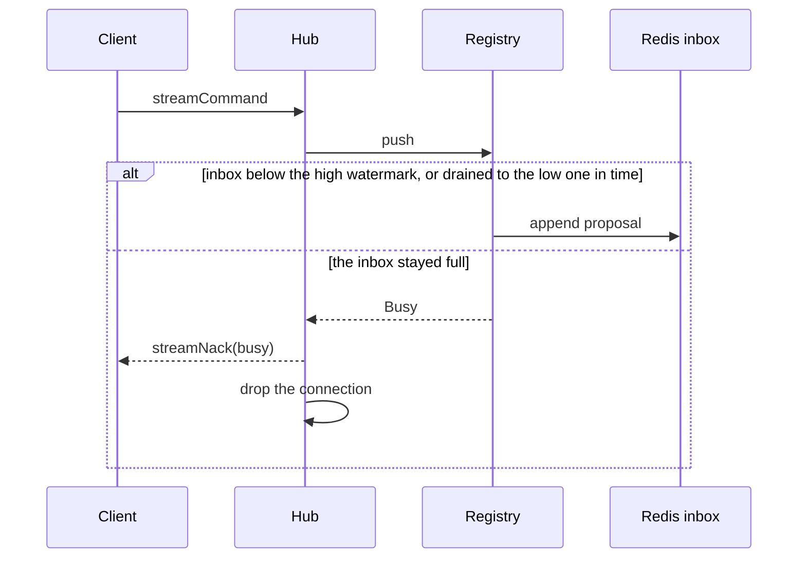
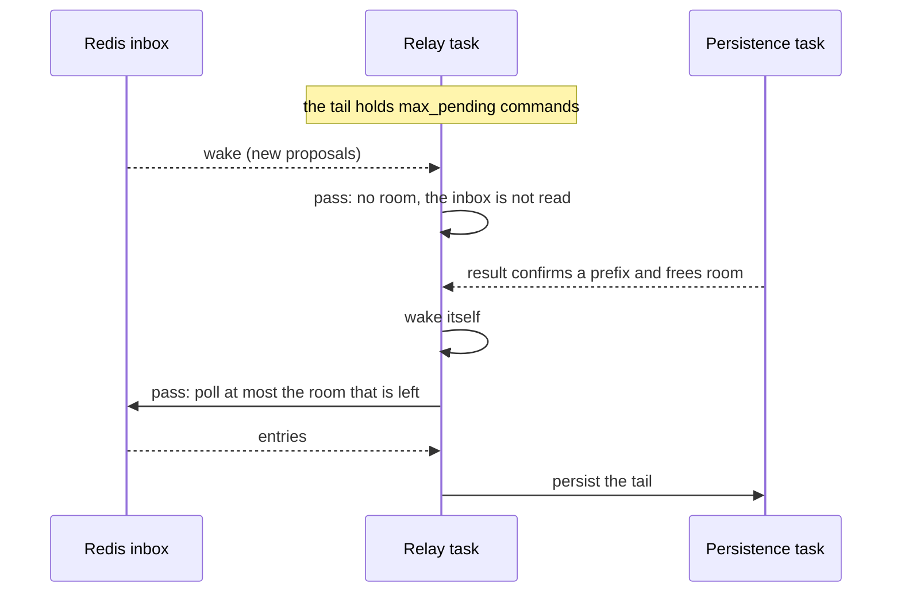
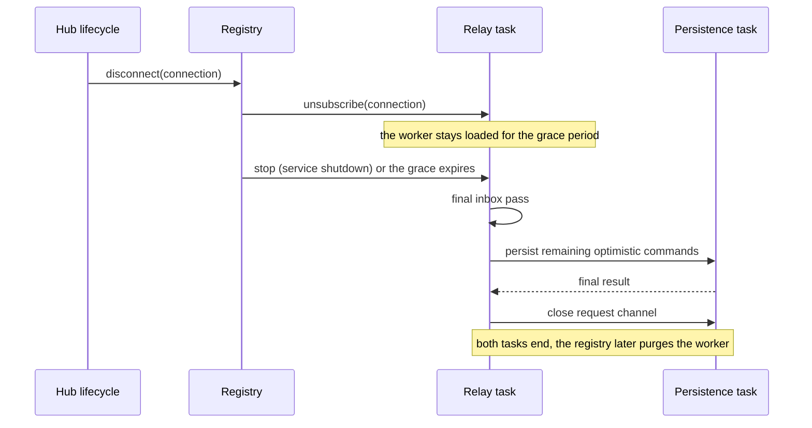

# Hub Command Streams

*How clients submit replayable commands, receive optimistic ordered updates, and converge on a Postgres-backed canonical stream.*

## Problem

Collaborative state such as chat and a shared pixel map needs one ordered command history, cheap writes, fast subscriber feedback, and bounded catch-up for late joiners. Builder instances may process the same stream concurrently, so no instance can be the authority. Redis accepts short-lived command proposals and wakes workers; Postgres owns canonical order and snapshots; every loaded worker keeps an optimistic in-memory tail that is corrected when durable history disagrees.

A **stream** is identified by a `StreamId` whose prefix selects a registered replay kind such as `chat` or `pixel-map`. A **snapshot** is replayed state at a checkpoint version. A **chain hash** covers the ordered command envelopes and lets workers and clients detect incompatible history.

## Architecture

The hub is the transport-facing API. It authorizes subscriptions and delegates stream work to the registry, which tracks the streams each connection has open, so only a connection with the stream open can push. The write path passes an inbox back-pressure gate before it enqueues (see [Back-pressure](#back-pressure)). Each loaded stream has one `StreamWorker` containing two Tokio tasks: a fast relay task for inbox polling and subscriber delivery, and a durable persistence task that owns the canonical replica.

After the WebSocket upgrade and successful hub registration, the server's first frame is
`{"type":"connected","userId":"<uuid>"}`. The client must wait for this frame before subscribing;
the user id is the authenticated identity assigned to commands submitted through that connection.

The relay never performs Postgres work. The persistence task never owns subscribers. Their bounded request channel permits at most one durable operation in flight while the relay can continue accepting lifecycle messages and optimistically serving commands.

## Relay loop

The relay task is one loop over three kinds of input. Everything it owns (optimistic tail, confirmed tail, inbox position, subscriber cursors) is touched only here, so there are no locks.

| Input | Handling |
|---|---|
| Subscribe, unsubscribe, stop | Subscribe records the subscriber as needing a sync and wakes the loop; unsubscribe removes it; stop drains and ends the worker. |
| Persistence result | Bookkeeping only (see [Canonical settlement](#canonical-settlement)), then a wake. |
| Wake or poll tick | A **pass**: the only place that talks to subscribers and the only place that starts a persistence. |

Inputs are served in that order (`biased`), so a result is settled before the next pass looks at the state. The recovery poll (`recovery_poll_interval`) is the safety net for a lost wake.

A pass (`process_inbox`) reads one page, delivers subscriber syncs and new commands once, and submits the optimistic tail if no persistence is in flight. A full page makes the relay wake itself for the next page, which leaves room for messages and results between pages.

## Subscribe and synchronize

`streamSubscribe` carries only `streamId`; its prefix identifies the kind. The hub authorizes the user for that stream, then has the registry **open** the stream for the connection (this verifies the kind is registered and lets the connection push at once) and emits an ordered stream event. The dispatcher applies that event to the registry, which creates or joins the worker when necessary. A subscribe event for a stream that was closed, or a connection that is gone, in the meantime is ignored. Unsubscribe and disconnect reach the registry directly from the hub.

A sync is built from the relay's memory after ingestion in the next pass: it includes the canonical history and any optimistic tail. After a reload, re-ingested commands can be included in the correction sync rather than sent in a separate commands batch. If startup cannot load the stream or an inbox read fails, queued or registered subscribers receive `streamUnsynced` and the worker ends.

## Submit, batch, and deliver

The command write path ends after one Redis inbox push. A wake says only that work may exist; it carries no ordering authority. The relay polls proposals in inbox order, validates them for the stream kind, assigns optimistic versions and chain hashes, and immediately sends one `streamCommands` batch to subscribers. A pass over the inbox is the only place that talks to subscribers and the only place that starts a persistence; every other event is short bookkeeping that ends with a wake to get a pass going.

The relay keeps one cursor per subscriber: the version it has been sent through, or none when it needs a sync (new, resubscribed, or told versions that no longer hold). Delivery sends a sync to the ones without a cursor and the commands after the cursor to the others, then moves the cursor; a subscriber that cannot be sent to is dropped.

The sender receives its own `commandId` in the optimistic batch; there is no separate success acknowledgement. Wake-triggered passes are coalesced, so a burst becomes bounded response batches. `poll_limit` caps one inbox read, and a full page wakes the relay for the next one. `max_pending` caps the optimistic tail (see [Back-pressure](#back-pressure)).

## Canonical settlement

Postgres decides which proposed continuation is canonical. Persistence owns a private replay replica and compares every request with its current canonical version and chain hash.

Settling a result is bookkeeping only; it sends nothing and does not submit the next batch. An `Advanced` result goes to `accept_canonical`: it promotes the canonical prefix from optimistic to confirmed state. If another worker inserted commands first, the relay re-versions any remaining optimistic commands; because subscribers already saw the old versions, every subscriber cursor is cleared. A `Reloaded` result goes to `accept_reload`: it replaces the relay's snapshot, confirmed tail, inbox cursor, and optimistic state, and clears every subscriber cursor. A `Failed` result ends the worker. After each result the relay wakes itself, and the next pass sends the syncs and submits whatever piled up.

A worker reconciles its confirmed head with Postgres at startup. After that a peer advance is found by the next persistence, whose baseline no longer matches. A periodic check of a quiet worker is not implemented for now.

## Back-pressure

Two limits stack, one on each side of the Redis inbox.

**Write side.** Each open stream has an inbox `Backpressure` (`shine-core`) with hysteresis: it polls the inbox length every `inbox_backpressure_poll_period`, blocks at `inbox_backpressure_high` entries and releases at `inbox_backpressure_low`. A push waits for it up to `inbox_backpressure_timeout`; if the inbox is still full, the push fails as `Busy`, the sender gets `streamNack` with reason `busy`, and the hub drops the connection. An unreadable inbox length does not block pushes; they fail on their own if Redis is down.

**Read side.** The optimistic tail holds at most `max_pending` commands. While it is full, a pass does not read the inbox: the proposals stay in Redis, and the persistence result that frees room is what brings the next read. Each read asks for at most the room that is left. A slow persistence therefore fills the inbox, which in turn reaches the write side.

## Snapshots and inbox cleanup

The persistence replica applies canonical commands in order. At configured checkpoint versions it creates a snapshot and a checkpoint containing the state hash (checkpoints are not sent to clients for now). Snapshot storage and pruning are best-effort: failure does not invalidate an already durable command batch.

After canonical advancement, persistence trims Redis through the latest inbox position known to be stored and publishes a persisted notification. Inbox positions, not client command ids, prevent already durable proposals from being ingested again.

Checkpoints are not sent to clients for now, so clients have no hash comparison to detect drift; a resubscribe returns a `streamSync` that replaces local state.

## Unload and shutdown

A worker stays loaded for `worker_unload_grace` after its last subscriber leaves; a returning subscriber cancels the countdown. When the grace expires or shutdown requests a stop, the relay drains what it can: it ingests remaining proposals, waits for in-flight persistence, submits pending optimistic commands until nothing is waiting, and then closes the persistence channel. Proposals arriving after that remain in Redis for a future worker.

## Key rules

| Concern | Rule |
|---|---|
| Canonical order | Postgres decides durable versions; Redis order only proposes a continuation. |
| Client latency | Subscribers see optimistically versioned commands before Postgres confirms them; syncs and new commands are delivered after inbox ingestion. |
| Correction | Any optimistic version invalidated by canonical history causes a canonical `streamSync` on the next pass. |
| Concurrency | One relay task and one persistence task run per loaded stream; only one persistence request is in flight. |
| Batching | A pass reads pages of at most `poll_limit`; a full page wakes the relay for the next one; wakes are coalesced. |
| Back-pressure (read) | `max_pending` stops inbox reads while the optimistic tail is full; entries remain in Redis. |
| Back-pressure (write) | Pushes wait while the inbox is at `inbox_backpressure_high` until it drains to `inbox_backpressure_low`; after `inbox_backpressure_timeout` the push is nacked `busy` and the connection is dropped. |
| Open streams | Only a connection that opened the stream (accepted subscribe) can push; closing, unsubscribing, or disconnecting removes it. |
| Duplicates | Stored inbox positions suppress already durable proposals; client command ids are correlation values, not uniqueness constraints. |
| Drift | Persistence reloads on baseline, replay, or canonical disagreement. |
| Recovery | Occasional checks at `recovery_poll_interval` recover missed Redis wakes. |
| Graceful close | The worker uses the core Tokio `GraceTimer`: `arm_if` starts or preserves the no-subscriber countdown and cancels it when subscribers return; cancelling `wait` never restarts the grace period. |
| Failure | A failed pass or persistence sends `streamUnsynced` and ends the worker. |
| Redis loss | Unsequenced proposals may be lost; canonical Postgres history remains valid. |
| Isolation | A slow or failing stream does not block another stream's relay or persistence task. |
| Limits | Commands are bounded before inbox insertion, and slow connection egress is dropped rather than blocking a worker. |

## Client protocol

Frames are JSON text with a camel-case `type`. `StreamId` contains the kind prefix; requests do not carry a separate kind.

| Direction | Message | Fields and behavior |
|---|---|---|
| to server | `streamSubscribe` | `streamId`; authorizes and synchronizes the stream. |
| to server | `streamUnsubscribe` | `streamId`; removes this connection's subscription. |
| to server | `streamCommand` | `streamId`, `commandId`, `command`; requires an active subscription. |
| to client | `streamSync` | `streamId`, optional snapshot, canonical commands after it; replaces client state. |
| to client | `streamCommands` | `streamId`, contiguous optimistic or canonical command envelopes. |
| to client | `streamCheckpoint` | `streamId`, version, state hash (not sent for now). |
| to client | `streamReset` | `streamId`; invalidates prior optimistic versions and is followed by sync (not sent for now: a sync alone replaces the state). |
| to client | `streamUnsynced` | `streamId`; the worker cannot currently serve the stream. |
| to client | `streamNack` | `streamId`, `commandId`, reason: `notSubscribed`, `invalid`, `failed`, or `busy` (the connection is then dropped). |
| to client | `streamSubscribeFailed` | `streamId`, reason: `unauthorized` or `failed`. |

Malformed frames and invalid stream ids do not enter the hub. Valid requests that fail a protocol rule receive the corresponding refusal frame.

## File map

| File | Role |
|---|---|
| `crates/shine-game/src/replica/` | Shared replay state, envelopes, chain hashes, snapshots, and client replica logic. |
| `services/builder/src/repositories/command_inbox/` | Redis proposal queue, monotonic inbox cursor, trimming, and wake notifications. |
| `services/builder/src/repositories/command_log/` | Postgres canonical commands, snapshots, append arbitration, and pruning. |
| `services/builder/src/services/command_stream/stream_relay.rs` | Fast in-memory side: ingest, optimistic versions, subscribers with their cursors, delivery, and sync. |
| `services/builder/src/services/command_stream/stream_persistence.rs` | Durable side: canonical replica, append, reconcile, reload, snapshot, and cleanup. |
| `services/builder/src/services/command_stream/stream_worker.rs` | Two-task lifecycle, channels, scheduling, settlement, failure handling, drain, and unload. |
| `services/builder/src/services/command_stream/stream_log_service.rs` | Durable repository operations used by persistence. |
| `services/builder/src/services/command_stream/stream_config.rs` | Poll, back-pressure, backlog, snapshot, poll-interval, and unload-grace limits. |
| `services/builder/src/services/command_stream/stream_registry.rs` | Kind validation, open streams per connection, workers by stream, write path with inbox back-pressure, wake routing, and shutdown. |
| `crates/shine-core/src/tokio/backpressure.rs` | Watermark-based soft queue limit polled from an async count. |
| `services/builder/src/services/command_stream/stream_kinds.rs` | Registration of the supported replay kinds. |
| `services/builder/src/services/command_stream/stream_egress.rs` | Transport-independent worker-to-connection delivery interface. |
| `services/builder/src/services/hub/hub_service.rs` | Authorized stream subscription, command submission, busy-connection drop, and egress implementation. |
| `services/builder/src/services/hub/tasks/stream_dispatcher.rs` | Applies ordered subscribe events to the registry, purges ended workers, and shuts the registry down. |
| `services/builder/src/models/messages/stream.rs` | Internal stream commands, events, failures, and client messages. |
| `services/builder/src/routes/ws/connect.rs`, `services/builder/src/routes/ws/message.rs` | WebSocket parsing and wire conversion. |
| `services/builder/src/app_config.rs`, `services/builder/src/app_state.rs` | Runtime stream configuration and application wiring. |
| `client/web/src/engine/net/stream-connection.ts` | Browser WebSocket lifecycle, subscribe, reconnect, and unsynced retry. |

Why optimistic delivery remains safe across competing workers

The relay's version is provisional until persistence returns the canonical continuation. The persistence task checks both the submitted baseline and the overlapping command prefix. Agreement promotes the prefix; disagreement reloads Postgres. The relay never attempts to conceal changed versions: it marks the subscribers for a canonical sync before further incremental delivery.

Why persistence has its own task and a capacity-one channel

Postgres append, catch-up, snapshot, and pruning must not stall subscription lifecycle or optimistic fan-out. A separate task isolates that latency while capacity one preserves the invariant that only one batch per stream is durable-in-flight. Additional optimistic commands accumulate in the relay and are submitted by the first pass after the result settles.

Failure and cleanup boundaries

A failed command append, like any failed pass, ends the worker: subscribers receive `streamUnsynced`, and the commands that were not made durable stay in the Redis inbox for whoever serves the stream next. Snapshot storage, pruning, and persistence notification are best-effort after the canonical command batch is durable. Startup load failure is different: there is no trustworthy state to serve, so queued subscribers receive `streamUnsynced` immediately.

Coverage map

Worker tests cover initial sync, optimistic ordered delivery, backlog draining, read-side back-pressure, sync refusal on inbox read failure, missed-wake recovery polling, competing canonical history, reload resync, persistence failure, and shutdown drain. Relay and persistence tests isolate re-versioning, subscriber cursors, canonical prefix acceptance, snapshots, pruning, and corrupt-history reload. Registry tests cover kind validation, open-stream bookkeeping, write refusal, write-side back-pressure (a push into an inbox that stays full fails as busy and is not queued), wake routing, worker reuse, and shutdown. `tests/api-tests/builder/streams.ts` covers the wire protocol against real services.

