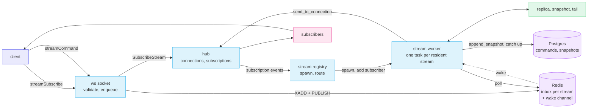
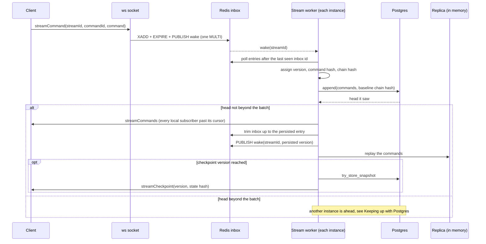
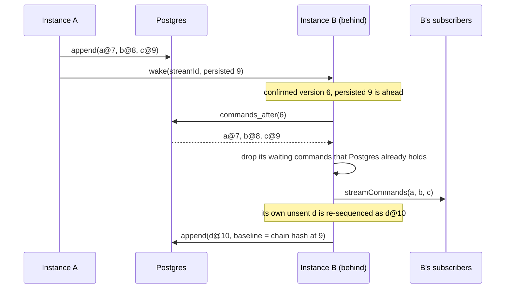
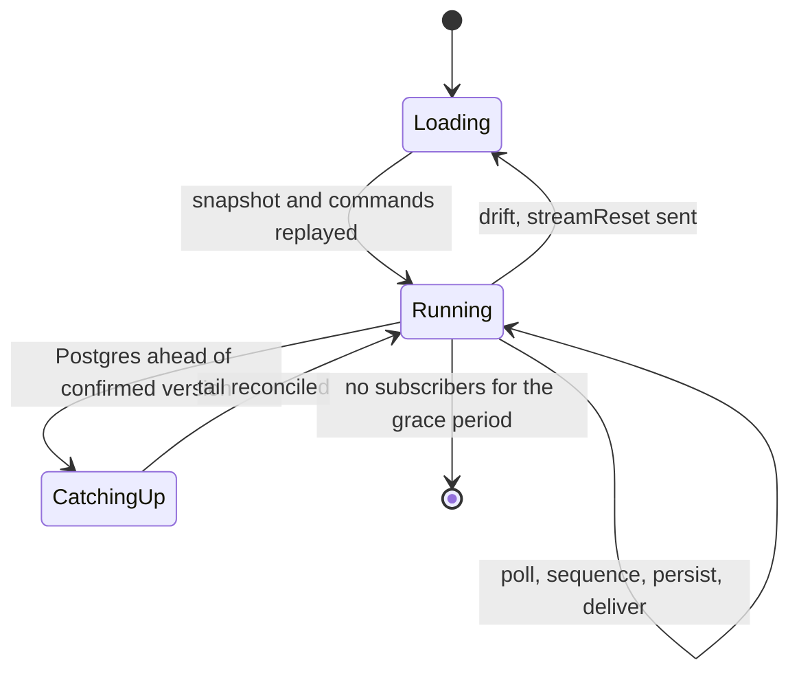

# Hub v2: Command Streams

*How clients write ordered commands through a Redis inbox, how builder instances sequence them into Postgres, and how subscribers receive a snapshot followed by the commands after it.*

## Problem

Collaborative, server-authoritative state (editing a shared world, chat as a replayable log) needs one total order of commands, durable history, and cheap catch-up for late joiners. There is no single owning server: any number of builder instances run side by side, and a client may be connected to any of them. The write path must stay cheap (one Redis write), Redis may lose data without losing acknowledged history, and clients must be able to detect and heal drift on their own.

The pieces are a **command** (an opaque, deterministic payload), a **stream** (an ordered log of commands of one `kind`), a **snapshot** (the replayed state at a checkpoint version) and a **chain hash** (a running hash over the log that proves two parties hold the same history).

## Architecture

Redis is only the **inbox**: unordered, short-lived, loss-tolerant. Postgres is the **truth**: ordered commands with their chain hash, and snapshots. Each stream with local subscribers is a **worker** task on that instance, owning its state **in memory** (replayed state, latest snapshot, the commands since it). Streams do not share a loop: each has its own life, so a slow or failing stream never delays another.

The hub owns only connections and the `connection to streams` map. Its command loop never touches Redis or Postgres for streams: a subscribe is recorded (and ignored if the connection is no longer registered) and published as an event, which the registry turns into a worker. Inbox writes, polling, persisting, and sending are outside the loop; sending is the hub's read-only `send_to_connection`, which does not go through the command loop.

Clients subscribe explicitly; a connection lives on exactly one instance, and its liveness is the socket's, already tracked by the hub. A stream tracks no clients, and no connection is held open per stream: wakes arrive on one shared pub/sub subscription per instance, which only looks up the stream's worker and notifies it.

### Write, persist, deliver

The worker of every instance with the stream resident runs this independently. The repo makes the duplicate work harmless: the first append stores, the rest verify.

Versions are assigned by the stream worker, not by Redis. The chain hash covers only the command envelope (`fold_chain_hash(previous, version, command_hash)`), so versioning and persisting never wait on replay. Clients are notified as soon as a batch is verified; the server-side replay, which feeds snapshots and sync, follows afterwards.

### Keeping up with Postgres

A worker can be behind: another instance already persisted and trimmed the inbox entries it has not seen. Its subscribers must still receive those commands, and its own batch must not claim a version that is taken.

The worker catches up whenever Postgres is ahead of its **confirmed version** (the last version checked against Postgres). Three signals tell it:

- `append` returns a head beyond what the worker had confirmed.
- A wake carries a persisted version above the worker's.
- The backstop tick reads the head, in case a wake was lost.

A mismatch **past** the confirmed prefix is lag: the worker adopts Postgres's commands, drops the waiting commands Postgres already holds (by inbox position), and re-sequences the rest. A mismatch **inside** the confirmed prefix is drift: the worker reloads the stream and sends `streamReset`.

### Stream worker states

Loading reads the latest snapshot and the commands after it from Postgres and replays them; the first inbox poll then follows. Unloading flushes pending persists first.

### Subscribing

A subscribe answers from memory: the resident stream's latest snapshot plus every confirmed command after it, as one `streamSync`. The subscriber's cursor is set to the last version in that sync, and later batches carry only versions above it. If the stream is not resident, the registry spawns its worker, which loads (Loading above) and holds the subscriber until it is ready.

## Key rules

| Concern | Rule |
|---|---|
| Order | Defined by Postgres: a version exists once appended. The inbox order only proposes; the repo arbitrates between instances. |
| Truth | Postgres wins every conflict. Memory is a cache of it plus a speculative tail. |
| Append contract | `Ok(head)` with `head.version` at or below the batch's last version means the batch is in the log as sent. A head beyond the batch means unverified: the worker must catch up. A hash mismatch is `Diverged { head }`. |
| Notify | Clients are told about a version only after it is confirmed against Postgres. |
| Duplicates | Every command in the log records the inbox position it came from, and commands are stored in inbox order. An inbox entry at or before the latest stored position is already stored, so it is never taken again; two instances storing the same entry at the same version is the repo's job. Command ids belong to the client and are never checked: a command sent twice is two commands, each with its own version. |
| Rejected commands | A well-formed command that the state ignores still takes a version. Replay is deterministic, so every party ignores the same ones. |
| Write ack | None. The writer sees its own `command_id` in a `streamCommands` batch. Failures are `streamNack`. |
| Back-pressure | The per-connection rate limit and the inbox TTL bound the inbox. There is no length check. |
| Redis loss | Unsequenced inbox entries are lost. Clients resubmit their pending commands after a resync; a command that had already landed is applied again, which is the client's to handle. |
| Checkpoints | `version % snapshot_every == 0` on every instance; the stored snapshot is authoritative and carries `chain_hash` and `state_hash`. |
| Drift (client) | The client compares its state hash with `streamCheckpoint` at that version and resubscribes on a mismatch. |
| Drift (server) | `Diverged` inside the confirmed prefix or `SnapshotDrift` from the consistency check: reload from Postgres and send `streamReset`. |
| Loop driver | Each worker waits on its own wake (from the shared subscription, coalesced with a minimum spacing) or its own jittered backstop tick. An idle stream costs one empty poll per backstop interval, not per second. A pub/sub reconnect wakes every worker, so the backstop only covers a wake lost without a reconnect. |
| Isolation | One task per stream and no shared loop: a slow or failing stream never delays another, and the number of streams an instance serves does not depend on the number of clients. Redis and Postgres calls go through the pools; a worker that cannot get a connection in time retries on its next wake or backstop tick. |
| Fan-out | A frame is serialized once per batch and shared by all subscribers of the stream. |
| Hub loop | Handles only subscription bookkeeping and never waits on Redis or Postgres for streams. |

Defaults (configuration, `builder` section): backstop tick 10 s with jitter (it polls the inbox and checks the Postgres head), minimum wake spacing 50 ms, `snapshot_every` 100, unload grace 60 s, inbox TTL 1 h.

### Client protocol

JSON text frames, `type` tagged in camelCase, the same envelope as chat. Hashes are hex strings.

| Direction | Message | Fields |
|---|---|---|
| client to server | `streamSubscribe` | `streamId`, `kind` (used only when the stream is created) |
| client to server | `streamUnsubscribe` | `streamId` |
| client to server | `streamCommand` | `streamId`, `commandId`, `command` |
| server to client | `streamSync` | `streamId`, `snapshot` (version, chain hash, state hash, data) or null, `commands[]`; always replaces the client's state |
| server to client | `streamCommands` | `streamId`, `commands[]` of version, `commandId`, `userId`, `command`; contiguous versions |
| server to client | `streamCheckpoint` | `streamId`, `version`, `stateHash` |
| server to client | `streamReset` | `streamId`; a fresh `streamSync` follows |
| server to client | `streamNack` | `streamId`, `commandId`, `reason` (`notSubscribed`, `invalid`, `failed`) |
| server to client | `streamSubscribeFailed` | `streamId`, `reason` (`kindMismatch`, `forbidden`, `failed`) |

A `streamSync` the client did not ask for is a resync. After any sync, the client resubmits the pending commands whose `commandId` it does not find in it.

## File map

New files are target state.

| File | Role |
|---|---|
| `crates/shine-game/src/replica/` | Pure replay core: `ReplayState`, `Replica`, `CommandEnvelope`, chain hash, snapshot codec. Shared with the client. |
| `services/builder/src/repositories/command_log/` | Postgres command log: `append`, `commands_after`, snapshots, `prune`, `check_consistency`. Each command stores the inbox position it came from (`inbox_id`), which is server side only and not part of any hash or client message. |
| `services/builder/src/repositories/command_inbox/redis/` | Inbox write (`XADD` + `EXPIRE` + `PUBLISH`), per-stream poll, trim, wake publish and listen. |
| `services/builder/src/services/command_stream/command_stream_service.rs` | Stateless service over the log and the inbox: `load` a stream, `sync` it (poll the inbox, version, append, adopt what other instances stored, re-sequence the rest, trim, announce). |
| `services/builder/src/services/command_stream/stream_state.rs` | The per-stream state the service works on: replica, snapshot, tail, confirmed version and chain hash, waiting commands, inbox cursor, latest stored inbox position. |
| `services/builder/src/services/command_stream/stream_worker.rs` | Per-stream task: wake and tick loop, calls to the service, replay and snapshots, subscriber cursors, fan-out, unload. |
| `services/builder/src/services/command_stream/stream_registry.rs` | Spawns and routes to workers from the hub's subscription events; owns the shared wake listener. |
| `services/builder/src/services/hub/hub_command.rs` | `SubscribeStream` and `UnsubscribeStream` control commands. |
| `services/builder/src/services/hub/hub_connections.rs` | Per-connection stream set, dropped with the connection. |
| `services/builder/src/routes/ws/connect.rs` | Stream frames: subscribe, unsubscribe, command ingest. |
| `services/builder/src/routes/ws/message.rs` | Stream message types. |

Why Ok from append is not enough, and what "confirmed" means

`append` verifies overlap only when the Postgres head falls inside the batch or right before it (`pg/append.rs`, `my_hash_at_head`). If the head is beyond the batch's last version there is nothing to compare and nothing to store. A lagging instance holding `d@7` while Postgres has `a@7..c@9` must not be told its batch is stored. `append` therefore returns the head, and the service treats a batch as stored only when that head is the batch's last command.

The service's baseline for each append is always the confirmed prefix: it advances only after a verified append or a catch-up read, and never after an `Ok` with a head beyond the batch. That makes a baseline mismatch real drift, and a mismatch past the baseline lag, with no extra classification in the repo. The chain hash includes the version, so the same command at two different versions never agrees.

Inbox trim and an unloaded stream

The service trims the inbox up to the latest inbox position known to be in the log; no waiting command is at or before it. Trimming is monotonic, so concurrent trims by several instances are harmless. A trim that is late or fails leaves entries that are already stored; they are at or before the stored position, so they are skipped, and a stream loaded later starts reading the inbox after it. Positions are Redis stream ids, which only grow within a live inbox. If an inbox is recreated while the clock has gone backwards, new entries can look stored and are lost; that loss is accepted. If no instance has the stream resident, unsequenced entries wait in the inbox until the TTL; the next load reads them. A crash of the last resident instance loses nothing that a reconnecting client does not resubmit.

Coverage map

| # | Case | Kind |
|---|---|---|
| 1 | Two workers on one inbox produce identical versions and hashes; one stores, one verifies | Redis + Postgres |
| 2 | Lag by one version, with the head inside the batch, and with the head beyond the batch: catch-up, no streamReset, own commands re-sequenced | service |
| 3 | Mismatch inside the confirmed prefix: reload and streamReset | service |
| 4 | A repeated `command_id` is not special: each command gets a version, and stored-but-untrimmed inbox entries are not taken again | service |
| 5 | Inbox flushed mid-run: pending client commands resubmitted, history intact | Redis + Postgres |
| 6 | Wake lost without a reconnect: the backstop tick delivers within its interval | Redis + Postgres |
| 7 | Late subscriber receives snapshot plus tail, then only newer versions | worker |
| 8 | Replay lags behind notify: sync stays consistent | worker |
| 9 | Postgres outage: sequencing stalls, nothing delivered unconfirmed, recovery resumes | fault |
| 10 | Subscribe for an already dropped connection is ignored; disconnect releases the stream | hub |

