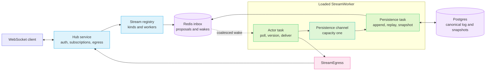
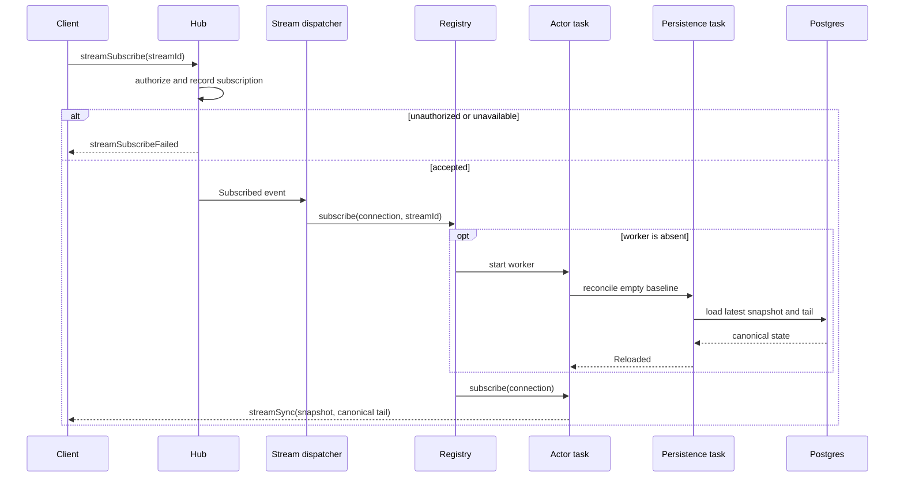
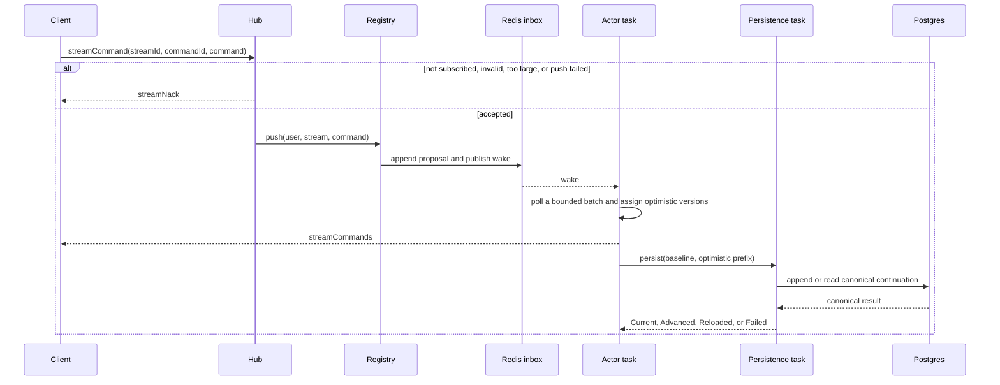
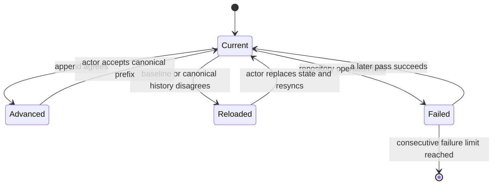

# Hub Command Streams

*How clients submit replayable commands, receive optimistic ordered updates, and converge on a Postgres-backed canonical stream.*

## Problem

Collaborative state such as chat and a shared pixel map needs one ordered command history, cheap writes, fast subscriber feedback, and bounded catch-up for late joiners. Builder instances may process the same stream concurrently, so no instance can be the authority. Redis accepts short-lived command proposals and wakes workers; Postgres owns canonical order and snapshots; every loaded worker keeps an optimistic in-memory tail that is corrected when durable history disagrees.

A **stream** is identified by a `StreamId` whose prefix selects a registered replay kind such as `chat` or `pixel-map`. A **snapshot** is replayed state at a checkpoint version. A **chain hash** covers the ordered command envelopes and lets workers and clients detect incompatible history.

## Architecture

The hub is the transport-facing API. It authorizes subscriptions, checks that commands come from subscribed connections, and delegates stream work to the registry. Each loaded stream has one `StreamWorker` containing two Tokio tasks: a fast actor task for inbox polling and subscriber delivery, and a durable persistence task that owns the canonical replica.

After the WebSocket upgrade and successful hub registration, the server's first frame is
`{"type":"connected","userId":"<uuid>"}`. The client must wait for this frame before subscribing;
the user id is the authenticated identity assigned to commands submitted through that connection.



The actor never performs Postgres work. The persistence task never owns subscribers. Their bounded request channel permits at most one durable operation in flight while the actor can continue accepting lifecycle messages and optimistically serving commands.

## Subscribe and synchronize

`streamSubscribe` carries only `streamId`; its prefix identifies the kind. The hub authorizes the user for that stream, verifies the kind is registered, records the subscription on the connection, and emits an ordered stream event. The dispatcher applies that event to the registry, which creates the worker when necessary.



A sync is always canonical. If startup cannot load the stream, queued subscribers receive `streamUnsynced` and the worker ends.

## Submit, batch, and deliver

The command write path ends after one Redis inbox push. A wake says only that work may exist; it carries no ordering authority. The actor polls proposals in inbox order, validates them for the stream kind, assigns optimistic versions and chain hashes, and immediately sends one `streamCommands` batch to subscribers.



The sender receives its own `commandId` in the optimistic batch; there is no separate success acknowledgement. Wake-triggered passes are coalesced and separated by the configured minimum response interval, so a burst becomes bounded response batches. `poll_limit` caps one inbox read and `max_pending` caps the optimistic tail; when the tail is full, unread proposals remain in Redis until persistence frees space.

## Canonical settlement

Postgres decides which proposed continuation is canonical. Persistence owns a private replay replica and compares every request with its current canonical version and chain hash.



An `Advanced` result promotes the canonical prefix from optimistic to confirmed state. If another worker inserted commands first, the actor re-versions any remaining optimistic commands; because subscribers already saw the old versions, it sends `streamReset` followed by `streamSync`. A `Reloaded` result also replaces the actor's snapshot, confirmed tail, inbox cursor, and optimistic state before resetting and syncing every subscriber.

A quiet worker periodically reconciles its confirmed head with Postgres. This catches a peer advance even when the Redis wake was missed or the peer already trimmed the corresponding inbox entries.

## Snapshots and inbox cleanup

The persistence replica applies canonical commands in order. At configured checkpoint versions it creates a snapshot and emits a checkpoint containing the state hash. Snapshot storage and pruning are best-effort: failure does not invalidate an already durable command batch.

After canonical advancement, persistence trims Redis through the latest inbox position known to be stored and publishes a persisted notification. Inbox positions, not client command ids, prevent already durable proposals from being ingested again.

Clients compare checkpoint state hashes with their local replica. A mismatch causes a resubscribe; the returned `streamSync` replaces local state, after which pending client commands may be submitted again.

## Unload and shutdown

Workers remain loaded for a grace period after their last subscriber leaves. A returning subscriber receives a sync from memory. When the grace period expires, or shutdown requests a stop, the actor drains what it can: it ingests remaining proposals, waits for in-flight persistence, submits pending optimistic commands, and then closes the persistence channel. Proposals arriving after that remain in Redis for a future worker.

```mermaid
sequenceDiagram
    participant H as Hub lifecycle
    participant R as Registry
    participant A as Actor task
    participant P as Persistence task

    H->>R: disconnect(connection)
    R->>A: unsubscribe(connection)
    Note over A: unload grace starts when subscriber count reaches zero
    alt subscriber returns
        R->>A: subscribe(connection)
        A-->>H: streamSync from memory
    else grace expires or service stops
        A->>A: final inbox pass
        A->>P: persist remaining optimistic commands
        P-->>A: final result
        A->>P: close request channel
        Note over A,P: both tasks end; registry later purges the worker
    end
```

## Key rules

| Concern | Rule |
|---|---|
| Canonical order | Postgres decides durable versions; Redis order only proposes a continuation. |
| Client latency | Subscribers see optimistically versioned commands before Postgres confirms them. |
| Correction | Any optimistic version invalidated by canonical history causes `streamReset` and a canonical `streamSync`. |
| Concurrency | One actor task and one persistence task run per loaded stream; only one persistence request is in flight. |
| Batching | A wake polls at most `poll_limit`; wake responses obey the configured minimum spacing. |
| Back-pressure | `max_pending` stops inbox reads while the optimistic tail is full; entries remain in Redis. |
| Duplicates | Stored inbox positions suppress already durable proposals; client command ids are correlation values, not uniqueness constraints. |
| Drift | Persistence reloads on baseline, replay, or canonical disagreement; clients resubscribe on checkpoint hash mismatch. |
| Recovery | Periodic reconciliation and backstop passes recover missed Redis wakes. |
| Failure | Consecutive failed passes are counted; reaching `max_failures` sends `streamUnsynced` and ends the worker. |
| Redis loss | Unsequenced proposals may be lost; canonical Postgres history remains valid. |
| Isolation | A slow or failing stream does not block another stream's actor or persistence task. |
| Limits | Commands are bounded before inbox insertion, and slow connection egress is dropped rather than blocking a worker. |

## Client protocol

Frames are JSON text with a camel-case `type`. `StreamId` contains the kind prefix; requests do not carry a separate kind.

| Direction | Message | Fields and behavior |
|---|---|---|
| to server | `streamSubscribe` | `streamId`; authorizes and synchronizes the stream. |
| to server | `streamUnsubscribe` | `streamId`; removes this connection's subscription. |
| to server | `streamCommand` | `streamId`, `commandId`, `command`; requires an active subscription. |
| to client | `streamSync` | `streamId`, optional snapshot, canonical commands after it; replaces client state. |
| to client | `streamCommands` | `streamId`, contiguous optimistic or canonical command envelopes. |
| to client | `streamCheckpoint` | `streamId`, version, state hash. |
| to client | `streamReset` | `streamId`; invalidates prior optimistic versions and is followed by sync. |
| to client | `streamUnsynced` | `streamId`; the worker cannot currently serve the stream. |
| to client | `streamNack` | `streamId`, `commandId`, reason: `notSubscribed`, `invalid`, or `failed`. |
| to client | `streamSubscribeFailed` | `streamId`, reason: `unauthorized` or `failed`. |

Malformed frames and invalid stream ids do not enter the hub. Valid requests that fail a protocol rule receive the corresponding refusal frame.

## File map

| File | Role |
|---|---|
| `crates/shine-game/src/replica/` | Shared replay state, envelopes, chain hashes, snapshots, and client replica logic. |
| `services/builder/src/repositories/command_inbox/` | Redis proposal queue, monotonic inbox cursor, trimming, and wake notifications. |
| `services/builder/src/repositories/command_log/` | Postgres canonical commands, snapshots, append arbitration, and pruning. |
| `services/builder/src/services/command_stream/stream_actor.rs` | Fast in-memory side: ingest, optimistic versions, subscribers, delivery, reset, and sync. |
| `services/builder/src/services/command_stream/stream_persistence.rs` | Durable side: canonical replica, append, reconcile, reload, snapshot, and cleanup. |
| `services/builder/src/services/command_stream/stream_worker.rs` | Two-task lifecycle, channels, scheduling, settlement, failure handling, drain, and unload. |
| `services/builder/src/services/command_stream/stream_log_service.rs` | Durable repository operations used by persistence. |
| `services/builder/src/services/command_stream/stream_config.rs` | Poll, backlog, checkpoint, timing, grace, and failure limits. |
| `services/builder/src/services/command_stream/stream_registry.rs` | Kind validation, workers by stream, connection mappings, write path, wake routing, and shutdown. |
| `services/builder/src/services/command_stream/stream_kinds.rs` | Registration of the supported replay kinds. |
| `services/builder/src/services/command_stream/stream_egress.rs` | Transport-independent worker-to-connection delivery interface. |
| `services/builder/src/services/hub/hub_service.rs` | Authorized stream subscription, command submission, and egress implementation. |
| `services/builder/src/services/hub/hub_streams.rs` | Per-connection set of subscribed stream ids. |
| `services/builder/src/services/hub/tasks/stream_dispatcher.rs` | Applies ordered hub lifecycle and stream events to the registry. |
| `services/builder/src/models/messages/stream.rs` | Internal stream commands, events, failures, and client messages. |
| `services/builder/src/routes/ws/connect.rs`, `services/builder/src/routes/ws/message.rs` | WebSocket parsing and wire conversion. |
| `services/builder/src/app_config.rs`, `services/builder/src/app_state.rs` | Runtime stream configuration and application wiring. |
| `client/web/src/engine/net/stream-connection.ts` | Browser WebSocket lifecycle, subscribe, reconnect, and unsynced retry. |

<details data-agent="implementation">
<summary>Why optimistic delivery remains safe across competing workers</summary>

The actor's version is provisional until persistence returns the canonical continuation. The persistence task checks both the submitted baseline and the overlapping command prefix. Agreement promotes the prefix; disagreement reloads Postgres. The actor never attempts to conceal changed versions: it resets and canonically syncs subscribers before further incremental delivery.

</details>

<details data-agent="implementation">
<summary>Why persistence has its own task and a capacity-one channel</summary>

Postgres append, catch-up, snapshot, and pruning must not stall subscription lifecycle or optimistic fan-out. A separate task isolates that latency while capacity one preserves the invariant that only one batch per stream is durable-in-flight. Additional optimistic commands accumulate in the actor up to `max_pending` and are submitted when the result settles.

</details>

<details data-agent="implementation">
<summary>Failure and cleanup boundaries</summary>

Command append failure keeps optimistic state available for retry. Snapshot storage, pruning, and persistence notification are best-effort after the canonical command batch is durable. Startup load failure is different: there is no trustworthy state to serve, so queued subscribers receive `streamUnsynced` immediately.

</details>

<details data-agent="test">
<summary>Coverage map</summary>

Worker tests cover initial sync, optimistic ordered delivery, backlog draining, missed-wake backstop, competing canonical history, reload/reset, persistence failure, grace unload, and shutdown drain. Actor and persistence tests isolate re-versioning, canonical prefix acceptance, snapshots, pruning, and corrupt-history reload. Registry tests cover kind validation, subscription bookkeeping, write refusal, wake routing, worker reuse, and shutdown. `tests/api-tests/builder/streams.ts` covers the wire protocol against real services.

</details>
