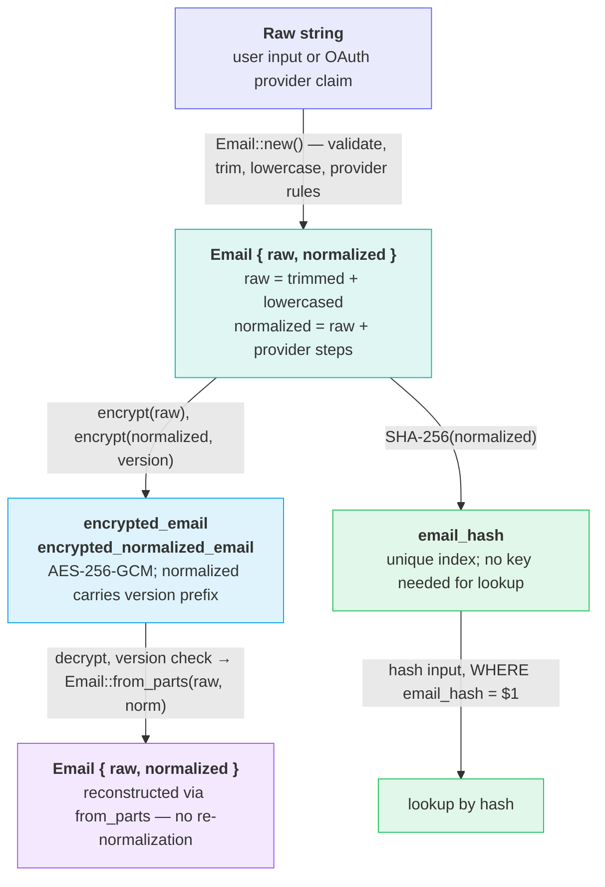

# Email Normalization & Storage

*How emails are validated, provider-normalized, encrypted, and stored for identity lookup.*

## Problem

The same physical inbox can be reached by multiple address strings: `user+tag@gmail.com`, `U.Ser@Gmail.Com`, and `user@googlemail.com` all deliver to the same person. Without normalization, a duplicate registration would succeed and the user would own two accounts. The system therefore stores three distinct representations of every email: the raw form for display and sending, a provider-normalized form for uniqueness enforcement, and an unkeyed hash for indexed lookup without exposing plaintext.

## Architecture

One `Email` value is built from the raw input, then encrypted and hashed for storage; reads rebuild it from the stored parts without re-normalizing.

## Provider normalization rules

| Provider | Domains | Steps applied to local part |
|---|---|---|
| Gmail | gmail.com, googlemail.com → gmail.com | strip plus-tag, remove dots |
| Yahoo | yahoo.com, yahoo.co.uk, ymail.com | strip dash-tag (first `-`) |
| Outlook | outlook.com, hotmail.com, live.com | strip plus-tag |
| All others | — | none (raw = normalized) |

## Key rules

| Rule | Details |
|---|---|
| Use `raw` for human-facing output | Display, sending email, API responses — never expose `normalized`. |
| Use `normalized` + `email_hash` for uniqueness | DB unique index on `email_hash`; lookup by hashing the normalized input. |
| Always reconstruct via `from_parts` on DB read | Decrypt both columns, call `Email::from_parts(raw, norm)`. Never call `Email::new` on a stored value — it would re-derive normalization and diverge if rules changed. |
| Normalized field carries a version prefix | `encrypt(normalized, version)` prepends a cleartext version tag to the ciphertext. `decrypt` verifies the prefix and fails on mismatch, flagging rows that need migration. See the implementation note below. |
| Version mismatch = needs re-normalization | A row whose `encrypted_normalized_email` decrypts to a different version must be re-normalized and re-written before use. A background migration job scans for mismatches after a rule change. |

## Storage locations

| Table | Columns | What is stored |
|---|---|---|
| `identities` | `encrypted_email` `encrypted_normalized_email` `email_hash` | Primary user account email. Both forms encrypted; hash is the unique lookup key. |
| `login_tokens` | `encrypted_email` | Email bound to an `EmailAccess` token (raw form only). Required for token kind 4. |
| `external_logins` | `encrypted_email` | Raw email claim from OAuth/OIDC provider. Informational; not used for uniqueness. |

## File map

| File | Role |
|---|---|
| `crates/shine-infra/src/email/email.rs` | `Email` type: construction, normalization dispatch, hash, serialization. |
| `crates/shine-infra/src/email/normalizer.rs` | Provider rule registry and `normalize_email()`. |
| `crates/shine-infra/src/email/mod.rs` | Module exports, including the normalization version constant. |
| `crates/shine-infra/src/crypto/data_protection.rs` | `DataProtectionUtils`: AES-256-GCM encrypt/decrypt, plus `encrypt_versioned` / `decrypt_versioned`. |
| `services/identity/sql_migrations/V1__identities.sql` | Defines `encrypted_email`, `encrypted_normalized_email`, `email_hash` on `identities`. |
| `services/identity/sql_migrations/V4__login_tokens.sql` | Defines `encrypted_email` on `login_tokens`. |
| `services/identity/src/repositories/identity/pg/pg_identities.rs` | Encrypts/decrypts both email columns; reads via `from_parts`. |
| `services/identity/src/repositories/identity/pg/pg_tokens.rs` | Stores and reads token-bound email; identity email reads via `from_parts`. |
| `services/identity/src/repositories/identity/pg/pg_external_links.rs` | Stores raw provider email; identity join reads via `from_parts`. |

Why the normalized column is versioned

The normalization rules are provider-specific and may change (e.g. a new provider added, or a rule corrected). Any change invalidates every stored `encrypted_normalized_email` written under the old rules. Without a way to detect stale rows, a silent divergence occurs: the DB holds old normalized forms while new logins hash against new rules, breaking lookup.

The version tag makes stale rows detectable at read time without decrypting them: `DataProtectionUtils::encrypt_versioned` / `decrypt_versioned` (`crates/shine-infra/src/crypto/data_protection.rs`) keep it as a cleartext `<version>.` prefix on the ciphertext, and a mismatch fails with `DataProtectionError::VersionMismatch`. The version constant `NORM_EMAIL_VERSION` lives beside the normalization rules in `normalizer.rs`; bump it whenever the rules change. Only the normalized column is versioned — `encrypted_email` (raw form) never changes meaning.

Why email_hash is unkeyed SHA-256

`email_hash` is a plain SHA-256 of the normalized address. It is stored in clear text and used as a unique index for fast lookup. Because the hash is unkeyed, a database dump exposes it to offline dictionary attacks: an attacker with the hash column can check candidate addresses by hashing them.

This is a deliberate trade-off: a keyed HMAC would require the application key to be present for every lookup, but the hash is also used as a DB-level uniqueness constraint (`UNIQUE INDEX idx_email_hash`) that fires at INSERT time — before the application layer is involved. Switching to a keyed HMAC would require computing it in-application and dropping the DB constraint, which sacrifices atomicity of the duplicate-detection step.

Mitigation: the actual email content is encrypted at rest (`encrypted_email`, `encrypted_normalized_email`); an attacker with only the hash column still cannot read email addresses without brute-force. Monitor access to the hash column in any DB-level audit logging.

