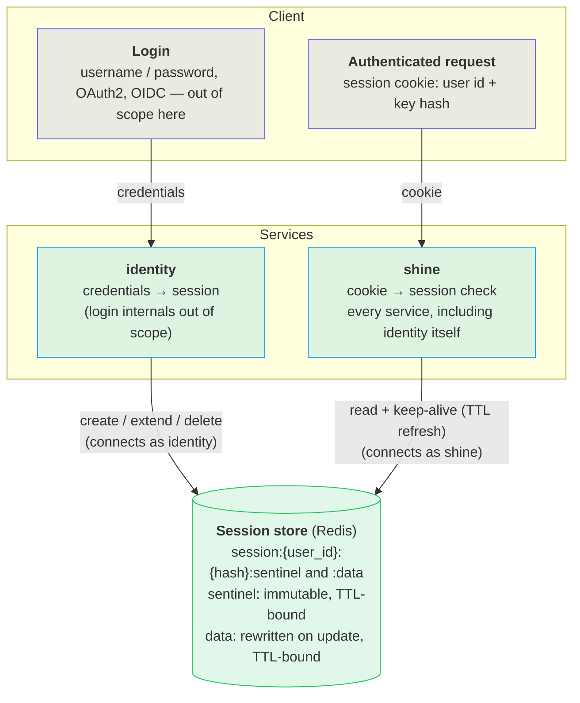

# Session Lifecycle & Access Control

*Only identity may create, extend, or destroy a session; every other caller may confirm it's alive and keep it alive, nothing more.*

## Problem

Identity and shine (builder) both need to know whether a user's session is still valid — but with very different needs. Identity creates, extends, and deletes sessions on login/logout. Every service — including identity's own request middleware — only needs to confirm a session is alive and keep its TTL alive on each check. Session storage access is split into two credentials — one that can write, one that can only read and keep-alive — so a bug or compromise in any service cannot forge or delete another user's session, and the blast radius of either side is bounded to what it actually needs.

## Architecture

Login and request handling take separate paths to the session store, each through its own credential.



Login creates the session: identity turns a validated credential into a stored session and hands the client a cookie carrying the user id and a key hash — the credential check itself is a black box here. Every later request goes the other way: the client presents that cookie, and whichever service is handling the request (including identity's own middleware) checks it against the session store and refreshes its TTL, without ever creating, modifying, or deleting a session. Identity opens two connections to the store to keep these paths separate — one as `identity` for its session repository (`services/identity/src/repositories/session/redis/redis_sessions.rs`), one as `shine` for the shared current-user check. Builder opens only the `shine` connection — it has no session-writing code path. The store is Redis; the split applies at the credential/ACL level, not in application code — the connection string alone determines what a caller can do.

<details data-agent="implementation">
<summary>Session key layout</summary>

Each session occupies two keys under one prefix, built from the user id and a hash of the client's raw session key (never the raw key itself — see the security note below):

```text
session:<user_id>:<key_hash>:sentinel
session:<user_id>:<key_hash>:data
```

| Key | Written by | Mutability | Contents |
|---|---|---|---|
| `:sentinel` | `identity` only, once at creation (`SETNX`) | Immutable — TTL-refreshed, never rewritten | created-at, fingerprint, agent/site info |
| `:data` | `identity` only, at creation and on user-info update | Rewritten on update; TTL-refreshed | name, email-confirmed flag, linked flag, roles |

A session counts as alive only if *both* keys exist. Splitting sentinel from data lets a concurrent update on `:data` during a logout not resurrect a session whose `:sentinel` was just deleted — the missing sentinel forces expiry regardless of a lingering or freshly-written `:data` key. See `services/identity/src/repositories/session/redis/redis_sessions.rs`.

</details>

## Key rules

| Rule | Details |
|---|---|
| `shine` gets TTL refresh too, not just reads | The shared current-user check (`CurrentUserService::get_current_user`) refreshes both keys' TTL on every call, so a strictly read-only credential would break session keep-alive for every service. `shine` can extend a session's life but never create, modify, or destroy one. |
| Only `identity` can create or delete sessions | Session creation (on login), data rewrite (on role/profile change), and deletion (logout, purge) are reachable only through the `identity` credential. |
| Both credentials are scoped to the session keyspace | Neither can touch keys outside session storage, even though they share the same store instance. |
| No unrestricted shared credential | Every consumer connects as either `identity` or `shine`. |
| Store contents never reveal a usable session key | The client only ever holds the raw key; the store only ever holds `SHA-256(raw key)`, both as the key name and inside the stored records. Reading the store — with either credential — yields no value an attacker could replay as a session cookie. See the security note below. |

## Config values

| Config key | Consumer | Credential |
|---|---|---|
| `identity.db.redisCns` | Identity's own session repository (create/extend/delete) | `identity` |
| `service.sessionRedisCns` | Shared current-user check — read by identity *and* builder | `shine` |

`service.sessionRedisCns` is a top-level `service` config key, so it applies to every service that loads `ServiceConfig` — one `shine` credential covers all of them. `identity.db.redisCns` is identity-specific; builder's `DBConfig` has no session-store field at all, since builder never writes session data directly. Local dev env vars provide one source variable per credential.

## File map

| File | Role |
|---|---|
| `services/docker/redis/users.acl` | Redis ACL file defining the `identity` and `shine` credentials and their command/key scope (target-state — not yet created). |
| `services/docker-compose.yml` | Redis service definition; mounts the ACL file and passes it via `--aclfile`. |
| `crates/shine-infra/src/db/redis.rs` | `create_redis_pool` — parses the connection string (including embedded credentials) and opens the pool; no code change needed, credentials travel in the URL. |
| `crates/shine-infra/src/web/service_config.rs` | Declares `session_redis_cns` — the `shine`-credential connection string, shared by every service. |
| `crates/shine-infra/src/session/current_user_service.rs` | `CurrentUserService::get_current_user` — the read/keep-alive path that runs as `shine`. |
| `services/identity/src/repositories/db.rs` | Declares `redis_cns` on `DBConfig` — the `identity`-credential connection string, identity-only. |
| `services/identity/src/repositories/session/redis/redis_sessions.rs` | Session create/extend/delete — the write path that runs as `identity`. |
| `services/identity/server_config.test.json` | `identity.db.redisCns` value. |
| `services/server_config_test.json` | `service.sessionRedisCns` value, shared by identity and builder test configs via `beforeLayers`. |
| `.vscode/tasks.json` | Local dev env vars for both connection strings, one source variable per credential. |

<details data-agent="security">
<summary>Why read access to the store doesn't leak a usable session key</summary>

The raw session key is 16 random bytes generated once, server-side, when a session is created (`SessionKey::new_random`, `services/identity/src/services/session_service.rs`). It is handed to the client in the signed session cookie and is never written to the store — the store only ever sees `SHA-256(raw key)`, computed by `hash_key()` in the same file. That hash is used both as the key name (`session:<user_id>:<hash>:{sentinel,data}`) and nowhere else; the stored sentinel/data records themselves don't embed the raw key or the hash again.

So a read of the session store — whether through the `identity` credential or the read-only `shine` credential, or via broader access such as a database dump or backup — exposes at most a user id and a SHA-256 hash. With 128 bits of entropy in the original key, that hash cannot practically be inverted or brute-forced back into a value that would authenticate as that session. Compare this to the fingerprint/cookie-signing key, which if exposed would let an attacker forge a session cookie — the session store itself carries no equivalent secret.

</details>

<details data-agent="security" data-transient="true">
<summary>Redis ACL setup for the two credentials (Upstash-managed instance)</summary>

The session store runs on Upstash (via Fly.io), which manages ACL user passwords itself rather than accepting an arbitrary `ACL SETUSER … >password`. Creating a user is two steps: generate a token with `ACL GENTOKEN`, then create the user with `ACL SETUSER` using that token as the password. The default user's own password/admin rights are managed by Upstash and are not touched here — there is no `aclfile` or `redis.conf` to mount on a managed instance.

```text
ACL GENTOKEN
> "<identity_token>"
ACL SETUSER identity on ><identity_token> ~session:* \
  +ping +get +set +setnx +expire +del +scan +ttl

ACL GENTOKEN
> "<shine_token>"
ACL SETUSER shine on ><shine_token> ~session:* \
  +ping +get +exists +scan +ttl +expire
```

Connection strings then carry the credential inline: `redis://identity:<identity_token>@<host>:6379?timeout=3000&pool_timeout=5000` and `redis://shine:<shine_token>@<host>:6379?timeout=3000&pool_timeout=5000`.

</details>
