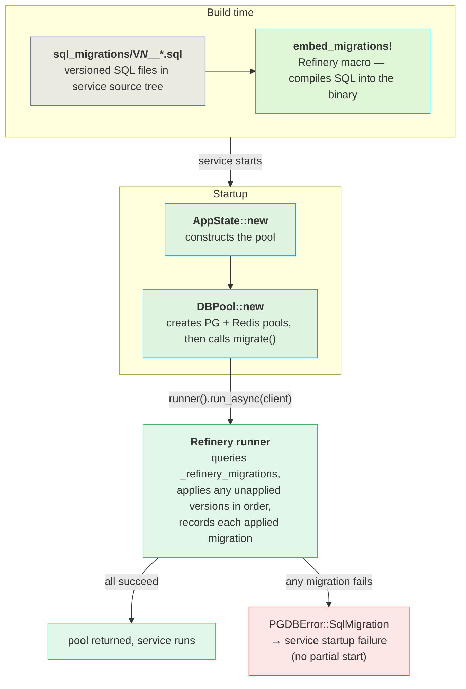

# Database Migrations

*Versioned SQL schema evolution via Refinery — applied automatically at service startup.*

## Problem

Each service owns a PostgreSQL schema that must stay in sync with the code deployed alongside it. Migrations are versioned, append-only SQL files that are compiled into the service binary at build time and applied once against the live database at startup. This ensures any running binary has already applied every schema change it depends on, with no manual intervention.

## Architecture

Migrations are embedded at build time and run by the pool constructor at startup; a failure aborts startup.

If any migration fails, `DBPool::new` returns `PGDBError::SqlMigration`, which propagates to a service startup failure. There is no partial-start: either all migrations succeed or the service refuses to run.

## Key rules

| Rule | Detail |
|---|---|
| Naming | `V<N>__<description>.sql` — double underscore, sequential integer, kebab-or-snake description |
| Sequential, no gaps | Refinery requires a contiguous version sequence. Skipping a number or reusing one is an error. |
| Append-only | Never edit or delete an applied migration file. Change the schema by adding a new version. |
| Idempotent runs | Refinery checks `_refinery_migrations` before each file; already-applied versions are skipped. |
| Startup gate | Migration runs inside `DBPool::new` — the pool is not returned until all migrations pass. |
| No DDL in app code | All schema changes go in migration files. Application code assumes the schema is already up to date. |

## Adding a migration

1. **Pick the next version.** Find the highest `V<N>` in the service's `sql_migrations/` directory and add 1.
2. **Create the file.** Add `V<N+1>__<description>.sql` to `sql_migrations/` with your DDL/DML.
3. **Rebuild.** `cargo build` — `embed_migrations!` picks up the new file at compile time.
4. **Run the service.** On next startup the runner applies the new version and records it in `_refinery_migrations`.

No code changes are needed beyond the new SQL file — the `embed_migrations!` macro in `db.rs` scans the directory at compile time and the runner iterates all embedded versions at startup.

## File map

| File | Role |
|---|---|
| `services/identity/src/repositories/db.rs` | Embeds migrations and runs them inside `DBPool::new`. |
| `services/identity/sql_migrations/` | Identity service SQL migration files (`V1`–`V6`). |
| `services/builder/sql_migrations/` | Builder service SQL migration files (`V1`). |
| `crates/shine-infra/src/db/db_error.rs` | `PGDBError::SqlMigration` variant wrapping `refinery::Error`. |
| `crates/Cargo.toml` | Workspace dependency: `refinery = { version = "0.9", features = ["tokio-postgres"] }`. |

Why migrations are embedded in the binary, not loaded from disk at runtime

`embed_migrations!` compiles the SQL files into the binary via Rust's `include_str!` under the hood. This means the deployed binary is self-contained: no `sql_migrations/` directory needs to exist on the server at runtime, and there is no risk of a version mismatch between the binary and migration files on disk. The tradeoff is that adding a migration requires a rebuild and redeploy — there is no hotfix path that applies SQL without shipping a new binary.

PGConnection.migrate — per-domain migration tracks for event-sourcing patterns

`crates/shine-infra/src/db/postgres/pg_connection.rs` exposes a lower-level `PGConnection::migrate(name, migrations)` that accepts raw SQL strings and stores its tracking data in `__migration__{name}` instead of `_refinery_migrations`. This allows multiple independent migration sequences to coexist in a single database — useful for event-sourcing aggregates that each own their own projection tables. Services that use the standard `DBPool` pattern do not need this.

