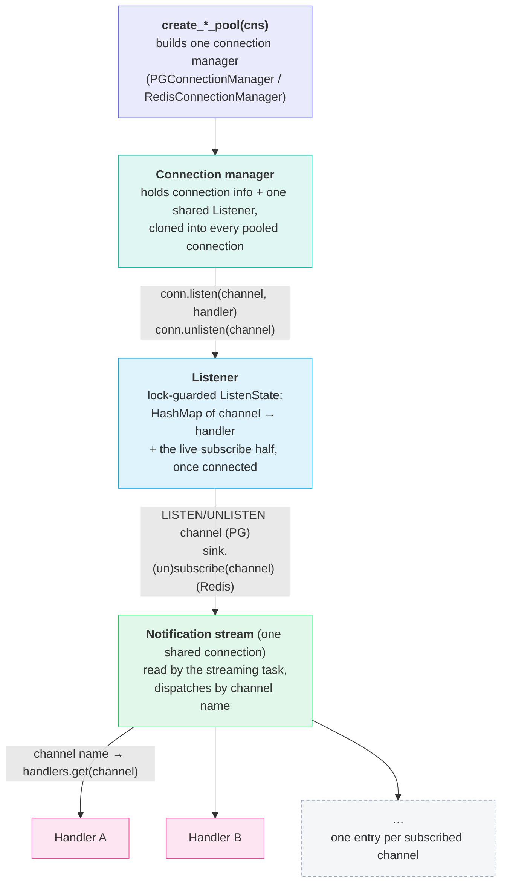
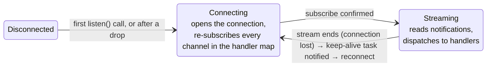
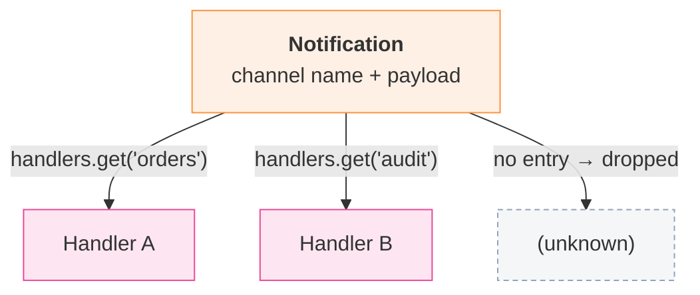

# DB Pooling and Listening

*bb8-pooled short-lived connections, plus one shared, reconnecting listener connection per backend.*

## Problem

Both Postgres and Redis need two different shapes of connection: short-lived checkouts for regular commands/queries, issued concurrently from many call sites, and one long-lived connection for push notifications (Postgres `LISTEN`/`NOTIFY`, Redis pub/sub), opened on the first `listen()` and held until the listener is closed. A bb8 pool is built for the first shape and wrong for the second — a pooled connection can be recycled or reused for an unrelated command mid-subscription. Each backend's connection manager owns both: a bb8 pool of command connections, and a single shared listener that every pooled connection can reach to add or remove subscriptions.

## Architecture

A connection manager hands out pooled command connections and owns one shared listener; subscriptions made through any pooled connection register on that listener.

Regular command connections are unaffected by any of this: they come from the same bb8 pool, each an independent connection, unrelated to the listener's single notification socket.

### Reconnect

Both listeners share this shape: a keep-alive task waits on a `Notify`, connects, and spawns a streaming task that reads notifications until the connection drops — at which point it notifies the keep-alive task to try again. Because every channel shares one connection, a drop pauses *all* subscriptions at once until reconnect completes and every channel is re-subscribed; this is the cost of sharing one socket, traded for not needing a socket per subscribed channel.

The first connection is opened lazily by `listen()`, not by the keep-alive task — whichever of the two runs the connect re-subscribes every channel already in the handler map, so the map (not the socket) is the durable record of what is subscribed. On connect the order is fixed: publish the connection into `ListenState` and spawn the streaming task *before* issuing any subscribe, because a Postgres `LISTEN` only completes while the streaming task is polling the connection driver (see [Concurrency model](#concurrency-model)).

### Dispatch

One streaming task reads the shared connection and routes each notification to the single handler registered for its channel. Handlers run synchronously on that task, so a slow handler stalls dispatch for every channel — an over-long one is logged, not queued.

### Concurrency model

A subscription change (`listen`/`unlisten`) and the streaming task both touch `ListenState`. Both backends resolve that contention the same way: a one-permit `Semaphore` (`ops`) serializes subscription/lifecycle changes, and the actual network command runs *without* the `state` lock so the streaming task can keep dispatching. The driver model differs (below), but neither listener holds `state` across network I/O, and every listener network op is bounded by a timeout so a broker outage cannot stall `listen`/`unlisten`/`close`.

Shared by both backends:

- **Serialize subscription changes with** a one-permit `Semaphore` (`ops`), held across the whole change.
- **Close-vs-listen safety:** `listen()` and `close()` re-check the closed flag under the `ops` permit.

Where they differ:

| | Postgres | Redis |
|---|---|---|
| Who polls the connection driver | Only this listener's streaming task. | An internal task inside redis-rs. |
| Run the network command | On a snapshot of `Arc<Client>` taken under a brief lock, then released. | On a clone of the `PubSubSink` taken under a brief lock, then released. |
| Bound on the connect | A `tokio::time::timeout` around `config.connect()` (the connection string's `connect_timeout`, else a default) — `tokio_postgres`'s own `connect_timeout` covers only the socket, not the TLS handshake/startup. | A `tokio::time::timeout` around `get_async_pubsub()`/`subscribe()` (the connection string's `timeout`, else a default) — redis-rs applies its timeouts only on the multiplexed path, not pub/sub. |

## Key rules

| Question | Answer |
|---|---|
| When does a command connection get created? | Lazily, on the first pool checkout that needs one, up to the pool's `max_size`. Idle ones are reused across checkouts. |
| How many listener connections exist? | At most one per connection manager — shared by clone across every pooled connection — regardless of how many channels are subscribed. It opens on the first `listen()` and stays open until `close()` or the last handle drops, even if every channel is later unlistened. |
| Can a channel be unsubscribed? | Yes — `unlisten(channel)` removes the handler and, if connected, issues the backend's unsubscribe on the shared connection. The connection itself stays open for the remaining (and any future) channels. |
| What happens if the shared connection drops? | The streaming task ends, which notifies the keep-alive task; it reconnects and re-subscribes every channel still in the handler map. All subscriptions pause together during the gap. |
| Can subscriptions change while messages are being read? | Yes. Redis uses `PubSub::split()` — an independent `Sink` and `Stream` over the one connection — and issues the command on a cloned `PubSubSink`; Postgres issues it on a cloned `Arc<Client>`. Neither holds the state lock across the command, so the streaming task keeps dispatching (see [Concurrency model](#concurrency-model)). |
| Regular commands on a pooled connection | Go through the backend's normal connection type (Postgres: `tokio_postgres::Client`/`Transaction` via `Deref`; Redis: `MultiplexedConnection` via `ConnectionLike`/`Deref`/`DerefMut`), entirely separate from the listener connection. |

## File map

| File | Role |
|---|---|
| `crates/shine-infra/src/db/postgres/pg_listener.rs` | `PGListener` — shared handler map + keep-alive/streaming task pair managing one `LISTEN`/`NOTIFY` connection. |
| `crates/shine-infra/src/db/postgres/pg_connection.rs` | `PGConnectionManager`, `PGConnection` (pooled connection + `listen()`/`unlisten()` passthrough), `create_postgres_pool`. |
| `crates/shine-infra/src/db/redis/redis_listener.rs` | `RedisListener` — shared handler map + keep-alive/streaming task pair managing one pub/sub connection. |
| `crates/shine-infra/src/db/redis/redis_connection.rs` | `RedisConnectionManager`, `RedisConnection` (pooled connection + `ConnectionLike` impl + `listen()`/`unlisten()` passthrough), `create_redis_pool`. |
| `crates/shine-infra/tests/pg_listener.rs` | Integration test: `LISTEN`/`NOTIFY` across pooled connections, multi-channel dispatch, reconnect. Gated on `SHINE_TEST_PG_CNS`. |
| `crates/shine-infra/tests/redis_listener.rs` | Integration test: publish/subscribe across pooled connections, multi-channel dispatch, `unlisten()`. Gated on `SHINE_TEST_REDIS_CNS`. |

Two invariants a refactor must preserve

**Shutdown depends on the background tasks never holding `Arc<Inner>`.** Drop is the only shutdown path: `Drop for Inner` clears the closed flag and wakes the keep-alive task. The keep-alive and streaming tasks therefore hold only the pieces they need — `Arc<RwLock<ListenState>>` and `Arc<(Notify, AtomicBool)>` — never `Arc<Inner>`. Giving a task an `Arc<Inner>` (or flattening `ListenState` into `Inner`) would keep `Inner` alive as long as the task parks on `notified()`, so the last handle drop would never fire and the listener would never stop. A `Weak<Inner>` doesn't help — the parked `notified().await` reconstitutes the cycle.

**Both listeners run the subscribe command lock-free, serialized by a one-permit `Semaphore`.** Neither holds the `state` lock across network I/O: PG snapshots `Arc<Client>`, Redis clones the `PubSubSink`, each under a brief lock, then runs the (timeout-bounded) command after releasing it. For PG this is *mandatory*: its own streaming task is the driver and needs `state.read()` to dispatch, so a subscribe under the write lock deadlocks (a read lock doesn't help either — tokio's fair `RwLock` lets a queued `unlisten` writer block the streaming task's next read, stalling the driver the command waits on). For Redis the driver is internal, so holding the lock would *not* deadlock — but `get_async_pubsub`/`subscribe` are untimed, so holding it across an unreachable-broker connect would block every other `listen`/`unlisten`/`close` for the full OS TCP timeout. Running lock-free under a timeout removes that hazard and keeps the two listeners structurally identical.

