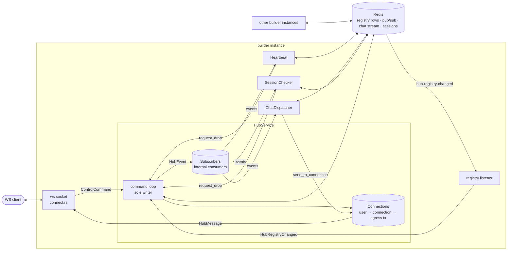
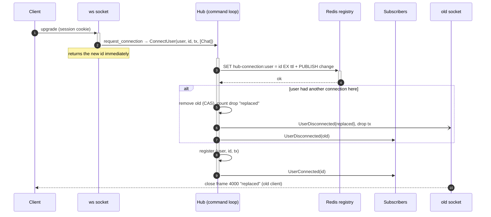
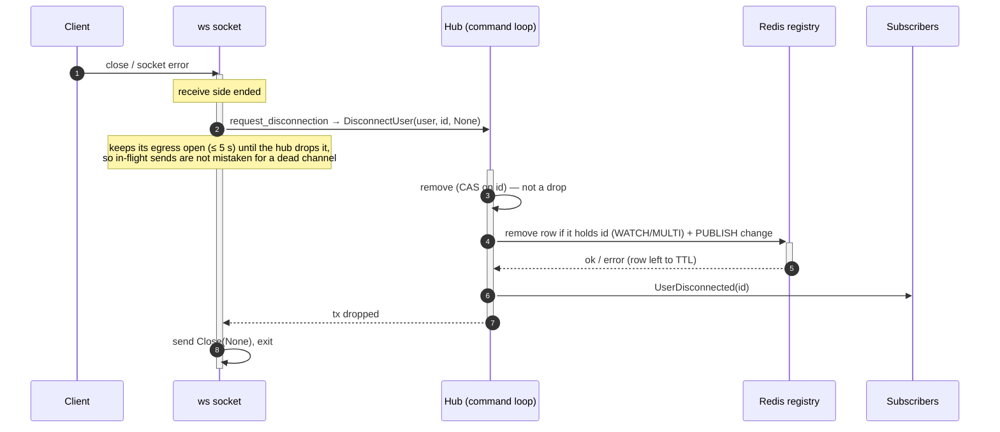
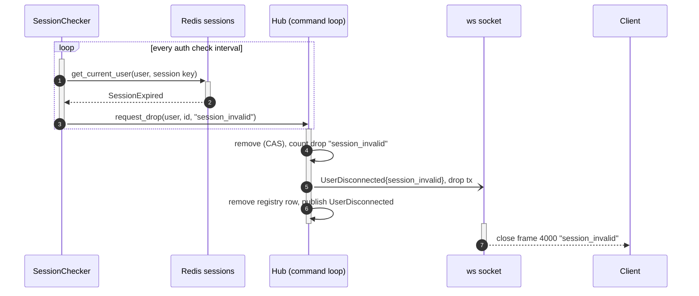
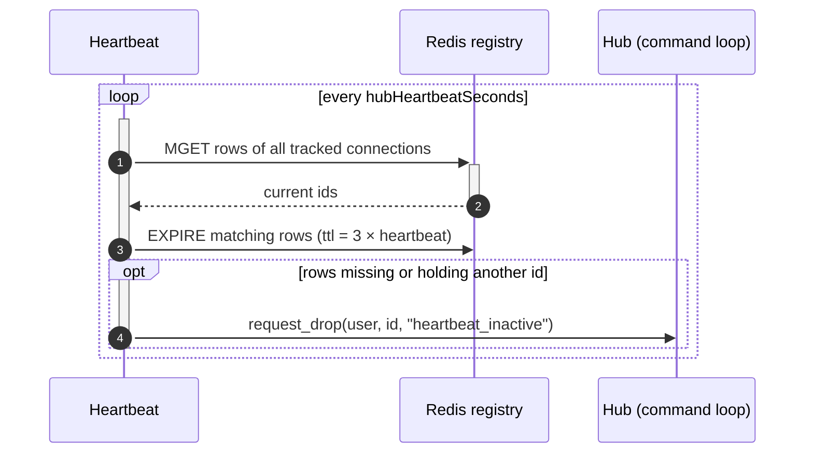
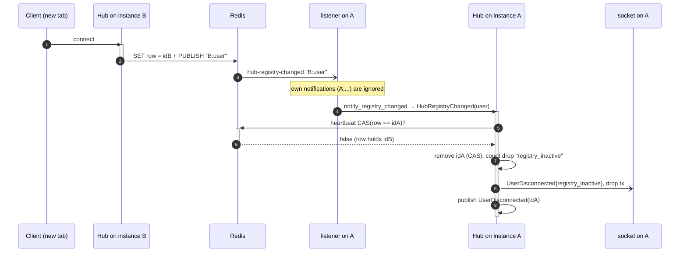
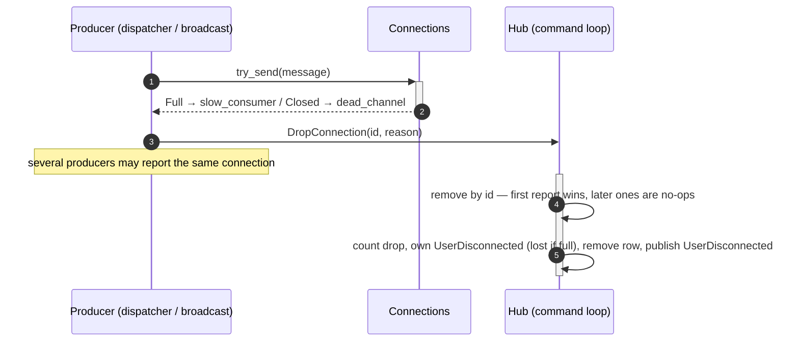
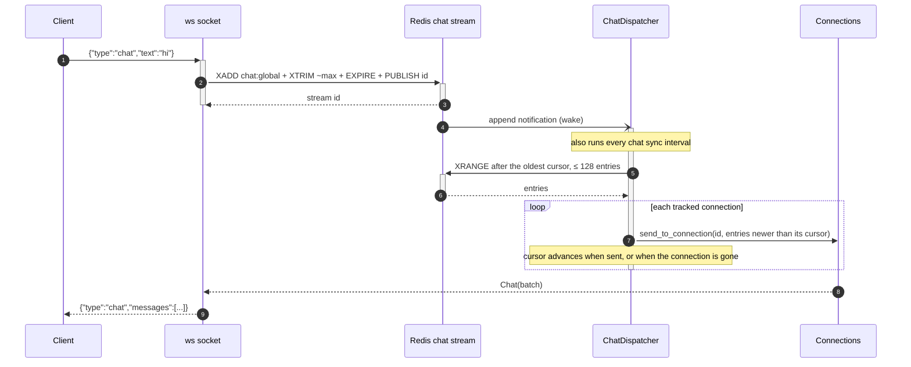
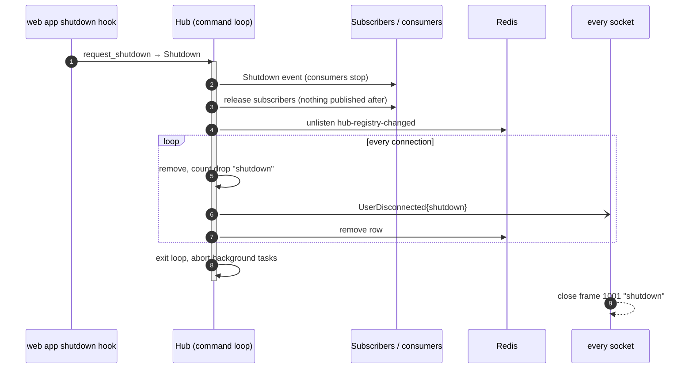

# Builder hub

The hub is the builder service's real-time layer. It tracks the WebSocket connection of every connected
user, delivers messages to them (chat today), and keeps each user to **one active connection** across all
service instances, using Redis as the shared registry.

Code: `src/services/hub/` (service), `src/routes/ws/connect.rs` (socket),
`src/repositories/hub_registry/` (Redis registry), `src/services/chat_service.rs` (chat storage).

## At a glance

- **One writer.** All connection state changes go through a single command loop. Callers *request*
  (`request_connection`, `request_disconnection`, `request_drop`, ...); the loop applies the commands in
  FIFO order. Nothing else mutates the connection set.
- **One connection per user.** A new connection replaces the user's previous one, on this instance
  directly, on other instances through the Redis registry and its change notifications.
- **Event-sourced consumers.** Background tasks (heartbeat, session checker, chat dispatcher) never read
  the connection set: each keeps its own view, built from the hub's lifecycle events.
- **The hub ends sockets.** When the hub removes a connection it sends that socket its own
  `UserDisconnected` (with the reason), then drops the channel; the socket closes with a matching close frame.
- **Redis errors never wedge a socket.** Removals always complete locally; a registry row that could not
  be removed expires by TTL.

## Components



| Component | Role |
|---|---|
| `HubService` (`hub_service.rs`) | Public API, command loop (`process`), publishing, shutdown. Cheap to clone (`Arc`). |
| `Connections` (`hub_connections.rs`) | `user_id → connection_id` and `connection_id → (session key, egress tx, topics)`. Read by senders, written only by the loop. |
| `Subscribers` (`hub_subscribers.rs`) | Unbounded, lossless channels of the internal consumers; receive every `HubEvent`. |
| `ControlCommand` (`hub_command.rs`) | Requests to the loop. |
| `connection_tracker.rs` | Shared loop of the background consumers: applies events to a private `ConnectionTracker`, runs `on_tick` periodically and on wake. |
| `Heartbeat` (`tasks/heartbeat.rs`) | Refreshes the registry TTL of every local connection; drops those the registry no longer holds. |
| `SessionChecker` (`tasks/session_checker.rs`) | Re-validates each connection's session; drops expired / compromised ones. |
| `ChatDispatcher` (`tasks/chat_dispatcher.rs`) | Pushes new chat comments to every connection, tracking a stream cursor per connection. |
| `RedisHubConnectionDb` (`repositories/hub_registry/redis/`) | Registry rows `hub-connection:<user>` → active connection id, with TTL; publishes `hub-registry-changed`. |
| ws socket (`routes/ws/connect.rs`) | Registers the socket, forwards egress to the client, appends client chat, ends the connection when either side closes. |

## Messages

| Type | Direction | Variants |
|---|---|---|
| `ControlCommand` | anyone → command loop | `ConnectUser`, `DisconnectUser { drop_reason }`, `DropConnection { reason }`, `HubRegistryChanged`, `Shutdown` |
| `HubEvent` | loop → all subscribers (and Hub-topic connections) | `UserConnected`, `UserDisconnected`, `Shutdown` |
| `HubMessage` | hub → one connection's egress / subscribers | `Hub(HubEvent)`, `Chat(ChatBatch)` |

- `HubEvent`s are **broadcast** lifecycle facts; the consumers' views are built from them.
  `UserDisconnected.reason` is a `DisconnectReason`: `Client` for a client disconnect, otherwise the
  drop reason (`is_drop()`). Shutdown drops publish no event (invariant 7).
- A connection the hub removes is no longer registered, so it misses the broadcast: the hub sends it its
  own `UserDisconnected{reason}` directly (best effort, lost if its channel is full), then drops the channel.
  This is how a socket learns why it ended.
- Topics: a connection subscribes to `Chat` and/or `Hub`. **ws sockets subscribe to both**: they ignore every
  event but their own `UserDisconnected`, which is cheap as lifecycle events are low frequency.
- Egress channels are bounded (1000 per ws socket). A send never blocks: a full channel is a
  `slow_consumer`, a closed one a `dead_channel`, and the connection is pruned.

## Invariants

1. Only the command loop mutates `Connections`; commands are processed one at a time, in order.
2. A user has at most one active local connection. Connection ids are fresh v4 UUIDs, never reused.
3. A connection publishes `UserConnected` once, and `UserDisconnected` at most once, only while active.
4. Every removal is idempotent and id-checked (CAS): a stale or repeated disconnect/drop is a no-op, so a
   late request can never remove a newer connection, nor be counted twice.
5. A drop (hub-initiated removal) is counted once, with one reason, and notifies its socket.
   A client-requested disconnect is not a drop.
6. Internal subscribers are registered before the loop starts, so no consumer misses an event.
7. Nothing is published after the `Shutdown` event.

## Lifecycles

Diagrams use activation bars for the part that runs on the participant; the command loop is the
`Hub` participant.

### Connect, with replacement



If the registry write **fails**, the hub reads the row back: if it already holds the new id (the write
landed, its reply was lost) the connect proceeds; otherwise the connect is rejected: the new socket's
`tx` is dropped (socket closes, nothing published) and the previous connection stays intact.

### Client disconnect



### Forced drop (session check shown; heartbeat is the same with "heartbeat_inactive")



Transient session errors (Redis down, pool exhausted) skip the connection for this tick; only a
definitive `SessionExpired` / `SessionCompromised` drops it.

### Heartbeat and TTL



The TTL only cleans up after crashed instances and failed removals; live rows are refreshed every
heartbeat. A heartbeat that fails (Redis down) drops nothing and retries next tick.

### Another instance takes the user over



Notifications are not ordered with commands, so instances converge *eventually*: the last registry write
wins, and every other instance drops its connection when the notification arrives. A lost notification
(listener reconnect) is caught by the next heartbeat.

### Dead and slow connections



A slow socket still receives what was buffered, then its channel ends and it closes without a reason.
Inside the loop, `publish` prunes connections found dead during its own broadcast the same way.

### Chat: client message and delivery



- A new connection's cursor starts at `"0"`: it receives the retained history (≤ `streamMaxMessages`).
- Each connection gets every comment exactly once, in stream order; a connection further behind than
  128 entries catches up over successive ticks.
- Wakes coalesce (one pending permit), and lifecycle events are applied before a pending wake, so a
  steady chat stream cannot starve connects/disconnects from the dispatcher's view.

### Shutdown



Commands queued behind `Shutdown` are never processed; requests after the loop exits fail with
`SendCommandFailed`, and a socket opened then is closed right away.

## Drop reasons and close codes

| Reason | Trigger | Close frame |
|---|---|---|
| `replaced` | same user connected again on this instance | 4000 `replaced` |
| `registry_inactive` | another instance took the user (registry change) | 4000 `registry_inactive` |
| `heartbeat_inactive` | registry row expired or replaced, found by the heartbeat | 4000 `heartbeat_inactive` |
| `session_invalid` | session expired or compromised | 4000 `session_invalid` |
| `slow_consumer` | egress channel full | none (notice does not fit), plain close after the buffer |
| `dead_channel` | egress channel closed without a disconnect | – (socket already gone) |
| `shutdown` | hub shutdown | 1001 `shutdown` |
| *(no reason)* | client disconnected | plain close; not counted as a drop |

## Failure behaviour (Redis)

| Situation | Behaviour |
|---|---|
| Connect, registry write fails and did not land | new socket rejected (closed, no events), old connection kept |
| Connect, write landed but reply lost | detected by read-back; connect proceeds normally |
| Disconnect / drop, row removal fails | local removal and events still happen; row expires by TTL |
| Heartbeat or session check fails | nothing dropped; retried next tick |
| Registry listener disconnected | notifications lost meanwhile; the heartbeat reconciles |
| Redis down entirely | live sockets stay; new connects are rejected; recovery is automatic |

## Configuration (`builder` section)

| Key | Default | Effect |
|---|---|---|
| `hubHeartbeatSeconds` | 300 | heartbeat interval; registry TTL = 3 × this |
| `authCheckInterval` | 60 | session check interval (s) |
| `chat.syncIntervalSeconds` | 1 | chat dispatcher tick (s), besides append wakes |
| `chat.streamMaxMessages` | 200 | retained chat history (approximate trim) |
| `chat.streamTtlSeconds` | 3600 | chat stream expiry after the last append |

Constants: ws egress capacity 1000, client-close drain 5 s (`connect.rs`), chat batch 128
(`chat_dispatcher.rs`).

## Observability

Status (`/info/status`, provider `hub`): `connections`, `subscribers`. Drops by reason are the `hub_connections_dropped` metric, and the `reason` of `UserDisconnected`.

Metrics (`hub_metrics.rs`, labels are fixed small sets — never user or connection ids):

| Metric | Labels |
|---|---|
| `hub_connections` (up/down) | – |
| `hub_connections_dropped` | `reason` |
| `hub_commands`, `hub_command_duration`, `hub_command_queue_delay` | `command` |
| `hub_messages_sent` | `kind` (hub/chat/close), `outcome` (ok/full/closed) |
| `hub_chat_delivered` | – |
| `hub_tick_duration` | `consumer` |
| `ws_messages_received` | `kind`, `outcome` |

Traces: each command runs in a root `hub command` span linked to the request that queued it; ws open /
close / message spans are linked the same way, so a socket does not keep its upgrade request open.
Drops log at info: `[user] [connection] Connection dropped: <reason>`.

## Testing

| File | Needs | Covers |
|---|---|---|
| `hub_connections.rs`, `hub_subscribers.rs`, `tasks/*` unit tests | – | send outcomes, topic filter, CAS removal, drop event, tracker starvation |
| `hub/tests/test_utils.rs` | – | harness: FIFO `barrier`, `drops` (drops by reason from the events), `replay` invariant checker, egress inspection, seeded `Rng` |
| `hub/tests/lifecycle.rs` | Redis | every lifecycle edge case with exact events / egress / drops / registry |
| `hub/tests/contention.rs` | Redis | parallel users, same-user races, churn under traffic, two instances |
| `hub/tests/chat.rs` | Redis | exactly-once ordered delivery, wakes, history replay |
| `hub/tests/fault.rs` | Redis + toxiproxy | lost registry reply, failed write, outages |
| `routes/ws/connect_test.rs` | – / Redis | close frames; socket lifecycle against a real hub |
| `tests/api-tests/builder/ws_connect.ts` | running service | gating, chat round trips, close codes over a real socket |

```bash
export SHINE_TEST_REDIS_CNS="redis://localhost:26379"
export SHINE_TEST_TOXIPROXY_URL="http://localhost:8474"   # fault tests skip without it
cargo test -p shine-builder
```

The **barrier** is the key technique: since commands are FIFO, a sentinel connect + disconnect whose
events arrived proves every earlier command was processed, so assertions after it are exact, without
sleeps. Hub tests share the `serial = "hub-service"` group.

## Notes for agents

- **Changing connection state?** Add or extend a `ControlCommand` and handle it in `HubService::process`.
  Never mutate `Connections` from a consumer, route or test helper.
- **Removing a connection?** Use the `remove_*` methods (CAS), then `record_drop(removed, reason)` for a
  hub-initiated removal (counts, logs, notifies the socket), then remove the registry row and
  `publish(UserDisconnected)`. Drop reasons are the `DisconnectReason` variants (metric labels via `as_str()`): add a variant
  and the compiler points at the close-code mapping in `connect.rs`.
- **New background consumer?** Implement `ConnectionConsumer` and start it in `HubService::new` *before*
  `start_dispatcher`, via `spawn_connection_loop*` (it subscribes before the loop runs).
- **New egress message?** Add a `HubMessage` variant; the ws socket forwards only what
  `event_to_wire_message` maps, and `try_send` labels its `kind`.
- **Sending to clients** happens off the loop (`send_to_connection`, `send_to_user`, `broadcast`); a dead
  target is reported, not removed, by the sender.
- Keep `HubEvent` for broadcast lifecycle facts only; addressed messages belong on `HubMessage`.
- Log levels: per-tick output at debug or below; user/connection ids are fine in logs, never as metric labels.
